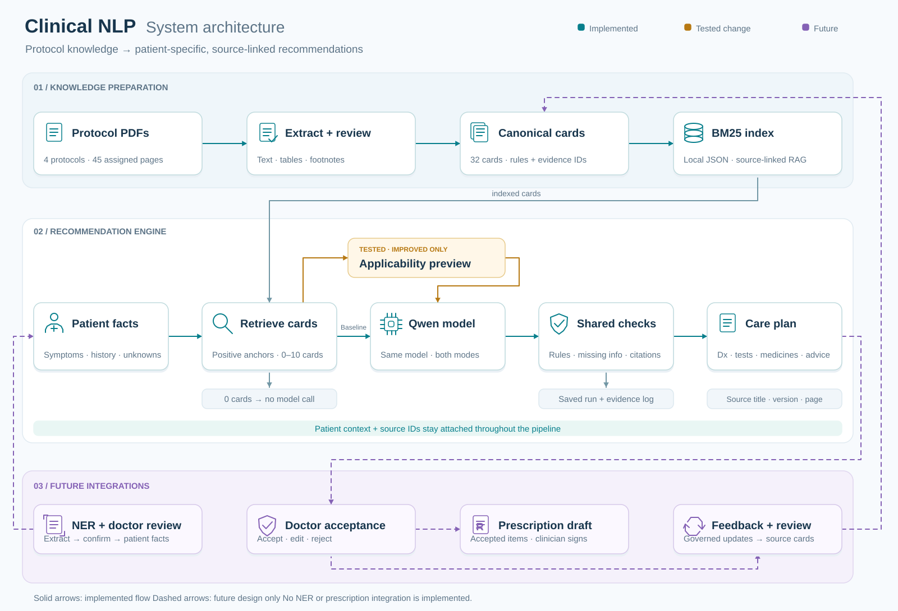

# Clinical NLP - Master Project Documentation

This is the single master narrative document for project progress, decisions, verification, evidence review and submission preparation. Update it alongside each completed task. The requirement tracker is a checklist; the source manifest and future cards, code and evaluation outputs remain separate machine-readable artifacts.

## 1. Project purpose and scope

Build an interactive guideline-based clinical recommendation prototype using four supplied protocols. Given symptoms, illness duration and available patient information, retrieve canonical recommendation cards and use an existing model to produce probable diagnoses/differentials, investigations, medication planning and advice with evidence references.

The prototype will have a fair baseline and one improved mode. Explicit applicability checking is the proposed improvement, not yet implemented or evaluated. Model training, ASR, NER training, hospital integration and production deployment are outside the assessment scope.

## 2. Documentation practice

For every task, record:

- What was done and which files changed.
- Why a design choice was made and whether it is proposed or implemented.
- What was actually verified, with commands or evidence where useful.
- Source IDs and one-based PDF pages for clinical evidence.
- Remaining work, limitations and unresolved issues.
- Tools and AI assistance used.

Do not mark planned work as completed. Do not record model results or clinical claims without supporting evidence. Use this document for ongoing narrative notes rather than creating a new documentation file for each step. Required submission artifacts, such as the paper summary and comparison note, can later be exported from the relevant sections.

## 3. Setup completed so far

- Workspace: `C:/Users/mahmu/Documents/ChatGPT/AIMSribe`.
- User works in VS Code with PowerShell.
- User reported Python version: `Python 3.15.0`.
- User created and activated `.venv`.
- User verified the active executable using `python -c "import sys; print(sys.executable)"`.
- Reported result: `C:/Users/mahmu/Documents/ChatGPT/AIMSribe/.venv/Scripts/python.exe` (path separators normalized here).
- Folders created: `docs`, `sources/protocols`, `sources/paper`, `data/cards`, `src`, `scripts`, `evaluation`, `slides`.
- Created `README.md`, `.gitignore`, empty `requirements.txt`, and `docs/requirements-tracker.md`.
- `.gitignore` excludes `.venv/`, `.env`, `__pycache__/`, `*.pyc` and `.streamlit/secrets.toml`.
- User successfully installed `pypdf==6.10.0` in the project `.venv` using `python -m pip install pypdf==6.10.0`; confirmed by the supplied terminal output. Recorded this dependency in `requirements.txt`. Manual extraction execution in this environment remains pending. Compatibility of the eventual application dependency set with Python 3.15 has not yet been established.

## 4. Source inventory and required reading

Original full PDFs are retained in `sources/protocols`; source details are registered in `sources/source_manifest.json`.

| Source ID | Protocol/version | File | Total PDF pages | Required PDF pages | Required count |
|---|---|---|---:|---|---:|
| BD_DENGUE_2025_5E | Dengue, 5th edition, 2025 | Bangladesh dengue guideline (2025).pdf | 133 | 26-28, 37-41, 45-48 | 12 |
| BD_HTN_2023_2E | Hypertension, 2nd edition, November 2023 | National Guideline on Hypertension Bangladesh.pdf | 138 | 46-52, 64-65 | 9 |
| WHO_CHOLERA_2024 | WHO cholera clinical tools, 2024 | Clinical tools for cholera treatment facilities2024(WHO).pdf | 15 | 5-14 | 10 |
| BD_CHIK_2017 | Chikungunya guideline, 2017 | National Guideline on Clinical Management of Chikungunya Fever (2017).pdf | 27 | 11-22, 26-27 | 14 |
| Total | | | | | 45 |

### Mandatory evidence-handling rules

1. Count the PDF cover as page 1. Use PDF positions rather than printed page numbers.
2. Review all 45 assigned pages, retaining tables and footnotes and their relationships to recommendations.
3. Visually inspect the complete hypertension algorithm on PDF page 64. Text extraction alone does not verify this algorithm.
4. Detailed POCUS and severe-dengue pathways outside the assigned excerpts are not required.
5. Record any additional page needed to support a recommendation, including source ID, PDF page, reason and linked recommendation/card.
6. Preserve original PDF page references if excerpts are created later.

### Verification performed

- Inspected the four filenames and read PDFs using the bundled Python runtime with `pypdf`.
- Checked edition/year information in opening pages and total page counts.
- Extracted samples from assigned page positions to check availability and general section alignment.
- Initial checks were inventory checks, not a complete clinical review. Subsequently, dengue PDF pages 26-28 were extracted and visually inspected in full, including the classification diagram, rash figures and highlighted note. The remaining assigned pages and full hypertension algorithm are still pending.

### Reading progress

| Protocol | Full assigned reading | Tables/footnotes visually checked | Evidence notes/cards |
|---|---|---|---|
| Dengue | User reports all assigned reading complete; assistant reviewed all 12 assigned pages | All assigned pages visually checked | Notes below; cards not started |
| Hypertension | User reports assigned reading complete; assistant reviewed all 9 assigned pages | Pages 46-52, 64-65 visually checked, including full page 64 algorithm and footnotes | Notes H01 below; cards not started |
| Cholera | User reports assigned reading complete; assistant reviewed all 10 assigned pages | PDF pages 5-14 visually checked, including tables and flowcharts | Notes C01 below; cards not started |
| Chikungunya | User reports assigned reading complete; assistant reviewed all 14 assigned pages | PDF pages 11-22, 26-27 visually checked; page 13 text/visual mismatch flagged | Notes K01 below; cards not started |

### Additional clinical pages used

None recorded yet. Opening pages consulted for source identity are bibliographic checks, not additional clinical recommendation evidence.

| Source ID | Additional PDF page | Reason | Linked card/recommendation |
|---|---|---|---|
| Pending if needed | | | |

## 5. Evidence review notes

### Batch D01: Dengue PDF pages 26-28

Source: `BD_DENGUE_2025_5E`, National Guideline for Clinical Management of Dengue, 5th edition, 2025. User confirmed reading these pages. Assistant extracted their text using `pypdf`, rendered the complete pages using `pypdfium2`, and visually inspected all three images. These are source review notes, not implemented cards or a patient treatment plan.

#### D01-01 - Presentation and classification (PDF page 26)

- Section 3.1 describes variable presentation influenced by virus strain and host factors such as age and immune status. Incubation is described as 4-7 days, range 3-14 days; this is not the duration of fever.
- Many infections are asymptomatic; the source states that most infections in children younger than 15 years are asymptomatic or minimally symptomatic. Do not interpret this observation as an exclusion of symptomatic dengue in a child.
- Mild undifferentiated fever, particularly in primary infection, can be indistinguishable from other viral infections. Nonspecific fever alone does not establish a confirmed diagnosis.
- Figure 12 is a classification diagram attributed in its caption to WHO and SEARO 2001 or WHO 1999 criteria. Preserve that attribution rather than presenting it as a newly derived classification.
- Visually retained hierarchy: dengue virus infection -> asymptomatic or symptomatic; symptomatic branches -> undifferentiated fever (viral syndrome), dengue fever (DF), dengue haemorrhagic fever (DHF, with plasma leakage), and expanded dengue syndrome/isolated organopathy (unusual manifestation). DF branches into without haemorrhage and with unusual haemorrhage. DHF branches into non-shock and with shock/dengue shock syndrome (DSS).
- Supporting passage: "may develop a nonspecific febrile illness with mild symptoms which are indistinguishable from other viral infections."

#### D01-02 - Classical dengue presentation (PDF page 27)

- Section 3.1.2.2 describes high fever, severe headache, retro-orbital pain, myalgia, arthralgia and rash. Leucopenia and thrombocytopenia are described as usually observed, not mandatory findings to invent when tests are unavailable.
- Fever: sudden onset, high grade, continued; usually 39-40 degrees C; may be biphasic and lasts 2-7 days in most cases. Preserve "usually", "may" and "most" rather than converting observations into strict diagnostic thresholds.
- The source also describes occasional gastrointestinal bleeding, hypermenorrhea and massive epistaxis. Do not flatten all bleeding into one diagnostic class; the page 26 diagram also allows DF with unusual haemorrhage.
- Supporting passage: "high fever, severe headache, retro-orbital pain, myalgia, arthralgia and rashes."
- Candidate future use: evidence supporting a probable disease/differential explanation. Formal case-definition and investigation evidence remains to be reviewed on later assigned pages.

#### D01-03 - Rash timing and figures (PDF pages 27-28)

- Page 27: first 2-3 days may show diffuse flushing/blanching erythema on face, neck and chest; third/fourth day may show maculopapular or rubelliform rash; afebrile/defervescence period may show confluent erythematous or petechial rash with spared normal skin and itching.
- Page 28: acute rash may involve face, thorax, abdomen and extremities, with possible pruritus. Convalescent rash is often pruritic, typically occurs within 1-2 days of defervescence and lasts 1-5 days.
- Preserve illness-day and defervescence context as separate information. A generic "rash present" field loses these dependencies.
- Page 27's paired images are labeled A/B and captioned "Figure 12: Dengue rash"; the A/B descriptions continue at the top of page 28. Page 28 also has "Figure13: Isles of White in the Sea of Red." Preserve the cross-page A/B relationship.
- Source-label ambiguity: both the page 26 classification diagram and page 27 rash figure are numbered Figure 12. Reference PDF page plus figure description to disambiguate; do not silently renumber the source.

#### D01-04 - Warning signs and exact conditions (PDF page 28)

The source heading attributes this list to "CDC 2024". This attribution is recorded from the supplied guideline; the underlying CDC source has not been separately reviewed.

| Warning sign | Source condition/detail to preserve | Patient information needed |
|---|---|---|
| Abdominal pain | Intense continuous pain OR pain on abdominal palpation | Severity/continuity or examination finding |
| Persistent vomiting | At least 3 episodes in 1 hour OR at least 4 in 6 hours | Episode count and observation window |
| Fluid accumulation | Pleural effusion, ascites or pericardial effusion | Available assessment/imaging findings; do not assume absent if unassessed |
| Mucosal bleeding | Gums, nose, vaginal metrorrhagia/hypermenorrhea, or macroscopic hematuria | Bleeding site and relevant description |
| Altered mental status | Irritability, drowsiness, Glasgow Coma Scale score below 15 | Mental status assessment and GCS if available |
| Hepatomegaly | At least 2 cm below costal margin | Examination measurement and unit |
| Increasing haematocrit | Progressive rise in at least 2 consecutive measurements taken 6 hours apart | Serial values and timestamps; a single result cannot establish this trend |

- Supporting passages: "Persistent vomiting (>=3 episodes in 1 hr or >=4 in 6 hrs)" and "Progressive increase of the haematocrit (in at least 2 consecutive measurements taken 6 hours apart" (comparison symbols normalized to ASCII; the source leaves the final parenthesis unclosed).
- Candidate for later representation reasoning: a plain "vomiting" keyword loses both frequency and time window. Preserve the OR condition between the two supported thresholds; missing counts/window must remain unknown. This is a candidate, not the final selected reasoning example or an implemented rule.
- Recommendation boundary: these pages identify warning signs, but do not supply a complete referral/treatment pathway for them. Review assigned management pages before creating corresponding action cards; do not invent an action from the sign list alone.

#### D01-05 - DHF course and monitoring (PDF page 28)

- Section 3.1.2.3 describes early febrile presentation similar to DF, with plasma leakage and abnormal hemostasis as hallmarks, usually around defervescence. Shock may develop with severe leakage or significant bleeding in addition to leakage.
- Source-supported action: close monitoring of patients with probable dengue illness because DHF can develop over time. Specific monitoring intervals and management pathways are not provided in this passage.
- Phases listed: febrile, critical (leakage) and convalescent.
- Highlighted source note retained: "Equilibrium phase is seen in some cases after critical phase". Do not promote it to a universal phase.
- Supporting passage: "patients with probable dengue illness should be closely monitored as it can develop DHF with time."

#### Batch completion and limits

- Reviewed 3 of 45 required pages; dengue review is 3 of its 12 assigned pages. No additional clinical pages used.
- Classification diagram, photographs/captions, cross-page figure descriptions and highlighted note inspected. No tables or separate numbered footnotes were visible on these three pages.
- No medication name, dose, route, frequency or duration was extracted from this batch. No canonical cards, diagnostic confirmation rules or treatment pathways have been implemented.
- Patient fields suggested by these notes include symptom pattern, fever duration, rash timing, defervescence timing, vomiting counts/time windows, bleeding details, mental status, liver examination, fluid findings and serial haematocrit timestamps. Final input/schema choices remain pending.

### Batch D02: Dengue PDF pages 37-41 and 45-48

All nine pages were extracted and visually inspected, including Table 2, Figure 19, Table 7 and highlighted notes. Source ID remains `BD_DENGUE_2025_5E`. Together with D01, assistant review covers all 12 assigned dengue pages. No extra clinical pages were used. These are source-grounded preparation notes; final cards and recommendations are not yet implemented.

#### D02-01 - Differentials and Table 2 (PDF page 37)

- Differential list includes chikungunya, Zika, measles, rubella/other viral exanthems, EBV, enteroviruses, influenza, hepatitis A, hantavirus; meningococcemia, leptospira, enteric fever, melioidosis, rickettsial disease, scarlet fever, sepsis; and malaria. Mentioning a differential here does not create a treatment protocol for it.
- Table 2 contains image-embedded text missing from the text extraction. Manually retain the certainty tiers; they are differentiating features, not numerical probabilities or confirmatory criteria.

| Certainty tier | Dengue | Chikungunya | Zika |
|---|---|---|---|
| High | Thrombocytopenia; progressive haematocrit increase; leukopenia | Arthralgias | Pruritus |
| Moderate | Anorexia/hyporexia; vomiting; abdominal pain; chills; haemorrhages involving skin/mucous membranes/both | Rash; conjunctivitis; arthritis; myalgias or bone pain | Rash; conjunctivitis |
| Low | Retro-ocular pain; hepatomegaly; headache; diarrhoea; dysgeusia; cough; elevated transaminases; positive tourniquet test | Haemorrhages involving skin/mucous membranes/both | Adenopathies; pharyngitis or odynophagia |

- Table credit identifies PAHO's 2022 dengue/chikungunya/Zika guideline (DOI printed in image: `10.37774/9789275124871`, CC BY-NC-SA 3.0 IGO). This is attribution within the supplied PDF, not an independently reviewed external source.

#### D02-02 - CBC, haematocrit and test timing (PDF pages 38-41, 45)

- Page 38: CBC plus NS1/anti-dengue antibody at first visit, selected by illness day. WBC <=5000 cells/mm3, differential counts and NLR are discussed; NLR <2 versus reversal >2 has a source evidence label of Level 6, while leucopenia and platelet associations include Level 1. Preserve these evidence labels when using those details.
- Platelets <100,000/mm3 usually precede/accompany leakage. This is not a standalone admission rule.
- Page 38: 5-10% Hct increase can accompany fever/anorexia/vomiting; source describes >10% as starting leakage and 20% from baseline as established leakage (example 35 to 42). Concurrent bleeding can mask a rise. During leakage, at least twice daily monitoring, more often by clinical circumstances/facilities; bedside Hct suggested in admitted patients.
- The source explicitly says there is no data for its assumed child/female/male Hct baselines (35/38/40%). Do not silently replace an unknown measured patient baseline with these assumed values.
- Pages 39 and 45: NS1 usually detectable from day 1 and may become negative on days 4-5; anti-dengue IgM detectable after day 5, peaks after day 7 and may persist 1-3 months. Primary IgG appears around days 9-10 and can persist lifelong; secondary infection has higher IgG/lower IgM in week 2. A solitary positive IgG must not be promoted to proof of a current infection.
- Page 39: RT-PCR usually positive within the first 5 days. Virus isolation is discussed mainly as a research test, not routine default investigation.
- Page 39 highlighted performance note retained: rapid NS1 sensitivity/specificity/PPV/NPV 81.5/66.7/78.2/71.1%; NS1 ELISA 89.9/100/100/94%; concordance with PCR 75.5% and 94%, respectively. These are source-reported statistics without a study/sample-size description on this page, not the prototype's accuracy.
- Page 41 Figure 19 visually shows differing virus/NS1/IgM/IgG trajectories in primary versus secondary infection. Preserve the primary/secondary distinction; do not infer exact numerical diagnostic cutoffs from curves.
- Page 41: first consultation within 5 fever days -> CBC, Hct, NS1, SGOT, SGPT; follow-up may occur on first afebrile day, daily once DHF suspected. Severe/shock discussion specifies Hct every 3 hours or more frequently with an annexure dependency; detailed severe-dengue pathway implementation remains outside scope.
- Stopping daily labs on page 41 requires platelets BOTH starting to rise AND reaching >=50,000/mm3; the threshold alone is insufficient.
- Page 45 supplies the explicit day switch: CBC + NS1 up to day 5; CBC + dengue antibody from day 6. If illness day is missing, ask rather than choose a timing-dependent test by guesswork.

#### D02-03 - Other investigations and source caveat (PDF pages 40-41)

- Page 40: AST/ALT, albumin and severity-dependent creatinine/BUN, electrolytes, venous blood gas, glucose and calcium are discussed; preserve clinical indication rather than recommending every test universally. Source describes AST/ALT 2-5 times upper normal in classical DF and 5-15 in DHF, albumin <3.5 g/dl, and calcium corrected for hypoalbuminaemia.
- Coagulation section describes aPTT/PT/TT abnormalities in relevant severe contexts. Other investigations: chest X-ray/ultrasound for fluid accumulation, urine R/M/E, malaria tests or blood culture for relevant alternatives, ECG/echo/troponin I/CK-MB if myocarditis suspected, CSF in dengue encephalitis.
- Highlighted page 40 note: analgesics, antipyretics, antiemetics and antibiotics can interfere with liver function and clotting. This is a caution, not a universal contraindication to every drug in those categories.
- Page 41 says POC ultrasound is not essential; brief listed targets include gallbladder wall/pericholecystic fluid, hepatorenal pouch, right pleural cavity and pelvis. No detailed POCUS pathways outside the excerpts were reviewed or added.

#### D02-04 - Diagnostic certainty and clinical assessment (PDF pages 45-46)

- Page 45 distinguishes suspected (clinical criteria without confirmation), probable (acute fever plus serological diagnosis) and confirmed disease. Confirmatory findings listed: positive RT-PCR or NS1; tissue immunohistochemistry; paired-serum IgM/IgG seroconversion; fourfold IgG rise in paired samples. Keep the guideline's formal labels separate from the application's generic probable-diagnosis heading.
- Severity: without warning signs uses fever 2-7 days plus at least two listed features (nausea, vomiting, rash, aches/pains, positive tourniquet or WBC <5000/mm3); with warning signs links to page 28. Do not classify an unassessed warning-sign status as absent.
- Severe categories include leakage with shock/respiratory distress, clinically severe bleeding and severe organ involvement. The printed organ-enzyme text says "AST/AST >=1000iu/L"; flag this apparent source typo rather than silently replacing it with another analyte.
- History needed on page 45: onset, last fever episode, oral intake, warning signs, diarrhoea, bleeding/menstrual bleeding, mental-status/seizure/dizziness, urine frequency/volume/last void, drugs and comorbidities.
- Page 46 examination: mental, hydration and haemodynamic status; breathing/effusion; abdominal tenderness/hepatomegaly/ascites; bleeding. Investigation list includes CBC/Hct, NS1, SGPT/SGOT and CRP (Level 4), with illness-day conditions retained from pages 38-45.
- High-risk factors: pregnancy, elderly age, obesity, anticoagulants. Comorbidities: diabetes, hypertension, chronic renal failure, liver disease, IHD, transplant, active malignancy, haemolytic disease/haemoglobinopathy, peptic ulcer, steroid/NSAID use and anticoagulants.
- Adverse circumstances: age <1 or >65 years, living alone/poor access, transport problems, unstable housing, extreme poverty. Source says high-risk patients MAY need admission even without other criteria; do not turn that into automatic admission or unconditional home clearance.

#### D02-05 - Table 7 and home-care prerequisites (PDF pages 46-47)

Table 7 was inspected visually; its merged fever cell and multiple assessment columns must not be reduced to one laboratory cutoff.

| Table 7 field | Home-management row | Inpatient/high-risk row |
|---|---|---|
| Shared fever context | Short duration / fever within last <=48 hours (merged source cell) | Same merged cell |
| Warning signs | Absent | Present |
| Comorbidity/high risk/adverse social condition | Absent | Present |
| Vital signs and urine output | Normal vital signs AND normal urine output | Deranged vital signs, reduced urine output |
| Fresh CBC | Low WBC; platelets >=100 x 10^9/L; Hct 35-40% or baseline | Decreasing WBC; platelets <=100 x 10^9/L; increasing Hct (leakage) or decreasing Hct (bleeding) |
| Risk/action | No immediate risk; home care plus regular reassessment | High risk; inpatient management |

- The two rows overlap at exactly 100 x 10^9/L. Do not resolve this by inventing a strict cutoff. Page 46 also explicitly permits admission for high-risk patients without all other findings; do not require every high-risk column simultaneously to escalate.
- Home-care paragraph requires absence of warning signs, coexisting conditions and social risk. Unknown status is not clearance. Combine pages 28, 46, 47 and 48 for eligibility, advice and return criteria.
- Highlighted notes: comorbidities can affect vital signs/urine output (example diabetes); settling fever is not proof of recovery because leakage can begin at defervescence.

#### D02-06 - Home-care medicine, hydration and advice (PDF pages 47-48)

- Page 47 supports rest, comfortable clothing, mosquito net and tepid sponging, conditional on appropriate home-care assessment.
- Paracetamol: "Do not exceed 3 gm/day" and "60mg/kg/24hrs in child". These are daily limits, NOT a single dose or dosing frequency. These passages do not specify route, per-dose amount, frequency or treatment duration. Record those fields as not specified; age and child weight are prerequisites to individualized planning. Preserve the warning against extra dosing if fever does not fully settle.
- Oral fluid guidance: around 2400 ml/24 hours; if weight <50 kg, 2 ml/kg/hour for 24 hours; spread intake across the day. Do not give a universal numeric plan without weight, oral tolerance and comorbidity context. Electrolyte-containing fluids include ORS, coconut water, fruit juice or soup rather than plain water alone.
- Urine advice: encourage voiding every 3-4 hours, measure/document amounts and time if possible, identify reductions. Explain page 28 warning signs.
- Page 48: light nutritious food when appetite permits; do not force-feed when appetite poor; dark/red/brown food or drink can confuse recognition of blood-stained vomit/melaena.
- Antiemetics/PPI/H2 blockers "if necessary"; no specific agent, dose, route, frequency or duration supplied here. Do not invent a regimen.
- Avoid NSAIDs (including COX-2 inhibitors) and steroids in this dengue home-care context. Source advises temporarily withholding long-term warfarin/aspirin/clopidogrel/dipyridamole and expert opinion where necessary. Preserve expert review and the physician-facing context; do not present autonomous patient medication cessation as unconditional advice.

#### D02-07 - Follow-up, return and transfer (PDF page 48)

- Home follow-up: daily review with CBC; first CBC at least by beginning of third illness day, preferably SGOT/SGPT. Follow until afebrile 24-48 hours with stable clinical parameters. This passage and pages 38/41 (first-visit baseline) should be retained together: do not delay a first-visit indicated CBC just because another passage mentions day 3. Their differing contexts remain a card-design reconciliation point.
- Immediate return/review/hospitalization triggers: deterioration as fever settles; oral fluid intolerance; severe abdominal pain; lethargy/irritability/restlessness; abnormal vaginal bleeding, haematemesis, melaena, nose/gum bleeding; reduced urine over last 4-6 hours (source gives <150-200 ml/4-6 hours if weight >=50 kg); cold clammy extremities; breathing difficulty. Preserve the source range rather than inventing one sharp urine cutoff.
- Transfer prerequisites: stabilize, send findings/results/treatments, document transfer reason and brief receiving team.
- Highlighted note requires written Bengali patient/carer instructions, investigation timing and how/when to contact the physician (physical visit/phone/WhatsApp). Referenced annexure has not been used; do not claim it was reviewed.

### Cross-protocol extraction completed

- Added `scripts/extract_assigned_pages.py`: resolves paths from project root, reads manifest, validates ranges/count, records source SHA-256 and original PDF positions, writes `data/extracted/assigned_pages.jsonl` and `extraction_report.json`.
- Executed with bundled Python and `pypdf`. Report: 45 records, per-source counts 12/9/10/14, no empty text pages. Original PDFs unchanged.
- Critical limitation demonstrated: page 37's table text was absent from extraction despite the page having nonempty text. Extraction completeness is NOT visual/evidence completeness. All JSONL records conservatively flag visual review required; review status is recorded here and in the manifest.
- User reports reading all assigned pages. Assistant clinical/visual verification currently covers 12/45 pages, all dengue; the other 33 remain pending. No final cards or model results exist yet.

### Batch H01: Hypertension PDF pages 46-52, 64-65

Source: `BD_HTN_2023_2E`, National Guideline on Hypertension, 2nd edition, November 2023. Assistant read extracted text and inspected all nine complete PNG pages generated by the user. PDF positions 46-52 map to printed pages 15-21; PDF 64-65 map to printed 33-34. No extra clinical pages used. Preserve source reference markers 9/10/12/14/16 as bibliographic pointers; their original external references have not been independently reviewed.

#### H01-01 - Confirmation and measurement (PDF pages 46-47)

- Generally at least 3 BP measurements per visit and 2-3 visits at 1-4-week intervals depending on BP level. A single set at one visit is generally insufficient.
- Exception: diagnosis may be made at a single visit for BP >=160/100 mmHg OR accompanying HMOD (retinopathy with exudates/haemorrhages, LVH, vascular/renal damage). Preserve the exception; do not implement a universal repeat-visit requirement.
- Initial SBP 140-159 OR DBP 90-99: repeat on 3 separate occasions within 1-4 weeks. Use the same arm. HBPM/ABPM confirmation if possible/available.
- Initial assessment in both arms; difference >10 mmHg -> repeat after 1-2 minutes; persistent >10 -> use higher-reading arm and document. Difference >20 -> consider further investigation.
- Table 3 (PDF 47): <130/85 -> remeasure within 3 years, 1 year with other risk factors; 130-159/85-99 -> repeated office visits and out-of-office confirmation if possible; printed >160/100 -> confirm within days/weeks. The exact > sign differs from >= on pages 46/65; do not silently harmonize all boundaries. For action planning retain the explicit management algorithm and Table 6 context.
- Postural assessment: lie 5 minutes, then BP/pulse at 1 and 3 minutes standing. SBP drop >=20 OR DBP drop >=10 OR lightheadedness/dizziness is abnormal. Figure 3 preserves positions/timing fields.
- Standing BP indicated in treated patients with postural symptoms, and first visit for elderly/diabetes. Source also allows starting supine/seated and repeating after at least 1 minute standing. SBP drop >=20 -> medication review, standing measurements thereafter, consider specialist if persistent symptoms.

#### H01-02 - History, examination, Tables 4/5 (PDF pages 48-50)

- Most hypertensive patients are asymptomatic; do not require headache or breathlessness to retrieve relevant assessment cards. Assess diagnosis/grade, secondary causes, contributing lifestyle/drugs/family history, CV risk, comorbidities and HMOD. Investigate HMOD while confirmation pending; if HMOD without hypertension, consider other causes.
- History: personal/family HTN/CVD/stroke/renal and lipid disease; salt/diet, smoking/alcohol, activity, erectile dysfunction; sleep/snoring/apnoea, previous pregnancy HTN/pre-eclampsia, contraceptive use.
- Organ symptoms/history: neurological/visual deficits, headache/vertigo/syncope, TIA/stroke/cognitive problems; chest pain, dyspnoea/oedema, MI/revascularization, palpitations/arrhythmia/AF/HF; thirst/polyuria/nocturia/haematuria/UTI; cold limbs/claudication/rest pain/revascularization and relevant CKD family history.
- Medication history includes effectiveness, intolerance, adverse effects and adherence/financial barriers. Escalation must not assume adequate adherence when it is unknown.
- Examination: height/weight/BMI, waist, neurological/cognitive and fundoscopic assessment, heart/carotid/peripheral arteries, both-arm BP, skin, kidneys; murmurs/bruits and radiofemoral delay, signs of Cushing/acromegaly/thyroid disease.
- Table 4 risk details: tobacco, BP, diabetes, total cholesterol >5.1 mmol/L, LDL >3 OR HDL <1 men/<1.2 women; age >55 men/>65 women; premature-CVD family history <55 men/<65 women; waist >90 cm men/>80 women. Retain sex, units and comparison signs.
- Table 5: cardiac LVH/CHD/HF with associated examination signs; cerebrovascular TIA/stroke and focal signs; peripheral pulse loss (except dorsalis pedis) with/without claudication; renal GFR <60 ml/min/1.73 m2, proteinuria >=1+, microalbuminuria in 2/3 tests over 4-6 months, leg oedema; retinal haemorrhage/exudate with/without papilloedema. A missing test is not negative HMOD.

#### H01-03 - Investigations with conditions (PDF pages 51-52)

- Screening tests must not delay/impede otherwise indicated treatment in low-resource settings. Testing may follow treatment when unavailable/costly. Long-acting dihydropyridine CCBs are described as more suitable for initiation without tests than diuretics/ACEi/ARBs; this is not blanket approval for every drug without screening.
- Limited initial tests: sodium/potassium, creatinine/eGFR, lipid profile/fasting glucose if available, urine dipstick, 12-lead ECG (AF/LVH/IHD). Most-patient list includes haemoglobin/Hct, chest X-ray (cardiomegaly/HF/coarctation), echo (LVH).
- HMOD-specific: urine albumin:creatinine ratio and creatinine/eGFR for renal disease; fundoscopy especially grade 2/3; echo when it changes treatment; carotid ultrasound with relevant vascular disease; abdominal imaging for renal structure/obstruction, aorta/adrenal questions (CT/MRI preferred for adrenal lesions), renal Doppler especially asymmetric renal size.
- PWV for arterial stiffness, ABI for lower-extremity arterial disease, cognitive testing for symptoms, brain imaging for suspected injury/history/cognitive decline. Do not propose every advanced investigation for every ordinary case.

#### H01-04 - Full Figure 8 algorithm, including footnotes (PDF page 64)

This image-embedded algorithm was absent from raw extracted text. Visual transcription below preserves dependencies. It is source review, not an implemented prescribing engine.

- Population: adults >=18. Footnote **: for age >=40, treatment decision may be based on total CVD risk estimation. Footnote ***: do not use this protocol for pregnant patients; refer to specialist.
- Entry: SBP 140-159 OR DBP 90-99 -> lifestyle advice, review after 2 weeks; if still in that range, start treatment below. Footnote a: SBP >=160 OR DBP >=100 -> immediate treatment at step 2 (amlodipine 5 mg + losartan 50 mg), subject to applicability/exclusions and the pregnancy-potential alternative.

| Step | Source regimen/action | Transition prerequisite |
|---|---|---|
| 1 | Amlodipine 5 mg once daily | Eligible persistent BP entry; footnote b permits considering 2.5 mg starting dose in elderly or low body weight |
| 2 | Amlodipine 5 mg + losartan 50 mg once daily | After 1 month if target not met, or higher-BP entry per footnote a; check adherence and losartan conditions |
| 3 | Amlodipine 5 mg + losartan 50 mg + hydrochlorothiazide 12.5 mg once daily | After 1 month if target not met; check adherence; retain footnote e alternative |
| 4 | Refer to specialist | After 1 month if target still not met; check adherence |

- Footnote c: check patient taking drugs regularly/correctly before escalation.
- Footnote d: check serum creatinine and potassium before starting losartan AND several weeks afterward. Avoid losartan in women of childbearing age who may become pregnant.
- Footnote e: consider losartan 100 mg before step 3; continue 100 mg at step 3 if that option used. Do not lose this optional pathway or reduce it to mandatory universal escalation.
- Separate pregnancy-potential branch: amlodipine 5 mg once daily -> after 1 month if target not met and adherence checked, amlodipine 10 mg once daily -> after another month if still not at target, specialist referral. Explicit warning: do not prescribe losartan, any ACE inhibitor or ARB to women who may become pregnant. This branch is not a pregnancy treatment protocol; current pregnancy is excluded and referred.
- Targets panel: most patients <140/90; comorbidity (diabetes/IHD/stroke/CKD) <130/80; high CVD risk >30% per prediction chart <130/80. Risk-chart computation is not provided by these excerpts; do not invent a risk score.
- Lifestyle panel retained: avoid alcohol/tobacco/secondhand smoke; exercise 2.5 hours/week; salt under 1 tsp/day; heart-healthy diet; lose weight if overweight; >=5 servings fruit/vegetables/day; healthy oils (sesame/olive/safflower/sunflower); nuts/peas/whole grains and potassium-rich foods (spinach/watermelon/yogurt/banana); limit red meat to once/twice weekly; fish/omega-3 at least twice weekly; avoid added sugars/cakes/cookies/sweets/fizzy drinks. These are source panel details; renal/potassium context must not be ignored when selecting individualized advice.
- Caption identifies an adapted NCDC/DGHS/MOHFW primary-care protocol; source footer credits the 2018-19 national diabetes/hypertension protocol. Do not relabel it as a newly generated treatment algorithm.
- Medication names, mg doses and daily frequency are explicit. Route and fixed treatment duration are not explicit in this figure; do not infer them from general drug knowledge. A one-month review interval is not a one-month prescription duration.

#### H01-05 - Follow-up, targets and referral (PDF page 65)

- Monthly follow-up after initiation/change until target achieved; thereafter every 3-6 months. Aim to reach target within 3 months; most require lifelong treatment once controlled. Do not translate this general statement into an individualized fixed prescription duration.
- Table 6: SBP <130 AND DBP <85 -> 3 years, 1 year if risk factors; 130-159 AND/OR 85-99 -> repeated office measures within 1-4 weeks; >=160 AND/OR 100 (printed shorthand) -> evaluate/initiate immediately. Use page 64 footnote a's explicit SBP/DBP comparisons for the high-BP branch rather than guessing meaning of shorthand.
- Narrative targets: <140/90 without comorbidity; systolic <130 in high-risk patients (high CVD risk, CVD, diabetes, CKD). Page 64's panel includes DBP <80 and specific >30% risk threshold. Preserve provenance/context rather than attributing all target details to page 65 alone.
- Refer for accelerated/malignant, suspected secondary, resistant hypertension, recent target-organ damage, pregnancy or children <18.

#### H01 completion and design implications

- Assistant reviewed 9/9 hypertension pages; combined with dengue, 21/45 assigned pages visually reviewed. Remaining: 10 cholera and 14 chikungunya.
- Candidate reasoning example: a flat losartan-containing escalation card can fail for a woman who may become pregnant or an unassessed pregnancy-potential field. Conditional branch/exclusion plus renal/potassium prerequisites preserves the source. Final representation choice still pending.
- Additional source issues to preserve: inconsistent > versus >= on Table 3/high-BP boundaries; different confirmation/entry windows (1-4 weeks, 2-week algorithm review); target details varying by source section. Cards must carry context rather than silently combine into one universal rule.

### Batch C01: WHO cholera PDF pages 5-14

Source: `WHO_CHOLERA_2024`, Clinical tools for cholera treatment facilities, 2024 (page footers v1.0). Read raw text and visually inspected every assigned PNG. No additional clinical pages used. Extracted text contains duplicated text/OCR-like content and recognition errors; the visible page is used to disambiguate. No new OCR was performed by this project.

#### C01-01 - Case definition, assessment and admission (PDF pages 5-6)

- Outside a declared outbreak: suspected case definition describes age >=2 years with acute watery diarrhoea and severe dehydration, or dying from acute watery diarrhoea. During a declared outbreak: any person presenting with or dying from acute watery diarrhoea. Preserve outbreak status and age; watery diarrhoea alone must not be presented as laboratory-confirmed cholera. If definition not met, page 5 sends the patient outside the cholera pathway rather than declaring no illness or no need for care.
- Severe dehydration: at least one danger sign (lethargic/unconscious, absent/weak pulse, respiratory distress) OR at least two of poor/inability to drink, very slow skin pinch, sunken eyes -> Plan C, admit.
- Some dehydration: no danger signs AND at least two of irritability/restlessness, sunken eyes, rapid pulse, eager drinking/thirst, slow skin pinch -> Plan B, admit. Assess the severe branch first; the shared sunken-eyes finding cannot determine severity by itself.
- No dehydration: awake/alert, normal pulse/thirst, eyes not sunken, normal skin pinch -> Plan A, no admission per this table. Unassessed findings must remain unknown, not normal.
- Plan C -> reassess every 15-30 minutes; awake/alert AND able to drink AND stronger pulse supports transition toward Plan B. Plan B -> reassess at least hourly; improvement conditions lead toward Plan A, severe dehydration OR severe vomiting leads back to Plan C. Preserve arrows and conjunctions; do not reduce the flowchart to independent treatment snippets.

#### C01-02 - Initial and ongoing rehydration (PDF pages 5, 7-12)

- Plan C: IV Ringer's lactate is first choice. Infants <12 months: 30 mL/kg over 1 hour then 70 mL/kg over 5 hours (total 100 mL/kg/6 hours). Age >=12 months: 30 mL/kg over 30 minutes then 70 mL/kg over 2.5 hours (100 mL/kg/3 hours). Requires actual age and weight; do not substitute an adult timing for an infant.
- Page 7: start IV immediately for severe dehydration, appropriate large cannula/two lines for rapid large volumes, write start time on IV bag; reassess at least 15-30 minutes, watch/treat hypoglycaemia, and add ORS for ongoing losses as soon as safe drinking is possible.
- Page 5 Plan B gives 75 mL/kg over 4 hours; page 9 provides approximate age/weight volumes over 4 hours. Add ORS for ongoing losses, separate from initial volume; hourly reassessment.

| PDF page 5 Plan B age | Weight | ORS over 4 hours |
|---|---|---|
| <4 months | <5 kg | 200-400 mL |
| 4-11 months | 5-7.9 kg | 400-600 mL |
| 12-23 months | 8-10.9 kg | 600-800 mL |
| 2-4 years | 11-15.9 kg | 800-1200 mL |
| 5-14 years | 16-29.9 kg | 1200-2200 mL |
| >=15 years | >=30 kg | 2200-4000 mL |

- Page 9 instead prints weights <5, 5-8, 8-12, 12-16, 16-30 and 30+ kg, and age 4-14 rather than page 5's 5-14. This produces overlaps at boundaries (including age 4 on page 9). Preserve page-specific tables and flag disagreement. Do not silently merge or assign a conflicting boundary; exact weight-based page 5 formula is an available supported representation for initial Plan B planning, subject to review and conditions.
- Maintenance after each loose stool (pages 8 and 10): <24 months 50-100 mL; 2-9 years 100-200 mL; >=10 years as much as wanted. These are per-stool amounts, NOT total initial 4-hour rehydration doses.
- Plan A page 11 uses the same per-stool amounts; supply enough ORS packets for 500 mL/day (<24 months), 1 L/day (2-9), 2 L/day (>=10). These supply amounts are not hard maximum drinking limits. Page 5 Plan A describes age quantities "over 4 hours", while page 11 explicitly says after each stool. Retain the difference; use the dedicated plan page's explicit context when making a corresponding card, with the source discrepancy noted.
- Page 12 quick reference tables retain two distinct timing schemes. Infant rows: <1 month/3-4 kg -> 350 total,105/245 mL; 1-2 months/4-5 ->450,135/315; 2-3/5-6 ->550,165/385; 3-4/6-7 ->650,195/455; 4-7/7-8 ->750,225/525; 7-10/8-9 ->850,255/595; 10-12/9-10 ->950,285/665. First component over 1 hour, second over 5 hours.
- Page 12 older-child/adult table (first over 30 min, second over 2.5 hours), weight kg: total/first/second mL: 10-13:1000/250/750; 13-15:1200/300/900; 15-17:1500/300/1200; 17-19:1700/400/1300; 19-20:2000/600/1400; 21-23:2200/700/1500; 24-26:2500/800/1700; 27-29:2800/800/2000; 30-31:3000/1000/2000; 32-34:3300/1000/2300; 35-38:3500/1000/2500; 39-43:4000/1200/2800; 44-49:4500/1500/3000; 50-54:5000/1500/3500; >=55:6000/2000/4000. These are literal quick-reference values, not exact calculations for every weight in the band. Overlapping/missing boundaries and splits differing from exact 30/70% must not be silently corrected or treated as exact formulas. Do not extrapolate the >=55 kg row to unlimited weights as a universal exact fluid prescription.
- Page 12 footnote: appropriate infusion set, 1 mL=60 drops, paediatric chamber 150 mL. Keep the equipment context; do not assume every available infusion set has that drop factor. Its older-child heading says >1 year; page 7 explicitly includes 12 months and older. Preserve this boundary wording difference.

#### C01-03 - Antibiotics and zinc (PDF pages 5, 7, 9, 11, 14)

- Antibiotics indicated for severe dehydration OR pregnancy OR elderly status. Pages 9/11 explicitly retain pregnant/elderly eligibility regardless of hydration status or plan. Do not generalize antibiotics to every cholera patient or limit them only to Plan C. The excerpts do not define a numeric elderly threshold.
- Page 5 preferred doxycycline, single dose: <12 years 200 mg; older children/adults 300 mg. Alternative azithromycin single dose: <12 years 20 mg/kg; older children/adults 1 g. Preserve the source's unusual fixed child doxycycline amount as source text, not a weight-based formula. Drug route is not explicitly specified here. Selection still requires patient context/allergies; absent source exclusions are not proof of universal suitability.
- Zinc panels on pages 7/9/11: under 6 months 10 mg once/day, over 6 months 20 mg once/day, for 10 days. Exact age 6 months is not assigned by the literal under/over wording; flag rather than invent a boundary. Page 14 links zinc completion specifically to paediatric patients, so do not infer universal adult zinc from the panels' phrase "patients over 6 months". Route and formulation are not explicit.

#### C01-04 - Hypoglycaemia algorithm (PDF page 13)

- Threshold <3.0 mmol/L (54 mg/dL), preserving the OR alternatives and reassessment loop. Adults: dextrose 50% 25-50 mL OR 10% 125-250 mL IV over 2 minutes; recheck glucose after 30 minutes, second bolus if necessary. Recurrent hypoglycaemia -> source mixture RL 800 mL + 50% dextrose 200 mL, at 50 mL/hour, with reassessment loop.
- Children: 10% dextrose 5 mL/kg IV over 2 minutes, recheck after 30 minutes, second 10% bolus if necessary; recurrent hypoglycaemia mixture as above at 5 mL/kg/hour. Do not swap child/adult concentration, bolus or maintenance rate.
- Bottom note: if no IV access, 2-5 mL of 50% dextrose fluid may be placed directly in cheek with a syringe, without needle or spoon. Age applicability and exact selection within this range are not further specified on the page. This is an emergency clinician-facing pathway, not routine self-care or unconditional advice.
- References name WHO-ICRC Basic Emergency Care and Pocket book of hospital care for children through QR codes. These external works were not opened or used as extra sources. Any emergency card needs the full measured-glucose/reassessment context; no such card implemented yet.

#### C01-05 - Discharge and advice (PDF pages 5, 14)

- Page 5 discharge consideration requires no dehydration AND ORS without vomiting AND no watery stool for 4 hours AND walking without assistance AND passing urine. Preserve the all-conditions requirement. Literal walking criterion has limitations for nonambulatory/infant patients; do not infer a substitute criterion from these excerpts.
- Page 14: teach that >=3 diarrhoea episodes/24 hours warrants treatment; ensure understanding of prevention; supply >=4 ORS packets at discharge; packets may also help family/neighbours who develop diarrhoea; paediatric zinc supply to finish 10 days. This page requires prevention education but does not itself enumerate a full sanitation/preparation protocol; do not attribute unlisted detailed instructions to it.
- Assessment coverage includes dehydration signs, drinking ability, pulse and glucose when indicated. These assigned tools do not supply a routine stool-test or antibiotic susceptibility investigation regimen; do not invent one for category coverage.

### Batch K01: Chikungunya PDF pages 11-22, 26-27

Source: `BD_CHIK_2017`, National Guideline on Clinical Management of Chikungunya Fever, 2017; appended expert opinion dated 29 July 2017 on PDF pages 26-27 (printed 1-2). Read extracted text and visually inspected all 14 assigned PNG pages. No extra clinical pages used.

#### K01-01 - Case definition and presentation (PDF pages 11-15)

- Page 11: suspect sudden fever, joint manifestations and rash. Clinical criteria: acute fever >38.5 degrees C plus severe arthralgia/arthritis not explained by another condition; epidemiology: residence/visit to epidemic area with reported transmission within 15 days before onset. Clinical-only -> possible; clinical plus epidemiological -> probable; laboratory criteria -> confirmed irrespective of presentation. Preserve criteria, not just a symptom keyword.
- Laboratory criteria: culture OR RNA RT-PCR within 5 illness days OR specific IgM in single serum collected days 5-28 OR fourfold IgG rise in paired samples >=3 weeks apart with first after day 7. Do not equate any antibody result with confirmation without sample/timing context.
- Page 12 Table 1: common fever, arthritis/arthralgia, backache, headache, rash; infrequent stomatitis, oral ulcers, exfoliative dermatitis, photosensitive hyperpigmentation; rare in adults but seen in children: photophobia, retro-orbital pain, vomiting, diarrhoea, mental confusion, meningeal irritation. Preserve frequency and age qualifiers.
- Fever usually 24-48 hours, abrupt 39-40 degrees C in some; symmetric joint disease especially ankles/wrists/small hand joints; can involve larger joints/spine, morning worsening, mild-exercise relief and aggressive-movement worsening, possible relapsing pattern. Descriptive findings are not universal diagnostic gates.
- PDF page 13 visible rendering contains symptom illustrations; text extraction also returns a mucocutaneous paragraph not visibly readable in that rendering. Flag this text/visual mismatch; do not use that paragraph as visually verified recommendation evidence. Page 14 visibly continues skin findings (persistent photosensitive pigmentation, stomatitis/oral ulcers), neurological and ocular manifestations.
- Page 14-15 classification: mild (low fever, mild joint/focal muscle pain, weakness, rash/itch), moderate (persistent low/high fever, moderate joint/general muscle pain, hypotension, mild bleeding, retro-orbital pain, oliguria), severe (persistent high fever, severe joint symptoms, persistent vomiting/diarrhoea, altered sensorium, bleeding including drug-associated GI bleeding, shock). Severity categories do not override page 19's explicit admission criteria.
- High risk (page 15): hypertension, diabetes, CAD/CVD, geriatric age, pregnancy, COPD; co-infections dengue/TB/enteric fever/pneumonia/HIV/malaria. Acute symptoms typically resolve 7-10 days; relapses/persistent joint disease may occur, with pain lasting months/years (page 16).

#### K01-02 - Differentials and comparison table (PDF pages 16-18)

- Differentials: dengue (bleeding/purpura/back pain), reactive arthritis after GI/GU infection, serum-sickness reactions to medicines/vaccines/infections, rickettsial disease, rheumatic fever (migratory large-joint disease, modified Jones context), malaria (periodicity/altered consciousness/seizures), leptospirosis (calf myalgia, conjunctival findings, contaminated-water exposure, oliguria/jaundice).
- Page 17 comparison table literal symbols below. No numerical legend is supplied here; do not convert plus signs to probabilities or absence/exclusion rules.

| Feature | Chikungunya | Dengue |
|---|---|---|
| Fever >38.5 degrees C | +++ | ++ |
| Arthralgia | +++ | +/- |
| Arthritis | + | - |
| Headache | ++ | ++ |
| Rash | ++ | + |
| Myalgia | + | ++ |
| Haemorrhage | +/- | ++ |
| Shock | - | + |
| Lymphopenia | +++ | ++ |
| Neutropenia | + | + |
| Thrombocytopenia | + | +++ |
| Haemoconcentration | - | ++ |

- Page 18 narrative says dengue is more likely to cause neutropenia despite equal plus symbols in table; retain this source-level difference. Clinical findings alone are difficult to distinguish; co-infection can occur. A confirmed chikungunya finding does not by itself exclude dengue.
- Explicit action: manage suspected chikungunya as dengue until dengue ruled out; aspirin/NSAIDs can increase bleeding risk in dengue. This is a cross-protocol dependency, not permission to combine all drug advice from both diseases.

#### K01-03 - Home care, admission and medicines (PDF pages 18-20)

- Mild/moderate home care statement on page 18 is conditional on page 19 admission/high-risk criteria. Rest, approximately 2 L electrolyte-containing home fluids/24 hours, cold compresses, avoid heat during acute illness and exertion; recovery exercise is phase-specific.
- Paracetamol tablets during fever: up to 1000 mg four times daily only in persons without pre-existing liver/kidney disease. Children: 50-60 mg/kg/day divided doses, not per dose. Fixed duration and child division frequency not given; tablet wording supports formulation, not an invented route field. This differs from dengue's page 47 3 g/day adult ceiling. Do not apply the chikungunya maximum when dengue remains possible; preserve the page 18 manage-as-dengue instruction and both sources.
- Page 19: avoid self-medication with aspirin/NSAIDs; antihistamines for itch, without specific drug/dose supplied. Hospital fluids listed as 5% DNS, normal saline and "baby saline" for paediatric cases; no volumes/rates or definition for baby saline. Do not invent concentrations or regimens.
- Admission: haemodynamic instability (frequent syncope, SBP <90 OR pulse pressure <30 mmHg); urine <500 mL/24 hours; altered sensorium; bleeding; failure/persistent pain/disabling arthritis after 3 days symptomatic treatment; age >60; infant <1; pregnancy; high risk. Preserve literal adult-like urine criterion without extending it as a normalized infant threshold.
- Antibiotics only for secondary bacterial infection, not routine viral chikungunya. No antibiotic regimen specified. Acute-stage steroids have no role; ophthalmic complications -> ophthalmologist; neuropsychiatric problems -> specialist care.
- Page 20: avoid aspirin/NSAIDs during first 10 days; NSAIDs only if dengue adequately excluded. Explicit expert opinion on page 26 adds phase and exclusion details (below). Do not grant NSAID eligibility based on negative NS1 alone.
- Serious complications page 20: bleeding AND platelets <50,000/mm3 in platelet-transfusion statement; FFP or vitamin K injection if INR >2; hypotension fluids/inotropes, renal failure dialysis, cardiopericardial/CNS complications intensive care. No full dosing pathways supplied. Anti-neuralgics named (amitriptyline, carbamazepine, gabapentin, pregabalin) with only "standard doses"; treat exact dose as unspecified.
- Refractory arthralgia: hydroxychloroquine 200 mg orally once/day OR chloroquine phosphate 300 mg orally/day for 4 weeks. Preserve refractoriness and specialist/complication context; do not treat as first-line acute therapy or a combined regimen. This is a record of the assigned 2017 source, not an independently verified current treatment recommendation.
- Zinc oxide cream/calamine lotion for hyperpigmentation/papular eruptions: names/formulations supplied; strength, frequency/duration not supplied.

#### K01-04 - Pregnancy, neonates, investigations and public health (PDF pages 21-22)

- Source describes rare pregnancy losses/perinatal transmission; maternal illness -4 to +1 days around delivery can transmit vertically, caesarean does not appear protective. Encourages breastfeeding, reporting no infants infected through breastfeeding in the source account. Retain as historical source statements, not new epidemiological findings. Pregnancy/infancy admission criteria remain active.
- Specimens: blood/serum; CSF only with neurological features. CBC, ESR, CRP and SGPT discussed. Thrombocytopenia described as rare in routine-lab text; use as a tendency, never exclusion of chikungunya or co-infection.
- Specific laboratory timing repeats page 11. Page 22 N.B. says available ICT IgM/IgG kits have very poor diagnostic validity and that PCR was performed only at IEDCR. These are 2017 availability/quality statements; do not present "only at IEDCR" as independently verified current service availability. No current service lookup has been performed.
- Public-health measures: household risk communication, vector reduction and reduce vector-patient contact; Aedes daytime biting, especially morning/late afternoon. Do not import unreviewed details from outside assigned pages.

#### K01-05 - Expert opinion and recovery (PDF pages 26-27)

- PDF 26 is appended expert committee opinion, 29 July 2017, printed page 1; PDF 27 is continuation, printed page 2. Preserve title/date/type as distinct source context within same PDF.
- Page 26 says physician may prescribe NSAID after 7-10 acute days if dengue excluded, described by negative dengue NS1 AND afebrile >=48 hours AND no dengue warning/danger signs. Page 20 says avoid first 10 days: unresolved timing nuance should stay visible. Conservative candidate implementation would require after first 10 days plus the full exclusion conditions, with this reconciliation disclosed rather than silently presented as an exact quotation. This remains proposed; no rule implemented yet.
- Cross-source caveat: dengue page 39 says NS1 can become negative at days 4-5, so negative NS1 alone is not sufficient proof of exclusion. Preserve source conditions and clinician assessment; do not compute definitive dengue exclusion from one negative result.
- Acute phase: no indication for physiotherapy; cold compression and normal joint/body movement. Post-acute: mild exercise such as level walking, active hand movement and joint positioning to prevent stiffness. Avoid conflating normal movement with an acute physiotherapy prescription.
- Persistent post-acute/chronic arthralgia/arthritis -> arthralgia clinic and physical-medicine consultation as needed; loss of fitness/autonomy (including disabled/elderly/athletes) may need rehabilitation. Physiotherapy regimen/referral if needed after assessment. Page 27 ties benefit to lesion assessment, pain, autonomy, quality of life, range of motion and muscle tone.
- Further-reading references retained as bibliography only: French guideline DOI `10.1016/j.medmal.2015.05.007`; Reunion retrospective study DOI `10.1371/journal.pntd.0003603` (159 cases, 2006-2012, as cited in the appendix). Those works were not opened or used as extra evidence.

### All-protocol review completion and remaining limits

- User reports all assigned reading complete. Assistant has now visually reviewed all 45 assigned pages: dengue 12, hypertension 9, cholera 10, chikungunya 14. Tables, figures, highlighted notes and full hypertension page 64 algorithm were inspected; original PNGs/PDFs preserve visual evidence. Source discrepancies are documented above, not silently resolved.
- No extra clinical page used so far. Completed review does not mean every source statement is independently validated, every clinical ambiguity resolved, or that cards/model outputs exist.
- Tools in this batch: `exec_command` with PowerShell `Get-Content`/`ConvertFrom-Json` to read existing extracted text, `view_image` to inspect user-rendered PNGs, and `apply_patch` to write this master narrative. No Python script executed by assistant, no OCR, model inference or web research performed.
- Master notes are the narrative review record; JSONL remains raw page text. Future canonical cards must carry source passages/conditions and manually reviewed table facts where needed; they must not blindly use raw text as complete evidence.

## 6. Canonical cards and representation reasoning

### Schema v1.0 prepared

Machine-readable schema: `data/cards/card.schema.json` (JSON Schema draft 2020-12). Chosen-representation example: `data/cards/examples/HTN_STEP2_FOLLOWUP.json`. Validator: `scripts/validate_cards.py`. Assistant wrote these files using `apply_patch`; no Python command has been executed for this batch. Schema/example validation in the user's environment is pending. The full cross-protocol dataset and applicability runtime are not yet implemented.

#### Field explanation

| Field | Meaning and convention |
|---|---|
| schema_version | Fixed `1.0`, allowing later explicit schema changes |
| card_id | Stable unique uppercase identifier; no case-specific answer IDs |
| disease | One of four protocol diseases; this is knowledge metadata, not a required patient input |
| clinical_category | probable_diagnosis / investigations / medication_guidance / advice |
| title | Short retrieval/display title |
| clinical_context | Population, phase, pathway and scope boundaries |
| relevant_symptoms | Searchable descriptive symptoms; empty allowed for asymptomatic hypertension; not a substitute for applicability logic |
| applicability | Nested `all` (AND), `any` (OR) and comparison predicates |
| exclusions | Conditions that block this card; keep restriction source references |
| required_patient_fields | Union of fields referenced by applicability/exclusions; a clarification vocabulary, not a rule to ask every field in every OR branch |
| recommended_action | One contextual recommendation with dependent monitoring/advice where needed |
| medications | Zero or more named options/components; dose, route, frequency, duration, instructions stored separately with evidence links |
| missing_information_policy | Explicit policy to retain unknown values, identify gaps and withhold dependent action while retaining other supported advice |
| evidence | One or more linked source facts with ID, source title/version, one-based PDF page, kind, locator, passage and transcription note |
| limitations | Source ambiguities, supported scope, representation decisions and missing medication details |

Recommendation text and every selected source passage must still be manually checked for fidelity. Multiple evidence entries let one card link figure text with necessary footnotes without duplicating unconnected recommendations. `kind` identifies text/table/figure/footnote; `locator` names the exact figure/table/footnote because page number alone may not identify the dependency.

#### Conditions, unknowns and units

- Leaf operators: `eq`, `ne`, `gt`, `gte`, `lt`, `lte`; each links to evidence IDs in the same card. Numeric comparisons require a numeric comparison value. Boolean literals are JSON true/false, not strings.
- Planned evaluator uses three states: met / not_met / unknown. This is a design contract; evaluator code is still pending.
- Missing patient key or null -> unknown for any comparison, including `ne`. Do not turn unknown into false, zero or a negative finding. No model inference of pregnancy potential, adherence, lab status or target achievement from demographics.
- `all`: any not_met -> not_met; otherwise any unknown -> unknown; otherwise met. `any`: any met -> met; otherwise any unknown -> unknown; otherwise not_met. Preserve OR alternative paths without requiring unnecessary missing fields from an already satisfied branch.
- An exclusion met blocks the card; relevant unknown exclusions require clarification before the dependent action. Check exclusions even when other prerequisites match.
- Patient field names specify units (`age_years`, `months_since_step1_started`); later input normalization must document units and avoid silently converting one calendar month to a fixed 30-day source rule. Measurements must carry correct units; source dates/timelines need explicit patient context.
- In card medication metadata, null means the cited evidence does not specify that field; it is not a patient-information question. In patient data, null instead means not known/provided. The two meanings occur in different data structures.
- Missing source detail is not permission to fill from model memory. A daily dose ceiling is not a per-dose regimen; review timing is not treatment duration. Empty medications list is valid for non-medication cards.

### Representation reasoning: hypertension step 2 and pregnancy restriction

Source: `BD_HTN_2023_2E`, PDF page 64, Figure 8 steps 1-3, footnotes c/d/***, and pregnancy-potential warning panel. These were visually reviewed in H01.

Representation A (simpler, considered but not implemented): a flat text card saying to add losartan 50 mg to amlodipine 5 mg after one month if target not met, followed by footnote prose. This is easy to retrieve/read and may work with a careful model, but restriction enforcement depends entirely on model attention to prose.

Representation B (chosen and encoded in the example): structured applicability predicates plus explicit exclusions and linked footnote passages. Follow-up context includes age >=18, current step 1 amlodipine 5 mg daily, >=1 month, unmet assessed target, regular/correct use, assessed nonpregnant/no pregnancy potential and required pre-losartan creatinine/potassium checks. The action retains repeat testing several weeks after initiation and monthly BP review. Current pregnancy and pregnancy potential are explicitly excluded; separate pregnancy-potential pathway remains for a later card.

Failure situation for A: an adult woman on amlodipine 5 mg daily for a month, above target and taking medicine correctly, who may become pregnant. A model attending to the escalation sentence but overlooking footnote/panel could select losartan. B explicitly blocks this follow-up card. If pregnancy potential is missing, B is intended to produce unknown and a clarification rather than assume eligibility. This is a design example, not an evaluated result or a frozen experiment case.

Why B: explicit conditions are auditable, preserve source exceptions and support the planned applicability-checking experiment. Cost: more authoring effort/fields and an additional checking component; errors in normalization or manual condition encoding can still cause failures. Schema validity does not establish clinical completeness.

Scope limits: this example is only the ordinary step-1 follow-up branch. Immediate higher-BP entry, low-dose starting option, alternative losartan escalation and pregnancy-potential alternative must have their own context if included in the final dataset. Checked-lab flags do not mean the results are acceptable; no renal/potassium eligibility cutoffs were invented. Output remains clinician-facing, with explicit limitations and need for clinical assessment. Route and fixed medication duration remain null as the cited figure does not state them.

Baseline fairness: both future modes use the same canonical dataset, model and patient cases. Baseline receives conditions and restrictions as evidence with a reasonable prompt. Improved adds the explicit three-state checking component. Do not withhold safety footnotes from baseline, change the dataset between modes or claim improved performance before comparison.

### Example validation completed by user

User installed `jsonschema==4.26.0` (with attrs 26.1.0, referencing 0.37.0, jsonschema-specifications 2025.9.1 and rpds-py 2026.9.1) and manually ran `python scripts/validate_cards.py` in the project `.venv`. Terminal output and saved `data/cards/validation_report.json` confirm `card_count: 1`, `passed: true`, `errors: []`. Pinned jsonschema's observed version in `requirements.txt`. This validates the example's schema/reference consistency only; it is not clinical or executable applicability validation. Earlier pending descriptions for the example are superseded by this result.

### Validation procedure

The initial allowed jsonschema range was >=4.18,<5; it is now pinned to observed 4.26.0. Install with `python -m pip install -r requirements.txt`; then run `python scripts/validate_cards.py`. Default input validates the single example card, not the full four-disease dataset. The user has now produced its successful `data/cards/validation_report.json`. Later validation of the dataset overwrites this report; the example's completed result remains recorded above.

Checks: schema definition validity, required fields/types/allowed values, unique card/evidence IDs, source title/version against manifest, assigned or registered additional PDF pages, condition field coverage, and evidence-ID references. Reports errors and nonzero exit status on failure. It does not run applicability, assert source passage transcription accuracy, prove drug suitability, measure clinical accuracy or build an index. Image-derived evidence passages require manual source verification because raw extraction may omit them.

Known registration convention for this first version: `additional_pages_used` is an array of integer original PDF positions; reasons and linked recommendations must also be recorded in the master additional-page log. No additional clinical page currently registered.

Files saved in schema step: schema, example card, validator, updated requirements and this master documentation. Example validation is complete; full dataset build/validation and patient-field normalization/applicability execution remain pending.

### First four-protocol dataset builder prepared

New authoring/build file: `scripts/build_cards.py`. It contains manually curated source facts and card definitions, with deterministic helpers to fill metadata, evidence IDs, linked conditions and the union of required patient fields. It imports the already validated `HTN_STEP2_FOLLOWUP.json` example unchanged. It does NOT automatically infer recommendations from raw extracted text or call any model. Authoring/editing performed with `apply_patch`; no Python execution by assistant.

Intended first build: 26 draft cards (7 dengue, 7 hypertension, 6 cholera, 6 chikungunya). Every disease has probable_diagnosis, investigations, medication_guidance and advice cards. These counts are based on static authoring, pending user-run confirmation. No card quota or claim of exhaustive protocol coverage is implied.

- Dengue: differential consideration; early/late tests; paracetamol source daily limits; conditional home advice; NSAID/other medicine restrictions; urgent return criteria.
- Hypertension: repeat confirmation versus higher-BP/HMOD exception; initial tests with access caveat; selected step 2 card; pregnancy restriction; follow-up; lifestyle.
- Cholera: outbreak-dependent case definition; severe-dehydration assessment with danger-sign OR two-feature logic; Plan B; age-specific Plan C; antibiotic eligibility/options; discharge conditions.
- Chikungunya: clinical criteria; timed investigations; dengue/NSAID precautions; conditional paracetamol source guidance; admission; phase-dependent recovery advice.

User commands from project root:

```powershell
python scripts/build_cards.py
python scripts/validate_cards.py --input data/cards/cards.jsonl
```

Generated by the first command: `data/cards/cards.jsonl` and `data/cards/build_report.json`. Generated/overwritten by the second: `data/cards/validation_report.json`. These new dataset outputs do not exist until the user runs the builder. Schema/example files already exist. No new package installation is needed after the user's successful jsonschema setup.

Important current limits:

- This is a first curated draft, not a case-validated clinical knowledge base. Six cases/checklists have not yet been drafted/frozen, so case coverage cannot yet be declared complete.
- Several cards deliberately expose missing source medication fields, missing patient details and clinician-review context rather than supply ungrounded dosing.
- `dengue_suspected`, `chikungunya_suspected`, `cholera_suspected` and `hypertension_under_assessment` are proposed internal routing/context fields; a disease name must NOT become required user input. Their normalization must later be grounded in symptoms/evidence and retain uncertainty. No such normalizer is implemented yet.
- Some advice cards retain conditional branches in narrative text (for example acute versus post-acute movement); formal branch splitting and checking require follow-up implementation. Some admission/management pathways are selected subsets; each card states scope/limitations. Do not claim complete algorithm execution from category counts.
- Hydration/drug quantities in text preserve source expressions; automated patient-specific calculations are not implemented. Age, weight, allergies, comorbidities and clinician assessment still matter.
- Definitions in the builder contain selected/joined source passages. Manually check every final card against cited original pages before final dataset freeze; schema validation cannot verify source fidelity or suitability.
- The selected representation example is implemented as card data, and validated; the improved mode's runtime applicability checker is still pending. No performance improvement has been measured.

### Manual dataset build and structural validation completed

User ran `python scripts/build_cards.py` and then `python scripts/validate_cards.py --input data/cards/cards.jsonl` in the project `.venv`. Supplied terminal output and saved reports confirm 26 generated cards; validation `passed: true`, `errors: []`. Assistant read both reports and confirmed 26 JSONL lines using PowerShell, without running Python.

| Disease | Probable diagnosis | Investigations | Medication guidance | Advice | Total |
|---|---:|---:|---:|---:|---:|
| Dengue | 1 | 2 | 2 | 2 | 7 |
| Hypertension | 2 | 1 | 2 | 2 | 7 |
| Cholera | 1 | 1 | 3 | 1 | 6 |
| Chikungunya | 1 | 1 | 2 | 2 | 6 |
| Total | 5 | 5 | 9 | 7 | 26 |

Saved artifacts now exist: `data/cards/cards.jsonl`, `data/cards/build_report.json`, `data/cards/validation_report.json`. The validation report now refers to the 26-card dataset; the earlier example pass is preserved in this narrative. These results establish schema/reference consistency only, not clinical correctness, complete six-case coverage or recommendation performance. Requirement 07 remains incomplete pending full card fidelity/coverage review.

Next: draft six demonstration cases and a card-to-case coverage plan (not frozen expected answers yet). Then resolve coverage gaps, define normalized patient fields/units and implement applicability checking before retrieval integration. Cases/checklists will only be frozen after development and before final comparison.

### Q1 final source/representation/coverage audit (2026-10-21)

Scope: manual review of all 32 authored cards against assigned-page evidence and the complete visual review notes in section 5; no external clinical source, additional page or model result introduced. Re-read the builder/example; re-opened dengue PDF 47/48, hypertension PDF 64 and chikungunya PDF 19 images to inspect high-risk home-care conditions, medication/return wording, full treatment figure/footnotes and admission criteria. Raw text and prior full-page reviews support the other cited pages. This is an AI-assisted source-fidelity review, not independent physician validation or clinical accuracy measurement.

#### Issues found and corrected in authored files

1. **New-diagnosis versus established treatment:** HTN_REPEAT_CONFIRM could also match moderate current BP during C02/C06 follow-up. Added explicit exclusion for documented prior BP confirmation, explained as an operational scoping choice and linked to follow-up policy. HTN_ESTABLISHED_REVIEW remains the corresponding context card.
2. **HMOD does not automatically establish hypertension at normal BP:** HTN_HIGH_BP_ASSESS now retains assessment context and page 48 instruction to investigate other HMOD causes if hypertension is not established.
3. **Home-care eligibility:** DEN_HOME_CARE now includes assessed high-risk absence and explicit clinician home-eligibility assessment. Added page 46 risk passage, page 47 Table 7 and actual home-advice passage. Current symptom reassurance alone is not a substitute for full assessment/CBC context.
4. **Missing evidence snippets:** added dengue differential/clinical-certainty evidence, paracetamol excess warning, follow-up measurement details, cholera explicit IV wording/prevention education, chikungunya co-infection/self-medication/activity evidence. Actions must retain their supporting facts, not just a page number.
5. **Precise condition links:** DEN_URGENT_REVIEW sign predicates now link to the actual return-sign list rather than only its heading; CHO_PLAN_B severity/danger predicates link to the admission assessment table. Included bleeding wording in the return evidence.
6. **Oliguria trigger:** CHIK_ADMISSION now explicitly includes clinician-assessed oliguria, with page 19 evidence, and links its high-risk flag to page 15 comorbidity/co-infection text. Avoid applying a non-weight-normalized adult-like urine threshold indiscriminately to infants.
7. **Transcription honesty:** manually selected/joined/normalized builder passages are labeled abridged source transcriptions, not guaranteed verbatim quotes. The original PDF/PNG/locator remains authoritative. Full serial-Hct timing retained in the warning-sign evidence.
8. **Case expectations:** updated evaluation-only checklist to draft-3-q1-audit, clarifying no unconditional home clearance for C01 without necessary assessment and no silent mild classification for severe joint symptoms in C04. No patient inputs changed and no checklist was adjusted to fit model output; none exists.
9. **Example status:** removed obsolete wording implying the selected HTN example was not part of the dataset. It remains imported once with the same card ID; no second representation dataset is implemented.

#### Per-card audit inventory

Each row was reviewed for action/context, relevant condition or missing-data requirement, supporting source location and medication fields where applicable. "Reviewed" here describes source/representation review of the authored revision, not successful Python execution, comprehensive medical contraindication checking or model performance.

| Card ID | Source PDF pages | Audit result/context |
|---|---|---|
| DEN_CONSIDER | 27, 37, 45 | Reviewed; differential and non-confirmed status passages added |
| DEN_TEST_EARLY | 39, 41, 45 | Reviewed; illness-day <=5, baseline tests, negative NS1 caveat |
| DEN_TEST_LATE | 39, 45 | Reviewed; day >=6 and antibody-persistence caveat |
| DEN_PARACETAMOL_LIMIT | 45, 47 | Reviewed; daily limits, not per-dose schedule; excess-warning evidence added |
| DEN_HOME_CARE | 45-48 | Revised; risk/eligibility assessment and actual advice evidence added |
| DEN_AVOID_NSAID | 45, 48 | Reviewed; physician/expert medication reconciliation qualifier retained |
| DEN_URGENT_REVIEW | 45, 48 | Revised; actual sign-list evidence links and bleeding text |
| DEN_WARNING_EDUCATION | 28, 47, 48 | Reviewed; anticipatory education, complete serial-Hct condition retained |
| HTN_REPEAT_CONFIRM | 46, 65 | Revised; excludes previously confirmed follow-up; measurement evidence added |
| HTN_HIGH_BP_ASSESS | 46, 48 | Revised; HMOD alternative-cause/assessment qualification |
| HTN_INITIAL_TESTS | 51 | Reviewed; testing access caveat and drug-specific monitoring distinction |
| HTN_STEP2_FOLLOWUP | 64 | Reviewed; conjunction of follow-up/adherence/pregnancy/lab conditions with footnotes |
| HTN_PREGNANCY_RESTRICTION | 64 | Reviewed; pregnancy versus pregnancy-potential distinction |
| HTN_FOLLOWUP | 65 | Reviewed; monthly until target, 3-6 months after target |
| HTN_LIFESTYLE | 64 | Reviewed; source-specific numeric exercise/salt advice |
| HTN_ESTABLISHED_REVIEW | 46, 65 | Reviewed; contextual explanation of supplied prior confirmation |
| HTN_PREGNANCY_POTENTIAL_ALTERNATIVE | 64 | Reviewed; nonpregnant alternate branch and adherence/age/target conditions |
| CHO_CASE_DEFINITION | 5 | Reviewed; outbreak-dependent age/severity, no confirmation inferred |
| CHO_SEVERE_ASSESS | 6 | Reviewed; one danger sign OR two severe findings |
| CHO_SOME_ASSESS | 5, 6 | Reviewed; severe precedence, no danger, >=2 findings |
| CHO_PLAN_B | 5, 6, 9 | Reviewed; formula and reassessment, corrected condition links |
| CHO_PLAN_C | 7 | Reviewed; explicit IV route, staged age-dependent timings |
| CHO_ANTIBIOTIC_ELIGIBILITY | 5, 11 | Reviewed; source-specific options and severe/pregnant/elderly OR condition |
| CHO_DISCHARGE | 5, 14 | Reviewed; all readiness conditions, supplies and education |
| CHO_PLAN_B_REASSESS | 5, 9, 10 | Reviewed; ongoing losses versus initial ORS separated |
| CHIK_CONSIDER | 11, 18 | Reviewed; clinical-only category, co-infection evidence added |
| CHIK_PROBABLE_EPIDEMIOLOGY | 11, 18 | Reviewed; clinical AND epidemiological category, not confirmation |
| CHIK_TEST_TIMING | 21, 22 | Reviewed; timing/poor-ICT caveat, historical availability claims avoided |
| CHIK_DENGUE_PRECAUTION | 18-20 | Reviewed; no premature dengue exclusion or NSAID permission |
| CHIK_PARACETAMOL_SOURCE | 18 | Reviewed; liver/kidney restriction, dengue exclusion gating, different source daily policy |
| CHIK_ADMISSION | 15, 19 | Revised; explicit oliguria trigger and high-risk source link |
| CHIK_PHASE_ADVICE | 18, 26, 27 | Reviewed; phase-specific physiotherapy/exercise and rest evidence |

#### Demonstrated-case coverage matrix

This is an authoring coverage assessment, not saved app outputs or evaluation scores. Blocked/unknown recommendations should expose relevant clarification rather than disappear without explanation; that Q2 behaviour still needs implementation.

| Case | Diagnosis/differential evidence | Investigations | Medication guidance | Advice |
|---|---|---|---|---|
| C01 | DEN_CONSIDER | DEN_TEST_EARLY | DEN_PARACETAMOL_LIMIT, DEN_AVOID_NSAID | DEN_WARNING_EDUCATION; DEN_HOME_CARE only after required eligibility assessment |
| C02 | HTN_ESTABLISHED_REVIEW | HTN_INITIAL_TESTS plus HTN_STEP2_FOLLOWUP monitoring | HTN_STEP2_FOLLOWUP | HTN_FOLLOWUP, HTN_LIFESTYLE |
| C03 | CHO_CASE_DEFINITION | CHO_SOME_ASSESS, with severe branch assessed first | CHO_PLAN_B; CHO_ANTIBIOTIC_ELIGIBILITY identifies absent antibiotic indication | CHO_PLAN_B_REASSESS; CHO_DISCHARGE only if recovery conditions later met |
| C04 | CHIK_CONSIDER/CHIK_PROBABLE_EPIDEMIOLOGY plus DEN_CONSIDER | CHIK_TEST_TIMING and appropriate dengue timing evidence | CHIK_DENGUE_PRECAUTION; DEN_PARACETAMOL_LIMIT/NSAID restrictions; higher chikungunya regimen withheld until dengue excluded | CHIK_PHASE_ADVICE and admission assessment as indicated; no home clearance inferred |
| C05 | Source differentials from DEN_CONSIDER and CHIK_CONSIDER with missing prerequisites stated | DEN_TEST_EARLY/LATE and CHIK_TEST_TIMING supply conditional planning; illness day clarification required | Disease-specific restrictions and source dose ceilings may be explained conditionally; no individualized dose | DEN_WARNING_EDUCATION and conditional phase/risk assessment; no home clearance |
| C06 | HTN_ESTABLISHED_REVIEW | HTN_INITIAL_TESTS; existing results retained | Standard losartan card excluded; HTN_PREGNANCY_POTENTIAL_ALTERNATIVE and restriction card | Same HTN_FOLLOWUP and HTN_LIFESTYLE remain relevant |

#### Medication field audit

- Every medication object carries name, dose, route, frequency, duration, instructions and linked evidence IDs. Nulls deliberately preserve fields not explicit in cited passages.
- Paracetamol sources retain different disease-specific policies; dengue daily ceiling is not turned into a dose schedule. Chikungunya's conditional higher limit cannot override unresolved dengue precautions.
- Amlodipine/losartan amounts and once-daily frequency are explicit on PDF 64; route/fixed duration remain null. One-month follow-up is not a one-month prescription duration. Checked renal/potassium tests are not numerical suitability thresholds.
- ORS has explicit oral route and 4-hour initial phase; Ringer lactate has explicit IV route and age-specific stages/duration. Formulas are not automatically individualized without age/weight and clinical context.
- Cholera antibiotics preserve single-dose preference/alternative policy, literal age-based source amounts, route absence, and eligibility. No unsupported routine antibiotics or zinc adult dosing introduced for the demonstrated adult case.
- The dataset intentionally covers demonstrated scenarios rather than every drug in all assigned pages; no fixed card quota. Complex severe-care pathways and out-of-excerpt POCUS remain outside this prototype's required scope.

#### Brief Q1 submission explanation

The canonical knowledge base is `data/cards/cards.jsonl`: one recommendation card per line, with disease/category, clinical context, symptoms, explicit applicability/exclusions, required patient fields, action and source-linked medication details. The `evidence` array preserves title/version/original PDF page, figure/table/footnote locator and supporting passage; one card can join several necessary source facts. Unknown patient values require clarification; source-unspecified medication fields remain null. This keeps disease policies and exceptions explicit for retrieval and application.

The reasoning challenge uses the hypertension follow-up recommendation on PDF 64. A flat text card is simpler but a model could overlook the pregnancy-potential warning and suggest losartan. The chosen representation stores condition predicates, exclusions and linked footnotes; pregnancy potential blocks that branch, unknown status requires clarification, and the distinct nonpregnant alternative has its own card. Only the structured representation is implemented; the flat alternative is described in prose. The selected example is included once in the canonical dataset. A complete field table and justification are above in section 6.

#### Audit status and final manual commands

Authored Q1 content/source/coverage review complete for these 32 selected recommendations, with qualifications above. Revisions are saved in `scripts/build_cards.py`, the imported example and evaluation-only checklist; generated `cards.jsonl` and reports still refer to the previous build until the user reruns. No Python command executed by assistant. Do NOT mark the revised Q1 package fully complete until these commands pass:

```powershell
python scripts/build_cards.py
python scripts/validate_cards.py --input data/cards/cards.jsonl
python scripts/validate_cases.py
```

Expected count remains 32; successful rerun will establish structural/reference consistency of the revised package. That will complete Q1's current deliverables for these demonstrated scenarios, not Q2, a final case freeze, clinical validation or the later baseline/improved experiment. If cases or source facts change later, revisit affected Q1 cards/coverage. Independent clinical validation and runtime normalization/applicability are not claimed.

### Q1 completion recorded (2026-10-21)

User manually reran all three final commands after the Q1 audit revisions. The rebuilt dataset contains 32 cards. Card validation passed with no errors; six-case/six-checklist consistency validation also passed with no errors, cases remain unfrozen, and the only modified patient field remains `patient.history.may_become_pregnant`. Assistant read the saved validation reports via PowerShell; no assistant Python execution occurred.

Q1 deliverables for the currently demonstrated scenarios are complete: canonical dataset `data/cards/cards.jsonl`, schema, field explanations, source-linked audit/coverage matrix and the two-representation reasoning example with only the selected representation encoded. Requirement 07 is marked complete. These are source-fidelity and structural checks, not independent clinical validation, measured model performance or Q2 completion. Revisit affected cards if cases or source interpretation change during later development.

The builder's printed status is a static reminder that building alone is not validation; the successful subsequent reports and this completion entry supersede its pending wording for this run. No extra rebuild is needed solely to change that label.

Next work is Q2: implement normalized patient-field handling and three-state applicability checks, followed by retrieval, model connection and an interactive two-mode prototype. The six cases/checklists remain development drafts until final comparison freeze.

## 7. Prototype and design decisions

Pending: UI framework, model and settings, retrieval/index approach, patient input, evidence display, structured recommendations and error handling. Disease name must not be required. Preserve patient context and provide brief evidence beside each recommendation. Do not guess missing medication or patient details.

Proposed improvement: explicit applicability checking. Hypothesis, failure criterion, exact implementation and added latency/cost remain to be documented. Baseline must also receive a reasonable evidence-grounding and missing-information prompt. Keep the model, source corpus, case inputs and other settings fixed where possible.

## 8. Cases and experiment

### Draft case inputs and evaluation-only checklists prepared

Created `evaluation/cases/draft_cases.json` and `evaluation/checklists/draft_checklists.json`, both version draft-1 and `frozen: false`. These are fictional, manually authored development examples, not real patient data or independent validation. Patient inputs contain available history/findings and explicit nulls, not card IDs or expected answers. Checklist/coverage data must never enter model prompts or the retrieval index. Source documents and canonical cards are the knowledge corpus; future runner must load only each case's `patient` object as patient input.

| Case | Role | Key patient context | Main cards | Draft expectation/source |
|---|---|---|---|---|
| C01 | Ordinary dengue presentation | Day 3 fever/headache/retro-orbital pain/myalgia/rash, reassuring current clinician screen, no confirmation | DEN_CONSIDER, DEN_TEST_EARLY, DEN_HOME_CARE, DEN_AVOID_NSAID | Probable/differential explanation, day-appropriate tests, conditional care; dengue PDF 27/28/39/41/45-48 |
| C02 | Ordinary hypertension follow-up | 32-year-old on amlodipine 5 mg daily for 1 month, BP above recorded target, adherence and labs reviewed, pregnancy/potential false | HTN_STEP2_FOLLOWUP, HTN_INITIAL_TESTS, HTN_FOLLOWUP, HTN_LIFESTYLE | Clinician consideration of step 2 with conditions/monitoring; hypertension PDF 51/64/65 |
| C03 | Ordinary cholera presentation | Declared outbreak, watery diarrhoea, 50 kg adult, thirst/restlessness/rapid pulse/slow skin pinch, no danger signs | CHO_CASE_DEFINITION, CHO_PLAN_B; related assessment/restriction cards | Some dehydration, Plan B/admission/hourly review, no routine antibiotic; cholera PDF 5/6/9/10/14 |
| C04 | Ordinary chikungunya presentation | Day 3 abrupt fever/severe symmetric joint pain/rash, source-compatible epidemiology; dengue unresolved despite negative day-2 NS1 | CHIK_CONSIDER, CHIK_TEST_TIMING, CHIK_DENGUE_PRECAUTION, CHIK_PHASE_ADVICE | Chikungunya explanation retaining dengue precautions and phase context; chikungunya PDF 11/17-22/26-27 and dengue PDF 39/47/48 |
| C05 | Ambiguous/incomplete | Fever/body/joint pain, age/day/weight/history/examination missing | Related dengue/chikungunya diagnostic/test/precaution cards | Differential/clarification, no fabricated timing, dose or negative screen |
| C06 | Modified C02 | Only `patient.history.may_become_pregnant` false -> true | HTN_STEP2_FOLLOWUP, HTN_PREGNANCY_RESTRICTION and unchanged monitoring/lifestyle cards | Block losartan-containing branch; current pregnancy remains false; hypertension PDF 64 |

C04 is the routine chikungunya presentation, while clinically retaining dengue overlap as required by the source. C05 tests substantially incomplete information across plausible diseases. No case requires the user to provide a disease-name input; C02 includes legitimate prior BP history and current medicines rather than a hidden expected recommendation.

The modified pair must have identical patient objects except one field. Expected change: losartan-containing standard escalation becomes inapplicable. Expected unchanged: age, BP/target, medicines/adherence, tests, need for BP review and relevant lifestyle advice. Pregnancy potential must not be confused with current pregnancy. Case IDs/types/modified_from are evaluation metadata and do not go to the model.

Each draft checklist contains key behaviour, conditions, one or more unsupported actions to avoid, four evaluation dimensions, mapped card IDs and source-page references. These are provisional development plans, NOT scored model results or frozen final answers. Changes before final development freeze must be documented; after freeze they cannot be changed to fit outputs.

### Coverage gaps found before retrieval integration

| Gap | Why it matters | Required follow-up |
|---|---|---|
| C01 warning-sign education | DEN_URGENT_REVIEW triggers after a return symptom exists, while ordinary home-care patients still need anticipatory education | Add source-supported warning/return education applicable during home advice; retain full eligibility checks |
| C02 established-treatment explanation | Current diagnostic cards focus on new reading confirmation, not documented established-treatment context | Add a contextual assessment/explanation card without fabricating a new diagnosis or ignoring prior confirmation |
| C03 some-dehydration classification | Existing severe-assessment card does not encode no-danger AND >=2 some-dehydration signs | Add the dedicated classification/applicability representation from PDF 6 |
| C03 ongoing-loss/reassessment advice | Plan B card mentions advice but no dedicated advice card/maintenance table quantities | Add source-linked per-stool maintenance and reassessment guidance, keeping it separate from initial 4-hour replacement |
| C04 epidemiology/diagnostic certainty | Clinical-only card does not encode upgrade from clinical to epidemiological probable criteria | Represent the source criteria without inferring laboratory confirmation; assess severity/admission context explicitly |
| C06 alternative pathway | Restriction card mentions distinct branch but full amlodipine 5-to-10 mg follow-up path absent | Add source-specific nonpregnant pregnancy-potential pathway and current-pregnancy exclusion |
| All cases normalization | Nested case observations do not directly match all flat proposed condition fields | Define traceable units/field mapping, explicitly unknown findings and evidence-grounded candidate routing; no expected-answer injection |

These gaps mean four-category card counts alone are insufficient to mark clinical/case coverage complete. Requirement 07 remains pending. Numeric Plan B total 3750 mL for 50 kg appears only in evaluation reasoning as an optional verified arithmetic consequence of 75 mL/kg, not a required hard-coded model answer or extra dose.

### Case consistency validator prepared

Created `scripts/validate_cases.py` using only Python standard library (`json`, `pathlib`, `collections`, `sys`). User command: `python scripts/validate_cases.py`. It reads the generated cards and both draft files, checks six unique cases/checklists, 4+1+1 roles, unfrozen status, exact checklist dimension names, card/source/page references and single-field C02/C06 difference. Also checks for prohibited answer/reference/diagnosis-label keys in patient objects. This syntactic guard is not proof against semantic leakage; patient prose still needs review.

Writes `evaluation/case_validation_report.json` when user runs it. User subsequently ran the validator: six cases, six checklists, `passed: true`, no errors, with the sole modified field `patient.history.may_become_pregnant`. Assistant read the saved report via PowerShell. This establishes draft-1 structural/reference consistency, not clinical truth, model behaviour, normalization or final freeze. The draft-2 card mappings described below require a new run after dataset rebuild; the existing successful report does not validate those newer mappings yet.

### Coverage additions prepared after draft-1 case validation

Updated `scripts/build_cards.py` with six more source-linked card definitions:

| Added card | Gap addressed | Source |
|---|---|---|
| DEN_WARNING_EDUCATION | Explain warning signs even when none currently present | Dengue PDF 28/47/48 |
| HTN_ESTABLISHED_REVIEW | Recognize documented treatment follow-up | Hypertension PDF 46/65 |
| CHO_SOME_ASSESS | No danger signs plus >=2 findings, with severe-branch precedence | Cholera PDF 5/6 |
| CHO_PLAN_B_REASSESS | Hourly review and per-stool ongoing-loss amounts separate from initial ORS | Cholera PDF 5/9/10 |
| CHIK_PROBABLE_EPIDEMIOLOGY | Clinical AND epidemiological probable category without confirmation | Chikungunya PDF 11/18 |
| HTN_PREGNANCY_POTENTIAL_ALTERNATIVE | Nonpregnant potential-for-pregnancy branch with amlodipine increase and exclusions | Hypertension PDF 64 |

The at-least-two some-dehydration condition is encoded as OR over the ten possible pairs among five signs. It also requires assessed absence of severe dehydration and danger signs, preserving priority of the severe branch. Unknown assessments remain unknown until normalization/applicability execution is implemented.

Updated `evaluation/checklists/draft_checklists.json` to draft-2 with new card mappings; six patient inputs are unchanged (draft-1). No expected checklist was revised to fit model results: no model outputs exist. These changes respond to source-based coverage gaps before development freeze.

Expected rebuilt dataset: 32 cards (8 dengue, 9 hypertension, 8 cholera, 7 chikungunya). Static PowerShell inspection found 31 explicit definitions plus one imported example; this is not a Python execution or validation result. The saved JSONL/build report remain the previous 26-card version until the user rebuilds.

Run in order:

```powershell
python scripts/build_cards.py
python scripts/validate_cards.py --input data/cards/cards.jsonl
python scripts/validate_cases.py
```

These overwrite only the generated card dataset/build report, card validation report and case validation report. Original PDFs and patient inputs remain unchanged. No extra dependencies introduced. Clinical fidelity review, normalized patient fields, runtime condition checks and eventual case freeze remain pending; the new card count alone does not complete requirement 07.

### User-run 32-card rebuild and draft-2 consistency checks completed

User supplied successful terminal output for all three commands above. Dataset rebuilt to 32 cards: dengue 8, hypertension 9, cholera 8, chikungunya 7. Card validation: `card_count: 32`, `passed: true`, `errors: []`. Case validation: six cases, six checklists, `frozen: false`, `passed: true`, no errors; only modified patient field remains `patient.history.may_become_pregnant`. These results supersede earlier pending build/validation descriptions for this version.

Current generated artifacts: `data/cards/cards.jsonl`, `data/cards/build_report.json`, `data/cards/validation_report.json`, `evaluation/case_validation_report.json`. Validation confirms structural/reference consistency only; it is not a model experiment or clinical result. No Python script executed by assistant in recording this user-run result.

Next implementation: define/implement traceable normalization from patient observations to card fields and a three-state applicability evaluator. Null/missing must remain unknown, severe-dehydration precedence must be preserved, and C02/C06 must yield different eligibility without using expected checklists. Rule-engine verification will be distinct from the later baseline/improved model comparison. Do not freeze cases or claim the experiment is complete at this stage.

After development and before final comparison, freeze all six cases and source-linked expected checklists. Include conditions, a key recommendation/clarification and an unsupported action to avoid. Keep expected answers out of prompts and the retrieval index; do not revise them to fit model outputs.

Run both modes on all six cases and retain 12 outputs. Evaluate expected behaviour, citation support, restrictions and missing-information handling as pass/fail/not applicable, with reason and source page. Record response time and failure notes. Report counts and denominators. These self-authored cases are not independent clinical validation, and this comparison does not establish RAG's value against no retrieval.

## 9. Results and comparison note

No final runs or results yet. Final comparison note must be at most one page, plus the results table. Discuss a failure/limitation, unchanged or worse results if present, likely cause, alternative explanation such as model variability, and next test. If all checks pass, discuss the hardest case and an untested limitation.

## 10. Architecture

Pending: one complete diagram covering preparation, cards, index, patient input, retrieval, model, applicability/missing-information checks and interface. Label implemented/future components and tested improvement. Show NER input, source IDs, doctor feedback/acceptance and prescription assembly connections. Explain a design choice against a simpler alternative, how new patient information changes recommendations and a cost/latency trade-off.

## 11. Paper and presentation

Assigned paper: Saab and colleagues, *Advancing conversational diagnostic AI with multimodal reasoning*, Nature Medicine, 2026, DOI: `10.1038/s41591-026-04371-0` (reference from assessment; paper not yet read or independently verified).

Pending: 200-300-word summary covering problem, design, evaluation, main findings, one result with table/figure/page reference, Bangladesh GP transfer limitation and one idea to adopt/reject with reasons. Prepare 5-10 slides, approximately 10-minute presentation and live demo.

## 12. Reproducibility and submission

Use `docs/requirements-tracker.md` to track coverage. Submission will include cards and explanations, runnable two-mode code, model details, README and launch command, index or rebuild instructions, six cases and frozen checklists, 12 outputs, results table, comparison note, architecture, paper summary/slides and tools/AI disclosure. Clean-start verification and new-case demo rehearsal are pending.

## 13. Tools and AI assistance log

- User performed VS Code/PowerShell environment setup and supplied source PDFs.
- Codex assisted with assessment interpretation, planning, setup files, source inventory and this documentation. This assistance will be disclosed in final submission.
- Bundled Python with `pypdf` was used for source identity/page-count checks; no project application dependencies were installed for those checks.
- For dengue pages 26-28, Codex used bundled `pypdf` for extraction and `pypdfium2` for rendering, visually checked the full pages and drafted the source-linked notes above. Local review images are in `tmp/pdfs/` and are intermediate artifacts, not submission outputs.
- No clinical cards, working model connection or experiment results have been produced yet.

## 14. Next small task

### Execution transparency and interview explanation

Manual extraction reproduction SUCCESS: user supplied successful installation output for `cryptography==50.0.2`, `cffi==2.1.1` and `pycparser==3.11`, then ran `python scripts/extract_assigned_pages.py` in the project `.venv`. Output confirmed 45 assigned pages (12/9/10/14) and no empty-text pages. This supersedes earlier pending execution status for extraction. Compatibility of this extraction step with the user's Python 3.15 environment is demonstrated; application dependencies are still untested.

Next prepared step: `scripts/render_assigned_pages.py`, using `pypdfium2==5.14.0` and Pillow. Reads the same manifest, renders each assigned original PDF page at scale 2 (144 DPI), saves images under `data/rendered/<source_id>/page-NNN.png`, checks count/uniqueness and writes `data/rendered/render_report.json`. Explicitly closes rendering resources. PNG filenames retain original one-based PDF positions. This is rendering, not OCR or clinical validation. The assistant has NOT executed this new script; user installation and execution are pending. Added rendering dependencies to `requirements.txt`; Pillow's resolved version remains to be recorded after installation.

Manual reproduction issue: the user's first extraction run failed inside `PdfReader` with `pypdf.errors.DependencyError: cryptography>=3.1 is required for AES algorithm`. This indicates a required AES backend was missing in the project environment; it does not itself establish that a user password is required. The script has not yet completed successfully in that environment. Changed `requirements.txt` from `pypdf==6.10.0` to `pypdf[crypto]==6.10.0` to request pypdf's encryption dependencies. User installation and rerun remain pending; record the resolved backend version after installation. The earlier bundled-runtime success did not establish that plain pypdf alone was a sufficient reproducible dependency specification.

Workflow preference: the assistant writes/edits Python scripts, but the user executes Python commands manually in the VS Code terminal. Do not execute further Python scripts on the user's behalf. After each task, provide a brief account of what changed, why, and the next command. Installation of `pypdf==6.10.0` has now been completed by the user; the reproduction command below is the next step, not yet confirmed executed.

The user did not run the extraction script in VS Code. Codex wrote it with the `apply_patch` file-editing tool and executed it through its `exec_command` PowerShell tool on the same local workspace. These tool commands do not appear as commands typed in the user's existing VS Code terminal. Output files are shared workspace files and therefore appear in VS Code.

Actual extraction command (project root as working directory):

```powershell
& 'C:/Users/mahmu/.cache/codex-runtimes/codex-primary-runtime/dependencies/python/python.exe' scripts/extract_assigned_pages.py
```

Verified extraction runtime: bundled Python 3.12.14, `pypdf` 6.10.0. Page rendering for assistant review used bundled `pypdfium2` 5.14.0. The user's project `.venv` uses Python 3.15.0; it was NOT used to execute extraction and project dependency installation remains pending. Do not claim the extraction has been reproduced in the user's `.venv` yet.

Extraction procedure:

1. Resolve project root from the script's own path using `pathlib`.
2. Read `sources/source_manifest.json` for source identity, filenames and assigned one-based page ranges.
3. Read each original PDF; compute SHA-256 as an identity fingerprint, not proof of publisher authenticity or clinical correctness.
4. Expand inclusive page ranges; reject duplicate positions per source and out-of-bounds pages.
5. Access `reader.pages[n - 1]`: Python's zero-based indexing maps back to PDF position `n`, with cover counted as 1.
6. Extract the page's existing text layer with `extract_text()`. This script does not perform OCR, interpret images, reconstruct tables or call an LLM.
7. Save one JSONL record per page, carrying source ID/title/version/file/hash, original PDF page, text and a conservative visual-review flag.
8. Check that the total is 45 and write a report with per-source counts and empty-text pages. A separate execution check confirmed 45 unique source/page pairs with nonempty text and hashes.

Output files: `data/extracted/assigned_pages.jsonl` (45 page records) and `data/extracted/extraction_report.json` (counts 12 dengue / 9 hypertension / 10 cholera / 14 chikungunya; no empty-text pages). These records are raw page extraction, NOT canonical recommendation cards or a RAG index.

Visual procedure: separately used `pypdfium2.PdfDocument`, accessed `document[n - 1]`, rendered page bitmaps and saved PNGs in `tmp/pdfs/`; inspected the images through `view_image`. This exposed image-only Table 2 content on dengue PDF page 37 that `pypdf` had omitted. Source-linked table/figure/note descriptions were manually recorded by the assistant in section 5. The JSONL itself still contains raw text and does not embed those reconstructed table notes. Original PDFs preserve the full visual source.

Known limits: nonempty text does not guarantee completeness; text order can differ from visual order (for example highlighted boxes). All four PDFs have now been extracted and all 45 assigned pages visually reviewed, as recorded in section 5. No OCR, automated clinical validation, model inference or RAG has occurred. Assistant notes and future cards still require project-owner review and any needed correction.

Future task updates must explain what changed, tool/library and purpose, input/output paths, actual command/runtime, checks performed and remaining limitations. Give reproducible commands while distinguishing assistant-executed steps from user-executed steps. Include this AI assistance honestly in submission and interview explanations.

To reproduce later inside the project environment, install the extraction dependency there and run from project root (not executed yet):

```powershell
python -m pip install pypdf==6.10.0
python scripts/extract_assigned_pages.py
```

This command rewrites the two generated extraction files; it does not alter original PDFs. Verify compatibility/install success in the project environment before marking reproduction complete. Rendering dependencies and a reusable rendering script are separate follow-up setup work.

User successfully installed `pypdfium2==5.14.0` and `Pillow==13.0.0`, then manually ran `python scripts/render_assigned_pages.py`. Supplied terminal output lists all 45 pages and successful completion. Assistant read the generated report header and hypertension images; PNG existence/count checks for the complete set are separate from clinical review. Pinned Pillow's observed version in `requirements.txt`. No Python commands were executed by the assistant in this step; PowerShell was used to read existing JSONL/report files and `view_image` to inspect existing PNGs. Earlier statements describing rendering as pending are historical and superseded by this successful user run.

All 45 assigned pages have been visually reviewed. Schema/example and the 26-card draft passed user-run structural validation. Six draft cases/checklists and a case validator are now prepared. Next: user-run case consistency validation, then resolve documented card coverage gaps and define normalized patient fields before retrieval/application work. Python scripts are executed manually by the user. (Historical entry; superseded by the later 32-card audit and section 15 execution preference.)

## 15. Q2 baseline development — 2026-10-21

### 15.1 User authorization, execution and cost constraints

The user now asks the assistant to run Python commands again, explain what was done and provide file paths. This supersedes earlier instructions that the user alone should run scripts. The authorized scope is Question 2, **Build the working recommendation engine**. Stop before Question 2 continued, **Test one improvement**, and obtain the user's permission before implementing that experiment. No improved mode, deterministic clinical applicability evaluator, comparison grading or final freezing has begun.

The user does not want paid APIs or expenditure on model usage. No API keys were requested or used. Initial hosted-model exploration was abandoned. Local Ollama was selected. Hardware observed: 7.70 GB system RAM, Intel Core i5-1135G7, integrated Iris Xe and NVIDIA MX330 with reported 2 GB adapter RAM; runtime reported only about 990 MB available RAM. The user said RAM cannot be freed and explicitly requested a smaller model. Therefore the initial `qwen2.5:3b` download was stopped and `qwen2.5:0.5b` (about 398 MB, Q4_K_M) selected. This is a hardware/cost choice before experiments, not evidence of sufficient clinical reasoning quality. Internet data, storage and electricity still have ordinary resource costs; there is no paid inference endpoint.

### 15.2 Implementation sequence, files and tools

1. Inspected the existing project and assessment requirements. Confirmed that editable new cases, live model connection, evidence references, six case inputs/outputs and launch instructions are required. The case/checklist drafts remain unfrozen.
2. Installed Streamlit 1.66.0 in the existing Python 3.15 `.venv`. Installation first failed because Streamlit requires Pillow below 13 while the project pinned 13.0.0. A dry-run found a Python 3.15 binary wheel for Pillow 12.3.0. Updated `requirements.txt` to that compatible version, installed successfully and ran `pip check` with no broken requirements. Rendered hypertension PDF page 64 to `tmp/pdfs/q2-pillow-compatibility.png` to check the existing pypdfium2/Pillow path after the change; the smoke render succeeded. Existing original PDFs and previously rendered pages were not regenerated.
3. Added `src/patient.py`: require a nonblank chief complaint, preserve the complete supplied patient object, distinguish unknown `null` from assessed `false`, validate basic numerical fields and create a lexical search query. Units are explicit: age in years, weight in kg, temperature in Celsius, illness duration as day number, BP in mmHg. This is input preservation/basic validation, not automatic clinical normalization or derivation of condition flags. Free-text negations are still interpreted by the model. The baseline supports English clinical input; Bangla input performance is not established.
4. Added `src/retrieval.py` and `scripts/build_index.py`: standard-library BM25, k1=1.5 and b=0.75, with fixed top_k=12. Tokenize card titles, disease, clinical context, symptoms, actions, required fields, medicine names and evidence passages. Store card text, term frequencies, document frequencies, lengths and the corpus SHA256 in `data/index/bm25.json`. The corpus contains exactly the 32 canonical cards; no patient cases, checklists, expected answers or model outputs are indexed. A hash mismatch forces a rebuild after card changes. Lexical BM25 is the retrieval part of RAG; embeddings and a vector database are not required for this small corpus. Retrieval does not establish patient applicability.
5. Added `src/model.py`: local-only HTTP requests to `http://127.0.0.1:11434`, existing model `qwen2.5:0.5b`, temperature 0, seed 42, context 16,384 and maximum output 2,600 tokens. Ollama receives a JSON output schema with diagnosis/investigation/medication/advice categories, patient reasons, purpose/timing, nullable medication fields, card citations, clarification questions and limitations. These settings remain development choices until a successful real run is recorded. An output schema does not make the clinical content correct.
6. Added `src/engine.py`: patient -> lexical query -> top matching cards -> one model call -> JSON schema and citation-ID checks. Baseline prompt asks for source-supported probable diagnoses, patient-specific reasons, conditions/restrictions, independent advice despite missing prerequisites, and no guessed medicine details. Full card conditions and evidence passages enter the prompt. Repeated source titles/versions and transcription notes are factored out once to reduce context size; clinical fields are preserved. Exact messages and full original retrieved cards are saved in the run record. Prompt sizes measured approximately 30,702–35,916 characters for the six draft cases. Character counts are not model token counts; actual context use must be checked on real runs. No rule-based applicability gate or extra clinical filtering has been implemented.
7. Added `app.py`: Streamlit editor for a complete patient JSON object, optional fictional example loading, new patient reset, evidence preview without a model, generation with the local model, full patient context alongside results, expandable conditions/passages and per-item source references resolved from canonical cards. The baseline handles missing medicine values as null and displays them as unspecified rather than inventing them. The app can download a run record. Only the patient object, not the selected case ID, enters retrieval/model messages.
8. Added `scripts/run_baseline.py`: real development calls for one case (`--case C01`), six cases (no argument), or an independent patient JSON (`--patient path`). It reads case inputs only, never expected checklists, and adds the case ID to the record after inference. Outputs are planned under `evaluation/baseline_development/<case_id>.json`; do not count missing/failed files as completed case demonstrations. These are not the final 12-output comparison.
9. Added `scripts/check_runtime.py`: GET local model tags/version; records actual readiness, model digest, runtime and settings in `data/index/runtime_status.json`. The first executed check correctly reported unavailable because no local server/model was ready; this was not reported as a working connection.
10. Set up optional portable Ollama CPU runtime. The normal Windows installer download was large (1,657,983,656 bytes). Instead inspected the official standalone ZIP with HTTP range requests and installed only its root executable and flat shared/CPU libraries using `scripts/setup_local_ollama.py`. Exactly 32 files, 24,899,154 compressed member bytes; ZIP member CRC validation and per-file SHA256 recorded in `.local/ollama/install-report.json`. This is transport integrity/provenance recording, not an independent publisher security audit. No CUDA/Vulkan libraries, system installer, PATH edits or Windows service were installed. The observed runtime is Ollama 0.40.7. Stopped the original large installer download after the portable setup succeeded. Its partial temporary file is not executable/complete and is not part of the submission.
11. Started the local server hidden with project-local model storage `.local/models`, localhost binding, cloud disabled (`OLLAMA_NO_CLOUD=1`), one loaded model and one parallel request. Added reusable `scripts/start_ollama.ps1` and `scripts/pull_local_model.py`. The pull script reports progress and requires a final success status. `.local/` and `tmp/setup/` are ignored by Git; runtime/model downloads are not submission source files. The initially proposed 3B model was not used for a recommendation run and its download was canceled following the user's smaller-model instruction.
12. Added `tests/test_baseline.py` and `tests/test_app.py`. Eight tests passed at the first app test run: unknown/false/zero preservation, invalid numeric inputs, new symptom-only retrieval, stale index detection, prompt data isolation, invented/empty citation rejection, editable new patient evidence preview, and example loading/reset. These tests validate infrastructure and simulated app interactions, not model intelligence or clinical safety. Test inputs are not runtime hard-coded answers. Re-runs are appropriate after subsequent changes.
13. Re-ran `scripts/validate_cards.py --input data/cards/cards.jsonl` (32 passed) and `scripts/validate_cases.py` (6 cases/checklists passed, not frozen; only modified field `patient.history.may_become_pregnant`). Launched the real Streamlit server on `http://127.0.0.1:8501`. Updated README with install, local runtime/model setup, index rebuild, launch, validation and development run commands plus tools/AI assistance disclosure.

### 15.3 Interview explanation and limitations

Q1 produced curated evidence cards; Q2 turns those cards into a searchable corpus and uses retrieval-augmented generation. The model is neither trained nor fine-tuned here. BM25 ranks textual overlap, then the existing local model reads the patient and retrieved clinical rules to propose recommendations. Source title/version/PDF page references are resolved from cited canonical card IDs. The format checker rejects malformed JSON and IDs outside retrieved evidence; it does not prove that the cited passage supports each claim. Patient eligibility is interpreted by the baseline model, so relevant restrictions can still be mishandled. Unrelated cards can appear in a top-k result. These limitations must be observed honestly and are not fixed by secretly using case checklists or hard-coded answers.

Current completion boundary: index and baseline app infrastructure verified. The small model pull ended with success after SHA256 verification and manifest registration. Runtime check confirmed Ollama 0.40.7, `qwen2.5:0.5b`, 494.03M parameters, Q4_K_M, installed size 397,821,319 bytes and digest `a8b0c51577010a279d933d14c2a8ab4b268079d44c5c8830c0a93900f1827c67`; recorded in `data/index/runtime_status.json`. The real model accepted C01's 8,823-token prompt at context size 16,384; six development calls are in progress. App health check returned HTTP 200 with body `ok`. Eight infrastructure/app tests were rerun successfully after compact prompt transport changes. Added a 40,000-character combined prompt guard to reject oversized custom input rather than silently dropping evidence; this is a coarse input bound, not an exact tokenizer guarantee. Do not mark all of Q2 complete until real outputs succeed and have been reviewed. No improvement experiment has started, and later experimental settings/cases must be frozen only at the authorized stage. The canceled incomplete large installer file was removed from `tmp/setup/`; original project source PDFs were unaffected.

Setup references checked: [Streamlit installation](https://docs.streamlit.io/get-started/installation/command-line), [Streamlit AppTest](https://docs.streamlit.io/develop/api-reference/app-testing/st.testing.v1.apptest), [Ollama Windows/standalone documentation](https://docs.ollama.com/windows), [Ollama chat API](https://docs.ollama.com/api/chat), [structured outputs](https://docs.ollama.com/capabilities/structured-outputs), [Qwen2.5 0.5B model details](https://ollama.com/library/qwen2.5:0.5b). Source clinical knowledge remains limited to the supplied registered protocol cards; setup websites are not clinical evidence sources.

### 15.4 Baseline development correction after first live responses

The first free-form structured generation attempt with the small model failed. C01 invented vomiting and a past dengue history, asked for weight despite a supplied 60 kg weight, selected a cholera treatment for a febrile patient without that assessment and cited evidence IDs instead of card IDs. The citation checker marked it `invalid_output`; it was not displayed as a passing response. Initial C01/C02 responses are preserved in `evaluation/development_trials/initial_free_generation/`. These are development failures, not a frozen experiment or final comparison.

The final baseline design uses the assessment's permitted **model selection** approach: the model selects retrieved card IDs, states patient-specific reasons and asks clarification questions. Ollama's structured schema enumerates the actual retrieved IDs; it does not allow the model to write action/dose fields. The application copies the selected card's exact action and medicine fields, including null route/duration, from the canonical dataset. Source clinical context is displayed as context/purpose; any timing in the clinical action remains intact. Multiple medicines in a selected card are displayed with their own available details. The original chief complaint is shown directly rather than rewriting the patient history. Generated reasons/questions may still be wrong, and selection of a genuine card may still be clinically inappropriate.

This replaces initial generation-format design in 15.2 items 5–7 and the earlier conceptual generator description. `src.model.selection_schema`, `src.engine.render_selection` and prompt version `baseline-v2-card-selection` implement it. It is ordinary development of the not-yet-completed baseline; no baseline/improved experiment, clinical applicability evaluator, expected-answer injection or freeze has been added. Both later modes must share this same baseline representation/renderer/model/settings to isolate a future approved change. Source-guided actions copied faithfully do not establish that the model chose the right card for the patient. Re-running infrastructure checks after this change passed the original eight tests; a further contract test checks that invented citation IDs or model-written dose overrides cannot enter the selection format.

### 15.5 Local-model limitation and user-approved free API setup

The 0.5B local model completed structured selection calls but did not perform adequate patient-specific selection. In C01 it selected all 12 retrieved cards, including irrelevant cholera pathways, and copied card titles into reasons/questions. C01 took 137.7323 seconds in the selection design; runtime logs confirmed no context truncation. This is a failed clinical-quality observation despite a `completed` software status. Completed local selection records C01/C02/C03 were preserved under `evaluation/development_trials/local_card_selection/`. The remaining local batch was stopped when the user selected the free API alternative. The assistant unloaded the model and stopped only the project-created Ollama server; no user apps were closed. The optional local installation/model files remain ignored under `.local/` for reproducibility, not as the chosen final recommender. Initial free-form generation failures remain separately preserved. These are development iterations, not the six-case final comparison and not evidence of independent clinical accuracy.

The user explicitly chose: **Google AI Studio free tier only; no billing**. Official pricing checked on 2026-10-21 lists free input/output for standard Gemini 2.5 Flash and Flash-Lite under their free tier. Official billing documentation says new accounts start on Free tier and paid upgrade requires linking billing. Actual access and quota depend on the user's project; this code cannot inspect Google billing or guarantee a key belongs to an unbilled project. The user must check the key's project says Free tier with no linked billing. No account signup, billing setup, payment or paid API call has been performed by the assistant.

Added `src/gemini.py`: standard-library HTTPS REST connector to Google's `v1beta/models/...:generateContent`, API key in `x-goog-api-key` header, structured JSON selection schema, temperature 0, seed 42, maximum 4,096 output tokens and thinking budget 1,024. Default requested alias `gemini-2.5-flash`; allowlist limited to the two verified free-tier text aliases. No web grounding, caching purchases, automatic provider/model fallback, quota upgrade or retry. Credentials and a manually verified `free_tier_confirmed=true` are required before network requests. HTTP 429 stops immediately; other errors redact the key. A metadata GET checks model availability before generation; it is not a generation-quality check. Actual provider modelVersion, token usage and full response will be recorded when available.

Added `.streamlit/secrets.toml.example` with empty placeholders and created ignored local `.streamlit/secrets.toml` with an empty key and `free_tier_confirmed=false`. The user was asked to create their own free-tier key, insert it in the local file (never chat), confirm their project has no billing and report readiness. Do not print/read the secret value into tool logs or documentation. `src/model.py` now dispatches explicitly to the configured provider, with Gemini as default; optional Ollama remains available only by manual configuration, never as an automatic fallback. The app sidebar and setup instructions were updated for the selected API. `scripts/run_baseline.py` stops its batch on the first failed output to avoid repeated quota/configuration failures.

All 13 infrastructure/app/free-tier guard tests passed: the previous nine plus no network before free-project confirmation, no nonallowlisted model request, quota error with exactly one attempt, and error-key redaction. The API tests use fake keys/mocked HTTP exceptions, not real Gemini generations. `scripts/check_runtime.py` currently reports configured Gemini but `ready=false`, `generation_verified=false`: credentials/free-project confirmation pending. This failure is expected at setup stage and is not hidden. No real Gemini output or six-case demonstration completion is claimed. Next necessary step is user-local key setup, then a real connection/new-patient check and six development outputs, with explicit review of limitations. Q2 continued still requires separate user permission.

API references: [Google free-tier pricing](https://ai.google.dev/gemini-api/docs/pricing), [billing and tiers](https://ai.google.dev/gemini-api/docs/billing), [generateContent REST reference](https://ai.google.dev/api/generate-content), [structured output guide](https://ai.google.dev/gemini-api/docs/structured-output). These are software setup references, not clinical evidence sources.

The user subsequently reported that the local key was added and Free tier confirmed. The saved file still had the confirmation flag false; the assistant applied the explicitly provided confirmation by setting only that flag true without showing any key. A presence-only check then reported `API key present: False`. Runtime check correctly stopped before a Google network request and reported the missing key. The user was asked to insert/save the key in the exact ignored `.streamlit/secrets.toml` (Ctrl+S), without sending it to chat. Current remaining prerequisite is a nonempty saved local key; Free-tier confirmation has already been provided. Do not ask for the same billing confirmation again. Actual Gemini connection/generation and six outputs remain pending this user-local configuration step.

### 15.6 Saved-key correction, current model and API project access diagnosis

After the user reported saving, a presence-only diagnostic found that the key was in `.streamlit/secrets.toml.example`, while the actual ignored file remained empty. The assistant moved the key internally into `.streamlit/secrets.toml`, preserved the user's explicit Free-tier confirmation and cleared the example. No key value was printed, sent to chat, or committed. The tracked/example template is now empty; the ignored local secret is the sole configuration source. This resolves the missing-key prerequisite above.

Gemini 2.5 Flash model metadata GET succeeded, but its first actual C01 generation returned HTTP 404 stating the model is no longer available to new users and recommending Gemini 3.8 Flash. That failed development record is preserved in `evaluation/development_trials/gemini_2_5_unavailable_C01.json`. The assistant checked current official standard pricing, which lists free input/output for Gemini 3.8 Flash on Free tier, and explicitly migrated the default/configuration/allowlist to `gemini-3.8-flash` (one allowed model, no automatic fallback). Model metadata reports version 3.0, supported generateContent and 1,048,576 input token limit. Current requested generation settings are maximum output 4,096 and thinking level LOW. Custom temperature/top-p/top-k were removed because official current troubleshooting documentation says Gemini 3.6+ ignores them. No reproducible/deterministic sampling guarantee is claimed; these fixed settings must be shared by both later approved experiment modes.

The actual C01 generation on Gemini 3.8 returned HTTP 403, PERMISSION_DENIED, with the message `Your project has been denied access. Please contact support.` The batch stopped at the first failure; no six-case completion or clinical output is claimed. The user reported that the AI Studio Playground answers a Hello prompt. To distinguish a legacy-route problem, one small documented Interactions API Hello request was made with store=false and low thinking; it returned the same project-access denial. This shows denial across both tested generation routes, not just a clinical prompt or one legacy endpoint. The exact account/project cause remains undetermined; Playground success does not establish the local key's API-project permission. No further denied generation attempts are authorized by an unchanged diagnostic state; resolve relevant project/key access first. Billing was not enabled or changed.

Browser inventory through `cua_repl` showed only empty Codex in-app/MCP browser surfaces, with no accessible AI Studio/Chrome tab. Therefore the assistant cannot inspect the user's signed-in project settings through the available browser connection. A project/key access check in AI Studio or Google support is the remaining external dependency. Do not create misleading mock answers or start Q2 continued while the required working generation connection is absent.

Final unaffected checks in this step: all 13 software/app/free-tier guard tests passed, 32 cards passed structural/reference validation, and six case/checklist drafts passed structural consistency (not frozen). `data/index/connection_diagnostic.json` records metadata success, both 403 generation failures, the user's Playground report and incomplete six-case status, without credentials. `data/index/runtime_status.json` now labels metadata_ready separately from generation_verified; the UI no longer labels metadata-only access as verified generation. README and tracker reflect the actual blocker. Q2 first part remains unfinished; the improvement experiment has not begun.

Additional setup references checked: [Gemini 3.8 Flash model](https://ai.google.dev/gemini-api/docs/models/gemini-3.8-flash), [current free-tier pricing](https://ai.google.dev/gemini-api/docs/pricing), [Interactions API](https://ai.google.dev/gemini-api/docs/interactions-overview), [Google troubleshooting](https://ai.google.dev/gemini-api/docs/troubleshooting). Google recommends not retrying unchanged client-permission errors such as 403. These are technical setup facts, not clinical evidence.

The user provided the API-key project ID after reporting no warning on the API Keys page. No new generation was retried because the access state has not changed. Checked Google's developer forum discussion of the exact project-denied message: support replies recommend opening the failing key's exact project in Google Cloud Console to inspect a restriction/appeal banner; later guidance also mentions AI Studio Projects-page callouts. A visible banner has not yet been observed for this user's project, so an account flag is only a possible explanation, not a confirmed diagnosis. Provided a direct read-only Cloud Console project dashboard link and requested the banner text or confirmation that none appears. No new key, project, billing setup or support message was created. Reference: https://discuss.ai.google.dev/t/your-project-has-been-denied-access-please-contact-support/168860 .

The user then supplied a Cloud Console screenshot showing the intended project cannot be opened: `You need additional access`, with `resourcemanager.projects.get (Missing)`. This establishes missing project-view access for the signed-in Console identity; it does not by itself establish the cause of the earlier Gemini API generation denial. A different Google account between AI Studio and the Codex in-app Cloud Console is a possible configuration issue, not a confirmed finding. Next step: have the user privately compare the signed-in account emails in both services and switch Console to the key-creating account if different, then reload the project. No email address or key needs to be posted in chat. Do not select the displayed Project Mover role or grant broad permissions merely because the Console lists that role among possible matches. No access request, IAM change, new credential or billing change was made. Official project-view permission reference checked: https://docs.cloud.google.com/resource-manager/docs/view-update-projects .

The user's subsequent screenshots show the correct Default Gemini Project dashboard is accessible with the key-creating account; the visible project ID matches the reported API-key project. The second screenshot is a public Resource Manager documentation page, not a project setting. No account restriction banner is visible on the shown dashboard. The Start free trial promotion is not a prerequisite for this project's selected no-billing setup and was not activated. This resolves the Console-view diagnostic but does not establish API generation access. One minimal text generation probe using the current model configuration returned the same HTTP 403 project-denied message in 0.635 seconds. Saved the sanitized result in `data/index/generation_probe.json`. No patient case batch was started. Next read-only check is the Generative Language API overview/enabled status for this exact project; do not assume the missing project-view permission was the API-generation failure's cause.

The user clarified that the missing interface was the Clinical NLP app itself, not Google settings. Local health probe found no server listening on port 8501. Restarted Streamlit as a hidden background process using the existing project virtual environment, localhost binding and telemetry disabled; stdout/stderr saved under `.local/app/`. Health returned HTTP 200 `ok`. Created a visible in-app browser tab at http://127.0.0.1:8501/, verified the actual Clinical NLP page, loaded fictional C01 and clicked Preview retrieved evidence. The UI displayed the patient object and 12 BM25 results in preview mode; no model/API generation was requested. Kept the app tab as a deliverable and saved screenshot `.local/app/interface-preview.png`. This verifies visible input/retrieval interaction, not clinical applicability or a working Gemini recommendation. Google 403 and the incomplete six-case model demonstration remain unresolved; no Q2 improvement experiment was started.

### 15.6 Google project restriction confirmed (21 October 2026)

The user authorized renewed access troubleshooting and completion of Q2's first part. One minimal generation recheck still returned HTTP 403, `Your project has been denied access. Please contact support.` The key was present and had no embedded whitespace; no key value was printed. Sanitized result: `data/index/access_recheck.json`. No patient batch followed this failure.

Used the Codex in-app browser through `cua_repl` for read-only Google settings inspection. The user completed sign-in with the key-creating account. In Cloud Console, the exact project `gen-lang-client-0814199744` (number 705468346030) is accessible and the Generative Language / Gemini API status is **Enabled**. Screenshot: `.local/app/gemini-api-enabled.png`. Therefore API enablement is not the missing setup step observed here.

Switched AI Studio to the same newly signed-in account and inspected its Projects page. The matching Default Gemini Project row explicitly shows **Status: Restricted** and **Billing Tier: Unavailable**. Screenshot: `.local/app/google-project-restricted.png`. Project details confirmed the same ID and number. The row's additional actions offer rename/remove only; no appeal action was exposed there. The UI does not explain the restriction's underlying reason. This establishes a provider-side project restriction consistent with the generation denial, not a malformed patient prompt or an inference that enabling billing will fix it. The earlier user-reported Free tier confirmation is superseded for current readiness by this directly observed unavailable/restricted status.

No billing/trial activation, API disable/re-enable, IAM grants, key replacement, project creation/removal, or support submission was performed. A replacement key within the same restricted project is not an established remedy. Further unchanged generation retries are unnecessary. Asked the user whether to pursue Google review or authorize investigation of another provider's free tier; no provider migration or data transfer to an alternative service has occurred.

Support draft for the user to review and send (not submitted by the assistant):

> Subject: Gemini API project Restricted; request review for no-billing access
>
> My project is gen-lang-client-0814199744, project number 705468346030. I can access it in Google Cloud Console, and the Gemini / Generative Language API is Enabled. AI Studio Projects shows Status Restricted and Billing Tier Unavailable. API model metadata is accessible, but generation returns HTTP 403 PERMISSION_DENIED: "Your project has been denied access. Please contact support." The same denial occurred on generateContent and a minimal Interactions request. I have not enabled billing and want to use only an eligible free tier. Please explain the restriction and whether it can be reviewed without enabling billing. I can provide sanitized request timestamps if needed; no API key is included.

Remaining Q2 first-part sequence: (1) obtain a permitted model connection, (2) run and inspect one real recommendation, (3) execute all six development cases and review selected evidence, citations, missing information and clinical limitations, (4) verify editable new input and complete launch/model/run documentation. Do not claim completion before those steps. Q2 continued remains outside the authorized current work and requires permission.

### 15.7 Authorized free-provider setup: Groq (in progress)

The user selected investigation/setup of another provider's free tier, with no billing. Checked Groq's official rate limits, billing FAQ and structured-output documentation. The user completed Groq login/signup personally. Read-only inspection of their organization billing page confirmed **Free, $0, Current Plan**; no upgrade/payment action was performed. Saved `.local/app/groq-free-plan.png`. Account Limits lists `openai/gpt-oss-120b`: 30 requests/minute, 1,000/day, 8,000 tokens/minute, 200,000/day. These quotas, not a paid plan, constrain the prototype. No claim of unlimited free use is made.

Added `src/groq_api.py`, a standard-library urllib REST adapter for `https://api.groq.com/openai/v1/chat/completions`. Explicit model allowlist: `openai/gpt-oss-120b`; requested settings temperature 0, reasoning effort low, max completion tokens 2,048, strict JSON-schema card selection. Model reasons remain fallible; schema adherence is not clinical correctness. The transport rejects an unconfirmed free plan, absent key and unknown model before requests; redacts the key in errors; stops on quota/error/truncation without automatic retry/provider fallback. It records response model, fingerprint and token usage when a generation succeeds. No extra SDK dependency is required.

Wired explicit Groq dispatch in `src/model.py`; updated app connection wording for the selected provider. User-authorized configuration now selects Groq and preserves the old Gemini key privately. Added an empty `[groq]` section to ignored `.streamlit/secrets.toml`; requested that the user enter their own key locally and confirm Free plan. No key was read from the browser or created by the assistant. The sanitized `.streamlit/secrets.toml.example` contains only empty keys and false confirmation flags.

Ran `python -m unittest discover -s tests -v`: **18 tests passed**, including five new Groq transport/guard tests with mocked network responses. These establish software behavior, not a working live Groq connection. The index/corpus and baseline top-k=12 have not changed. A local size inspection at top-k=8 measured roughly 21,867–24,993 characters; this is neither an exact provider token count nor a chosen new baseline. It also exposed potentially missing clinical categories, so reducing retrieval solely to fit quota is not assumed adequate. Actual provider budgeting and one real generation must be resolved after key setup before six-case completion is claimed.

References: https://console.groq.com/docs/rate-limits ; https://console.groq.com/docs/billing-faqs ; https://console.groq.com/docs/structured-outputs .

### 15.8 Working Groq generation and free-plan transport development

The user reported saving the Groq key. A presence-only check found it in `secrets.toml.example`, while the actual local `[groq]` section was empty/unconfirmed. Internally transferred the key and confirmed flag to the ignored runtime file, preserving Gemini settings, and sanitized all key values/confirmation flags in the example. No key was printed, sent in chat or read from the browser. The initial urllib metadata request returned edge error HTTP 403/1010. Added an explicit identifying application User-Agent in `src/groq_api.py`; the subsequent model metadata request succeeded and confirmed the selected model is active. This was a changed HTTP client configuration, not an IAM/billing change or a claim that the Google restriction was lifted.

The first real C01 request was rejected with HTTP 413: requested 9,252 tokens against the 8,000 TPM allowance. Smaller output allowance alone did not resolve C03's request-size rejection, so it is not claimed as the solution. No card, evidence passage, clinical restriction or medication field was deleted to meet quota. Instead, added `src/prompt_transport.py`: repeated long strings are stored once in a string table; repeated object layouts use ordered column lists and value rows; remaining repeated keys use a legend. The model receives decoding instructions. Patient input remains unchanged. Exact prompt messages, full original cards and SHA256 are saved in every run. Removing repeated prose/unused transport metadata and expressing the same objects as rows finally fit real requests. JSON schema is supplied once through the provider's strict response format rather than duplicated in the user prompt. Baseline prompt version is `baseline-v3-lossless-card-transport`; exact per-run messages and requested settings distinguish intermediate drafts.

Verified `unpack(pack(cards)) == cards` for **all 32 canonical cards**, including every original field, condition, evidence passage, medication and null value. Existing prompt tests also verify the expanded clinical fields and unchanged patient object. This proves data preservation for the current corpus, not that a model always interprets compact tables correctly. Nineteen software tests passed after the transport changes.

Selected runtime remains Groq `openai/gpt-oss-120b`, temperature 0, low reasoning, maximum completion 1,024 tokens. These are development baseline settings, not a completed baseline-versus-improvement experiment or a deterministic guarantee. All 12 BM25 hits remain available. Added 65-second spacing between batch request starts and explicit optional initial cooldown in `scripts/run_baseline.py`. One separately launched batch started too soon after a previous call and returned 429; it stopped. The assistant later resumed after the quota window and/or payload configuration changed. There is no automatic error retry, provider switch, payment upgrade or hidden case-specific setting. The free quota constrains back-to-back demo requests even though actual generation takes only a few seconds.

Successful real C01 generation first took 2.6256 s; real C03, C04, C05 and C06 generations also succeeded. The first two cases are being regenerated with the final shared transport/settings; earlier C01/C02 drafts are preserved under `evaluation/development_trials/groq_transport_drafts/`. These development drafts are not frozen experimental cases or the final 12-output comparison.

The app now saves generated records automatically to timestamped JSON files in `evaluation/interactive_runs/`, and displays the saved path. Its empty-category message explicitly says no card was selected, rather than asserting no investigation/treatment is needed. Added `scripts/summarize_development.py` to summarize actual saved cases, model/settings, tokens, card IDs, categories and timings; this script makes no API calls and performs no clinical grading. It can record successful real-generation verification separately from metadata-only checks.

Baseline content observations already identified (to be retained, not silently counted as clinical passes):

- C01: BM25 top 12 omitted the dengue investigation card. The final model selection includes a dengue paracetamol ceiling, but its reason incorrectly says the patient is using paracetamol despite an empty medicines list. Some clarification questions repeat already supplied warning-sign/social-history information. Diagnosis/recommendation text remains copied from cards; model-generated reasons/questions can still introduce incorrect claims.
- C02: an early real draft selected the step-2 treatment but asked for current regimen, target status and laboratory assessment despite supplied regimen, BP target/readings and reviewed laboratory results. Final-settings rerun must be reviewed separately. Clinical predicate names in cards differ from natural patient fields; the baseline has no deterministic normalization/applicability evaluator.
- C03: model selected suspected cholera, some-dehydration assessment, Plan B and reassessment. Its 75 mL/kg × 50 kg = 3.75 L calculation is arithmetic on supplied/source values, not a generated new dosing rule. The authoritative medication fields remain source copies.
- C04: model retained dengue as a differential, early dengue investigations, the dengue paracetamol ceiling and NSAID precaution instead of the higher chikungunya-source adult ceiling while dengue was not excluded. The rationale/limitations still require source review; a valid card ID alone is not proof of support.
- C05: model kept dengue/chikungunya differentials and asked for illness day, epidemiology and age/weight. It incorrectly described joint pain as severe when severity was not supplied. This is an actual baseline factual-reasoning limitation.
- C06: model selected the pregnancy-potential amlodipine alternative and did not select `HTN_STEP2_FOLLOWUP`/losartan. The selected action retains the source page-64 pregnancy restriction. One successful modified-case response is not proof of general safety.

The independent fictional UI patient was entered manually through browser automation: 41-year-old man, watery diarrhoea/thirst on day 1, incomplete dehydration/outbreak history, no disease label. Preview returned 12 cards from editable patient input. Input saved at `evaluation/development_trials/custom_patient.json`; real Generate-button verification remains the next check. The model never receives case IDs, checklists or expected answers. No applicability gate or Q2 continued experiment has been implemented.

### 15.9 Six shared-settings development outputs and live app verification

All six actual saved development generations now complete with the same selected model/settings, prompt version, 32-card corpus and top-k=12. This is the working baseline demonstration, not a baseline/improved comparison. `scripts/summarize_development.py` reports **6/6 completed**, and writes `evaluation/baseline_development/summary.json`. It also updates `data/index/runtime_status.json` with generation verification grounded in an actual saved response. Re-running the metadata-only runtime check may report generation not tested in that fresh check; saved run evidence is authoritative for what actually ran.

| Case | Seconds | Selected cards | Returned categories | Missing-information questions |
|---|---:|---|---|---:|
| C01 | 2.4298 | DEN_CONSIDER, DEN_WARNING_EDUCATION, DEN_PARACETAMOL_LIMIT | Diagnosis, medication, advice | 3 |
| C02 | 1.8254 | HTN_STEP2_FOLLOWUP, HTN_INITIAL_TESTS, HTN_FOLLOWUP | Medication, investigations, advice | 0 |
| C03 | 2.2542 | CHO_CASE_DEFINITION, CHO_SOME_ASSESS, CHO_PLAN_B, CHO_PLAN_B_REASSESS | All four categories | 0 |
| C04 | 2.5030 | CHIK_PROBABLE_EPIDEMIOLOGY, DEN_CONSIDER, DEN_TEST_EARLY, DEN_PARACETAMOL_LIMIT, CHIK_DENGUE_PRECAUTION | Diagnosis, investigations, medication | 0 |
| C05 | 2.5786 | DEN_CONSIDER, CHIK_CONSIDER, CHIK_DENGUE_PRECAUTION, DEN_AVOID_NSAID, DEN_WARNING_EDUCATION | Diagnosis, medication, advice | 3 |
| C06 | 3.3234 | HTN_PREGNANCY_POTENTIAL_ALTERNATIVE, HTN_FOLLOWUP, HTN_INITIAL_TESTS | Medication, investigations, advice | 0 |

Timings are this development run's end-to-end wall-clock latency; they exclude the scheduler's between-case quota waits. Category presence and completed status are not clinical pass/fail metrics. The final C02 rerun selected the expected step-up, initial tests and follow-up without the redundant questions in its earlier draft; it retains clinician review/pregnancy restrictions. Its model-generated explanation says tests are recommended before medication changes, while its limitation says testing must not delay treatment. Review the source's access caveat; free-form reasons can overstate a conditional policy. The C01 and C05 factual issues noted above remain in the saved outputs.

Re-ran the unchanged 32-card structural/source-reference validation and six-case/checklist consistency validation: both passed; `frozen=false`, only modified patient field remains `patient.history.may_become_pregnant`. Re-ran the two app tests after adding automatic run saving: passed. `git check-ignore .streamlit/secrets.toml` confirmed the runtime key file is ignored. These checks do not establish independent clinical validity.

Clicked the real app's Generate recommendations button for the independent 41-year-old fictional patient. It completed in approximately 2.1 s, showed missing-assessment questions with WHO PDF pages 5/6, preserved the patient's entered values and saved the full record as `evaluation/interactive_runs/20261021T143049400302Z.json`. All treatment categories were withheld because the model did not select a card; the interface explicitly avoids equating empty output with no care needed. The model also wrongly requested the already supplied 55 kg weight and described weight as missing. This confirms both new-input operation and a real missing-information reasoning defect; it is not a clinical pass. No case lookup/hardcoded answer or expected checklist was used. The app is then being checked with the complete C03 assessment to verify medication tables/citations render for a nonempty recommendation.

Completed the additional real UI C03 check after quota cooldown: `evaluation/interactive_runs/20261021T143247617961Z.json`, approximately 1.9 s. Visibly verified probable diagnosis, dehydration assessment, ORS medication name/dose/route/frequency/duration/instructions table, explicit unspecified frequency and WHO PDF page citations. Saved `.local/app/working-recommendation.png` and kept the visible app tab open. The UI generation omitted the separate reassessment advice card that appeared in the CLI development run; both exact records are retained. Fixed requested settings do not guarantee identical selections. This is another baseline coverage/reliability observation, not a selected best experimental answer.

Q2 first-part **functional baseline package** is now implemented and demonstrated: real API model, canonical-card retrieval, editable new input, source-linked output, six saved demonstration generations, run metadata/timing, README and software checks. Known retrieval, factual-reasoning and completeness defects prevent a claim of clinically validated or uniformly correct recommendations. The original Google restriction remains unresolved; the authorized working connection is Groq Free. No paid API/payment setup was used. Q2 continued (one improvement, freeze, paired 12 outputs and clinical checks/comparison) has not begun. Ask the user before starting that stage.

### 15.10 Requirement-by-requirement Q2 first-part audit

The user supplied the complete Q2 first-part wording and asked whether every task is complete. Re-read current engine, patient input contract, README, tracker, case documentation and saved six-case summary. Corrected the milestone wording: a functional baseline is implemented, but the full required recommendation behavior is not yet complete. Six completed generations and valid citation IDs alone do not satisfy all output requirements. This audit did not change clinical code, rerun models, freeze cases or start Q2 continued.

Implemented/verified artifacts: Streamlit editable JSON input; symptoms/duration/age/sex/history/medicines/allergies; no mandatory disease label; canonical-card BM25 RAG and index rebuild; real existing model through authorized Groq Free; patient/evidence/output display; per-card source-title/version/PDF-page references; source-copied medicine fields with unspecified/null preservation; six fictional inputs in the required 4+1+1 arrangement and six real saved development outputs; an independent live new-input run; runnable code/model settings/README launch instructions. C02/C06 differ only in pregnancy potential; section 13 already explains the expected changed medication branch and unchanged patient facts, monitoring and lifestyle needs. This explanation exists, but broader output quality/completeness remains partial.

Unresolved first-part compliance gaps: (1) C01 retrieval omitted the early dengue investigation card despite known illness day and symptoms; (2) renderer sets investigation purpose to generic clinical context and timing to null for every item, although some timing is preserved in action text, so explicit purpose/timing presentation needs review and completion where the source supports it; (3) model reasons invent current paracetamol use in C01 and severe pain in C05; (4) missing-information logic asks for supplied facts such as the independent patient's 55 kg weight; (5) supported independent advice and other category coverage are omitted inconsistently, including the separate reassessment advice card in the repeated live C03 run. Each listed issue is tied to an actual artifact/code observation, not a newly invented requirement for a specific rule-engine design or external clinical trial.

These gaps belong to making the Q2 first-part baseline satisfy the stated output requirements. The later formal one-improvement experiment still requires user permission; it is not assumed necessary to defer baseline requirement fixes into that experiment. Public hosting/deployment is explicitly outside this Q2 scope and is not a missing requirement. No full 100-percent completion claim should be made until the concrete first-part gaps have been addressed and rechecked.

### 15.11 Authorized Q2 corrections and accessible light interface

The user explicitly authorized fixing Q2's outstanding requirements and requested a white/light, user-friendly interface. This is ordinary baseline development before any freeze; the formal Q2 continued comparison is still not started. No subagents, paid model, billing, external messages or deployment were used.

**Retrieval correction.** Added `CardIndex.recommendation_search` in `src/retrieval.py`. BM25 diagnostic-card scores and the diagnostic cards' own symptom terms nominate up to two candidate protocols. No case ID, expected checklist or mandatory disease label is consulted. The candidate list is evidence retrieval, not a confirmed diagnosis. Reserve category coverage and include the complete primary-protocol card set first (7–9 cards in this corpus); remaining capacity supports the secondary differential. Current maximum is 10 cards, not the previous global top 12. This avoids spending the free request budget on unrelated protocols and makes the appropriate primary-protocol investigation cards available. No field is removed from retrieved original cards. An initial attempt to reserve four cards per candidate was too large under the verified free-plan limit; the final primary-first budget is documented rather than claiming all previous 12 hits are still transmitted.

**Explicit investigation presentation.** Added optional, consistent `investigation_details` fields (purpose, timing, conditions, supporting evidence IDs) to all six investigation cards via `scripts/build_cards.py`; extended `data/cards/card.schema.json` and `scripts/validate_cards.py` accordingly. Used existing assigned-page evidence only: dengue PDF 39/41/45, hypertension 51, cholera 5/6 and chikungunya 21/22. Added `monitoring_details` to the existing HTN step-2 card, linked to `H64_MONITORING` on PDF page 64. The renderer now puts losartan creatinine/potassium monitoring in Investigations as well as retaining the medication action. This is source-supported monitoring, not a new guessed schedule. Card count stays 32, source passages and medication doses remain unchanged. Rebuilt/validated the corpus and BM25 index; current corpus SHA256 is `2a5d99bd7402ea3a05d9d51abae32082761c3c702eef0567bf2ba9b39db8084a`.

**Grounded selection/output contract.** Added `src/patient_facts.py`. Every supplied known scalar or explicitly assessed empty list gets an exact path/value fact reference F0, F1, etc. Unknown/null is not evidence of absence. The model returns a decision for each retrieved card, supporting F-references and Q-references to genuinely unknown patient slots; it cannot author displayed clinical actions, doses, patient reasons, questions or limitation prose. `grounded_selection` validates card coverage, exact fact references, genuinely unknown slots and source-prerequisite relevance. Questions are rendered from registered human-readable wording and deduplicated. A known 55 kg weight or an assessed empty medicines list cannot be presented as missing through this contract. Displayed supporting reasons are constructed from exact input values; current paracetamol use or severe joint pain cannot be invented in model-written reason text because that text is no longer accepted. Clinical relevance of the chosen facts/card remains a model judgment; factual provenance does not establish clinical entailment.

**Observed prerequisite checks.** Added `src/observed_constraints.py` as part of the user-authorized baseline correction. It checks registered exact input fields against canonical conditions/exclusions with unknown preserved: age/day/temperature, pregnancy/pregnancy potential, explicit home-care assessment, clinician dengue exclusion, selected joint/epidemiological facts and liver/kidney history. Known contradictions or exclusions block a selected branch; directly required missing assessments generate clarification instead of clearance. It does not infer cholera dehydration class or implement exhaustive clinical normalization. Unknown children of OR are not all required. Model judgment still handles remaining derived concepts. This changes the earlier proposal: a limited observed-field guard now belongs to the baseline and must not later be falsely counted as a newly tested improvement. A later experiment needs a distinct, prospectively specified change and permission.

**Readable model view and actual failures.** Initial compact-field/string-reference trials produced a source-unrelated question, omitted a card and, later, confused `@...` transport references with missing-field codes. Provider errors included request size 413 and strict-schema rejection 400. Each failed batch stopped; no failed JSON was used as a recommendation. Per-card `anyOf` schemas were rejected by the provider; duplicating card-specific schema objects exceeded free-plan token capacity. The final compact shared schema is validated again in Python for each card's own question slots and exact fact references.

The active prompt is now `baseline-v5-readable-grounded-decisions`. It sends readable canonical action/context/conditions/exclusions/medicine/investigation/monitoring fields, source locators, exact patient facts and question maps. Full original evidence passages remain in the canonical JSONL, every retrieved run record and the UI; the selection call does **not** duplicate those passages. This projection is deliberate, not a claim of lossless transmission of every original card field to the model. The model selects existing source-backed cards and input facts rather than writing clinical content. Historical `src/prompt_transport.py` is retained/tested but is no longer imported by the active engine. Selected model remains Groq GPT-OSS 120B, temperature 0, low reasoning, max completion 2048. Batch spacing remains 65 seconds; explicit startup cooldown handles a preceding separate call. No automatic retry or paid fallback.

**User interface.** Replaced `app.py` with a light Streamlit interface and `.streamlit/config.toml`. Guided form is default: chief complaint, age, sex, illness day, weight/temperature, history/medicines/allergies, pregnancy fields, examination/tests and context. Advanced JSON remains optional; untouched structured demo values are preserved. Three workflow steps, four care-plan categories, purpose/timing labels, source-backed medicine tables, citations, passage/condition expanders, patient-context and evidence tabs, run download/details and automatic record saving are visible. Patient summary/history remain available in the sidebar. If inputs change, stale output is hidden with a regenerate notice. A per-session 65-second Free-plan cooldown prevents immediate repeated requests. The technical model/JSON details are placed behind optional sections rather than dominating the patient workflow.

**Checks performed so far.** Canonical 32-card validation and six-case/checklist consistency passed; the only modified patient field remains pregnancy potential and the cases are not frozen. Twenty-eight software tests passed, including guided entry without JSON, advanced JSON, example load/reset, stale-result notice, retrieval coverage, exact-input grounding, unknown-question checks, explicit pregnancy/home-assessment restrictions and investigation/medication-monitoring presentation. These are targeted software regressions, not independent clinical validation. Old development outputs were preserved in `evaluation/development_trials/q2_before_requirement_fixes/`. Added `scripts/audit_q2_development.py` for checks on actual saved new outputs, separate from runtime and not a final experiment grader. Final readable-prompt six-case runs, audit and live new-input/UI verification are in progress; record their actual results before closing this step.

### 15.12 Traceable hypertension context and explicit free-model migration

Readable source cards still exposed a mapping problem in C02: a model deferred the medication branch without naming an actually missing field because source predicates use canonical names such as `current_htn_step`, whereas input records contain medicine objects, elapsed time, readings and target text. The rejected response was not treated as a working recommendation. Added `src/clinical_context.py` with general, traceable aliases for documented prior BP confirmation/adherence; the exact single-drug amlodipine-5-mg-once-daily regimen and recorded months; named tests explicitly reviewed by the clinician; and consistently below/not-below readings relative to the clinician-recorded target. Each derived value carries source input paths and the transformation method. No case IDs or expected outputs are accessed. Mixed BP readings do not get an invented averaging rule; unreviewed/missing lab details do not become acceptable results. Pregnancy/pregnancy-potential are not inferred from age or sex.

The source-condition interpreter now consults these traceable derived values as well as direct observed fields. If all canonical prerequisites and exclusions are explicitly resolved, the engine can apply that rule and construct a reason from supporting supplied facts; this avoids an incorrect model request for an internal flag already established from the record. Known excluded/contradicted branches are withheld regardless of the model's label. Other partially resolved disease concepts remain model/clinician judgments; no exhaustive dehydration classifier or unstructured clinical extraction is claimed. This is a hybrid baseline, not a hidden hard-coded six-case answer lookup. The source diagram supplies rules; patient facts drive their application. The model still reviews retrieved cards and supplies selections/fact references for unresolved clinical interpretations.

Added a regression for documented HTN aliases, lab-review flags and mixed BP readings. **29 software tests passed** after the final guided-input validation/context changes. Invalid/blank input is validated before an API request/cooldown; changing patient data hides stale output. CLI case inputs remain unchanged and unfrozen.

On the readable-prompt batch, C01–C05 succeeded, but C06 hit the GPT-OSS 120B **daily** token limit: limit 200,000, used 198,615, estimated request 7,736, with provider-supplied wait approximately 45m44s. The runner stopped; no upgrade/payment action was taken. These were development calls across earlier iterations, not a final frozen experiment. Preserved those records in `evaluation/development_trials/gpt_oss_daily_quota/`. The failed C06 must not be counted as success for that batch.

Checked current official Groq free-limit and structured-output/API documentation. `qwen/qwen3.8-27b` is listed in the Free plan at 8,000 TPM/200,000 TPD, and supports the selected reasoning/JSON setup. Within the user's authorized free-provider setup, explicitly changed the local model configuration and sanitized example to Qwen; added it to the free-model allowlist. No automatic fallback logic was added. Metadata and a real C06 generation succeeded on Qwen, demonstrating available quota for that model. C06 selected the pregnancy-potential amlodipine alternative and omitted the losartan step-2 branch, with source-backed tests/follow-up/lifestyle and pregnancy restriction. Settings stay temperature 0, low reasoning, max completion 2048; prompt version `baseline-v5-readable-grounded-decisions`. Re-running C01–C05 on the same selected Qwen model/corpus/settings is in progress so the completed package will not mix models.

References checked: https://console.groq.com/docs/rate-limits ; https://console.groq.com/docs/structured-outputs ; https://console.groq.com/docs/api-reference . Numeric metadata pricing describes the provider's general model price, not a change from the verified Free plan. No free-plan quota is described as unlimited or guaranteed for future sessions.

### 15.13 Completed Q2 first-part corrections, resumed verification and live form demonstration

This section records the final current state after resuming from the Codex usage interruption. It supersedes the in-progress settings/results in 15.11–15.12 while retaining them as development history. The user authorized completing these first-part corrections, improving the light interface and running Python commands directly. The later **Q2 continued: Test one improvement** remains unstarted and requires separate permission. No model training, deployment, billing or paid fallback was introduced.

**Final model settings and token-budget correction.** All six current demonstration responses use explicit Groq `qwen/qwen3.8-27b`, temperature 0, reasoning effort `none`, maximum completion 900, prompt `baseline-v5-readable-grounded-decisions`, and the same 32-card corpus SHA256 recorded in 15.11. Actual API errors revealed separate 7,000 input/1,000 output tokens per minute within the listed combined allowance. Earlier low-reasoning/2048-token settings were therefore replaced: reasoning alone could consume the output allowance. Readable structured clinical fields remain in the request; redundant passage text and nonclinical locator/kind metadata are omitted from the model projection. Full original cards/passages remain in retrieved records and the UI. C01/C02 requests retained locator/kind metadata that later requests omitted to fit input quota; these are development requests, not an assertion of frozen identical prompt transport. Maximum retrieval remains 10, with primary-protocol coverage prioritized. Failed calls stopped and are not counted as successful outputs; the runtime does not silently retry or change providers/models.

**Final source-policy corrections.** `src/clinical_context.py` recognizes the explicitly documented narrative that dengue has not been excluded, preserving its input provenance; a negative NS1 result alone never establishes exclusion. `src/observed_constraints.py` withholds an active referral/admission branch whose necessary positive trigger remains unknown; separate warning-sign education can still be shown. In `src/engine.py`, an unresolved individual card with no valid missing-field question is withheld with a review note instead of inventing a question or losing other valid actions. A source-advice link retains independent reassessment advice when all its AND-prerequisites are entailed by a selected treatment's prerequisites. This does not flatten OR or grant home-care clearance. Limited source rules and patient facts drive these checks; no case-ID lookup is used, and exhaustive clinical interpretation is not claimed.

**Exact provenance of the six saved outputs.** Six genuine Qwen generations completed and are saved as `evaluation/baseline_development/C01.json` through `C06.json`. After the final deterministic observation/advice corrections, ran `scripts/replay_development_policy.py` uniformly on all six saved model decisions. This made **no new API calls**. The exact original messages, raw provider responses, model settings and generation times remain in each record. `postprocessing_replay` separately records policy version `source-observations-and-advice-v2`, timestamp and replay duration; `postprocessing_context` records the revised derived context. Pre-replay originals remain in `evaluation/development_trials/qwen_before_policy_replay/`. Do not describe this as six new generations after the policy change or as a controlled improvement experiment. A future paired comparison must use fresh, matched runs after freezing cases/settings and obtaining permission.

**Current demonstration behavior.** C01 now includes early dengue investigations and supported symptom-care/warning guidance. C02 includes established hypertension review, source tests/monitoring and the eligible step-2 branch. C03 includes source dehydration assessment, Plan B and hourly reassessment advice. C04 retains chikungunya consideration/testing plus dengue precautions and supported differential evidence; unsupported active admission and the already resolved dengue-exclusion question are withheld. C05 retains ambiguity and source-relevant questions without inventing severe pain. C06 changes the pregnancy-potential prerequisite only, blocking the losartan branch and retaining the source alternative, tests/follow-up/lifestyle. All four ordinary demonstration cases now have diagnosis, investigations, medication guidance and advice categories. Category presence and correct identifiers alone do not prove clinical completeness.

**Software and saved-output verification.** Ran `.venv/Scripts/python.exe -m unittest discover -s tests -q`: **34 tests passed**, including guided/JSON input, visible load/reset behavior, stale-result handling, fact/unknown-slot validity, retrieval coverage, prerequisite restrictions, investigation metadata, monitoring and source-advice links. Streamlit bare-mode warnings and mock HTTP-error resource warnings appeared; they did not fail the suite. Re-ran 32-card structural/source-reference validation and six-case/checklist consistency: both passed. Cases remain `frozen=false`; the sole C02/C06 changed field is `patient.history.may_become_pregnant`. `scripts/summarize_development.py` reports 6/6 completed. `scripts/audit_q2_development.py` reports **46/46 targeted checks passed**, saved in `evaluation/baseline_development/requirement_audit.json`. These checks address observed requirement regressions, not independent clinical grading or the later formal experiment.

**Live new-patient test after resumption.** Used the browser's actual Guided form, without loading a demo answer or pasting JSON. Entered a new fictional 41-year-old male, illness day 2, weight 55 kg, temperature 37 degrees C, acute watery diarrhoea/thirst/restlessness/sunken eyes, assessed empty medicine/allergy/comorbidity lists, and narrative examination findings: alert, safely drinking eagerly, skin pinch slowly but not very slowly, pulse rapid but not weak/absent, no respiratory distress, walking/passing urine. Context states a declared cholera outbreak, clinician-assessed absence of danger signs, not elderly, and no microbiological confirmation. Optional unknown assessments remained unknown. Preview retrieved 10 cards without a generation; clicking **Generate care plan** made one real request with the final model and policy. The successful run is `evaluation/interactive_runs/20261021T175859123945Z.json`, total wall time **1.8325 s** (retrieval 0.0528 s), with no replay marker.

The visible new-input result includes provisional suspected cholera, source dehydration assessment with purpose/timing, Plan B ORS name/dose/route/frequency/duration/instructions, and reassessment/ongoing-loss/escalation advice. Each recommendation shows WHO source title/version/PDF pages and expandable evidence. Unspecified frequency is explicitly labeled; no guessed prescription field is filled. The exact 55 kg weight is cited as supplied and is not requested again. No missing-information question was returned for this input. This verifies a fresh editable input, actual model connection and rendered outputs; interpretation remains for clinician review.

**Visible UI verification and reset correction.** The light form has Basics, History & medicines and Examination & tests tabs; results have Care plan, Source evidence, Patient context and Run details tabs. An actual-browser reset test exposed stale frontend values after clearing stable widget keys. Fixed it with an `editor_generation` suffix on form widget keys, incremented on new/load/mode switch, and verified visible values really clear; the regression is included in the 34-test suite. The running interface is `http://127.0.0.1:8501/`. Saved screenshots `.local/app/q2-light-interface.png` and `.local/app/q2-light-care-plan.png`; the latter visibly shows source-backed assessment, supplied findings, purpose and timing. Kept the app tab open. Python checks ran through the local virtual-environment interpreter; browser clicks/observations used the Codex browser control tool; source/documentation edits used file patch tools. No secrets were printed or put in screenshots.

**Milestone.** The identified Q2 first-part implementation gaps are corrected and demonstrated for the current development package. Updated `README.md` and `docs/requirements-tracker.md` to the actual current settings, evidence and replay caveat. The six cases, index/rebuild instructions, runnable app, source-linked outputs and model metadata are present. This completion concerns the assessed prototype implementation, not independent clinical validation, the whole assessment submission or the formal improvement experiment. Next work requires the user's permission for Q2 continued; the present baseline guards/advice links must not be relabeled as that future experimental improvement.

## 16. Q2 continued: prespecified two-mode experiment

### 16.1 Authorization, hypothesis and isolated implementation

The user supplied Q2 continued and explicitly authorized starting the work. Selected one feasible change: expose a compact **pre-model applicability preview** for each retrieved card. The hypothesis is that nested conditions/exclusions and unknown prerequisites compete for model attention; making the existing intermediate source-check status visible may improve selection/clarification. A tie in passed checks with added tokens, or additional failures, would not demonstrate benefit. A mixed result must report regressions as well as gains. This is within-RAG, not evidence for RAG versus no retrieval.

The baseline retains the developed reasonable prompt, exact patient facts, canonical clinical fields/source references, BM25 with the existing diagnostic-protocol/category coverage policy (maximum 10 cards), derived context, schema/fact/question validation, final limited source-condition checks and advice links. None was removed to manufacture a weaker baseline. The improved mode adds only `applicability_preview` to the user JSON: a card-ID/status mapping and an unresolved-does-not-mean-clearance note. The same checker already ran after selection in both modes; adding a new checker is not claimed as the improvement. No extra model call, source/card edit, retrieval change or changed renderer. New mode arguments are in `src/engine.py`; the default remains baseline. The full structured source conditions remain visible to both modes.

`app.py` has one **Recommendation mode** selector, Baseline/Improved, in the existing Patient workspace. Mode selection is separate from Guided form/Advanced JSON input selection. Changing mode hides stale results until preview/generation. Simulated UI testing caught a variable-name collision with input mode; fixed it before freeze. A test path-resolution error was also fixed before freeze. Full pre-freeze suite: **37 tests passed**, including exact equality of baseline/improved prompt context after removing the sole preview field and real UI mode-switch/stale-output behavior. Browser testing also verified the selector and old-result hiding; screenshot `.local/app/q2-two-modes.png`. No extra API request was made through the UI during the comparison batch.

### 16.2 Source review, prospective freeze and runner

Wrote `evaluation/experiment/plan.md` before the comparison: weakness, change, hypothesis/falsifier, fixed components, paired/alternating order, cost, grading rules and limitations. Re-read assigned-page extracted source text for clinical definitions, timing, restrictions and advice. Visually re-opened the entire hypertension PDF 64 algorithm including footnotes and WHO PDF 5 flowchart. Recorded methods/pages/findings in `evaluation/experiment/source_review.json`. This review is by the AI coding assistant against supplied source documents, not independent clinician validation. No additional clinical pages were needed.

After development/tests, ran `.venv/Scripts/python.exe scripts/freeze_experiment.py` once. Freeze time: **2026-10-21 18:58:49 UTC = 22 October 2026 00:58:49 Asia/Dhaka**. Created `evaluation/experiment/cases.json` and `checklists.json` with frozen metadata. All six patient objects are unchanged from the development inputs; existing expected-behaviour/condition/unsupported-action/check/source wording is retained. Only stale engineering `coverage_status` notes were removed from the evaluation copy. Source-linked expected answers are evaluation-only. The canonical corpus is unchanged.

`evaluation/experiment/manifest.json` hashes 19 files: frozen inputs/checklists/plan/source-review, corpus/index, app, engine/runtime modules and comparison runner. Model/settings fixed to Groq `qwen/qwen3.8-27b`, temperature 0, reasoning none, maximum completion 900. The manifest hashes files locally but is not sent to the model; no credential file is hashed or printed. Neither runtime nor model messages import the expected checklist. The runner verifies local hashes and model settings before each request, saves the exact response first, adds case ID only after inference, and verifies paired patient/retrieval/system/context equality. Its only permitted context difference is `applicability_preview`.

Started `scripts/run_comparison.py`: one fresh call per mode/case, C01 B/I, C02 I/B, C03 B/I, C04 I/B, C05 B/I, C06 I/B, at least 65 seconds between starts. Output directory refuses overwrite; failures stop without retries, fallback or substituted answers. No prior development-policy replay is accepted for this final comparison. Each output includes prompt/response, patient, full evidence, model/settings, policy, manifest hash and elapsed time. Quota waiting is outside per-request elapsed time. Final outputs/results and source-by-source review will be recorded in the next section after the batch, rather than pre-claiming success.

### 16.3 Completed fresh comparison, source review and negative result

The comparison runner completed **12/12 fresh generations**, with no provider/format failure, retries, substitutions or policy replay. Last generation began approximately **22 October 2026 01:10:49 Asia/Dhaka**. All six exact pair-isolation checks passed and every frozen code/data hash remained unchanged. The runtime/corpus/checklists were not edited after seeing comparison results. The prior development records are separate historical evidence and are not counted among these 12. Saved files are `evaluation/experiment/outputs/C01_baseline.json`, `C01_improved.json`, continuing through C06. Each model request is one actual Groq Free request; no extra UI generation was made during the batch.

**Review method.** Read each final output's actions, supporting findings, medicine fields, questions and limitations against the frozen expected behaviour/conditions/unsupported-action checklist and supplied protocol evidence. Rechecked relevant assigned extracted pages; visual checks included full hypertension PDF 64/WHO PDF 5 before freeze and dengue PDF 47/chikungunya PDF 26 during final review. No additional clinical pages were used. This is assistant source review, not an independent clinician or separate AI-judge API. Card-ID validity alone did not establish source support: applicability, timing, restrictions and omissions were reviewed. Verdicts apply to final displayed output; raw model errors are separately discussed rather than hidden or falsely attributed to the preview.

Authored `evaluation/experiment/manual_reviews.json` with **48 individual check verdicts**, short reasons, source IDs/PDF positions and SHA256 of each exact reviewed output. The file explicitly distinguishes key-behaviour completeness from missing-information honesty: missing a required question fails key coverage; it does not automatically mean the model invented patient facts. Source-unspecified medication fields remain null. Generic canonical instructions such as 'ask illness day' may still appear alongside a known day; they are a presentation limitation, while actual question slots do not label supplied fields missing.

**Actual final counts (not clinical accuracy):**

| Check | Baseline pass/applicable | Improved pass/applicable |
|---|---:|---:|
| Key expected behaviour | 5/6 | 5/6 |
| Citation support | 6/6 | 6/6 |
| Relevant restrictions | 6/6 | 6/6 |
| Missing information without guessing | 6/6 | 6/6 |
| All four checks passed per case | 5/6 cases | 5/6 cases |

Each mode has **23/24 passed checks**, one failed key-behaviour check, NA=0. Matched fail-to-pass gains: 0; pass-to-fail losses: 0. Thus the prespecified net-benefit criterion was **not met**. Keep Baseline as the default; Improved names the experimental variant, not an established superior recommender.

**Unchanged failure and partial gain.** In C05 both modes omitted exposure/travel/transmission clarification explicitly required by the frozen checklist. Both did ask genuine illness-day, age/weight, examination/history/medicine/allergy questions and avoided guessed doses/home clearance; those strengths do not erase the missing key question. Baseline withheld investigations; Improved additionally displayed conditional chikungunya test windows without pretending onset was known. This partial coverage gain still did not satisfy the complete key-behaviour check. Inspecting the actual retrieved set shows eight dengue cards plus `CHIK_CONSIDER` and `CHIK_TEST_TIMING`; the formal epidemiological-criteria card is absent, and the registered question map has no exposure slot. A status-only preview cannot recover a missing evidence/question pathway. This explains a likely bottleneck without changing retrieval or the frozen answer after the fact.

**Raw error retained.** In C04 both raw model responses selected `CHIK_ADMISSION`, even though positive source triggers were not established. Improved's preview explicitly marked it `trigger_review`, so the hint did not repair this raw decision. The same post-model guard in both modes withheld the action and displayed clinician-review uncertainty. Final restriction checks pass because the unsafe branch was not displayed; this success belongs to the common guard and cannot be claimed as a preview gain. Patient-specific fact references provide provenance but do not prove that selected findings entail the clinical rule. C04 is a demanding overlap/admission example; C05 remains the failed incomplete case.

**Measured cost and timing.** Baseline six-call total input tokens **35,905**, completion tokens **2,516**, mean end-to-end elapsed **1.4882 s**. Improved input **36,613**, completion **2,525**, mean **1.5371 s**. Added cost is **708 input tokens**, nine completion tokens and local preview computation across six calls; **zero additional model calls**. Total token usage across the whole 12-call comparison is 77,559. Quota waits are excluded from request timings. The 0.0489-second mean difference is too weak to establish a latency effect. No paid upgrade or billing action occurred.

**Reproducible reporting.** `scripts/inspect_comparison.py` reads saved outputs for review. `scripts/report_comparison.py` does not generate clinical verdicts: it validates the authored reviews against exact output hashes, frozen patient objects, canonical retrieved cards, model/settings, no-replay provenance and pair isolation, then calculates counts and writes `results.json` and `results-table.md`. The compact table contains case ID, mode, all four verdicts, elapsed seconds, PDF references and failure/limitation notes. Full per-check reasons remain in the JSON. Report script ran successfully; all frozen hashes still match. `comparison-note.md` is **392 words**, intended as the required one-page note with the table separate. It reports the negative result, unchanged failures/partial gain, likely cause, alternative model-variability explanation and next test.

**Limits and next test.** There is only one observation per mode/case, cases are self-authored and development-familiar, and review is not independently clinical. Temperature 0 does not remove provider/model variability; a changed C05 selection could reflect variability. Strong shared guards can create a ceiling effect; coarse preview labels may add little beyond already readable conditions. Proposed next test is repeated matched runs on independent onset/exposure and explicit admission-trigger counterfactuals, with blinded clinical review, separately studying retrieval/question coverage. That is a future test, not an additional improvement quietly included here. Q2 continued's requested implementation, frozen plan/checklists, 12 outputs, evaluation, table and short note are complete. Subsequent assessment questions/slides/submission remain separate work.

### 16.4 Local app availability recovery

The user reported ERR_CONNECTION_REFUSED at http://127.0.0.1:8501/. Checked the local listening port: no process was listening on 8501; the virtual-environment interpreter remained present. This establishes the immediate cause as an inactive local server, not a requirement for more internet connectivity; the reason the earlier process stopped is not established. Restarted the existing unchanged Streamlit app with the project interpreter, bound to 127.0.0.1:8501, hidden/headless and telemetry disabled. New process ID: 6836. New stdout/stderr files use the .local/app/restart-<timestamp> naming pattern, preserving previous logs. The local /_stcore/health request returned ok after restart. No frozen runtime file or comparison result was changed, and no model generation/API request was made. Browser visual recheck was blocked by the browser URL security policy on the error tab; no workaround was attempted. Ask the user to reload the page; successful health verification is not represented as a completed visual UI check. If the computer/server process stops again, relaunch using the README Streamlit command; localhost is available only while that process runs.

## 17. GitHub source snapshot and ongoing version control

The user requested uploading the current work to GitHub account MSristy and explicitly selected the Public repository name Clinical NLP. Prepared the source snapshot without altering frozen runtime/corpus/experiment files. The local repository had no prior commits or remote. GitHub browser sign-in was completed by the user; no password/OTP was requested in chat.

Expanded .gitignore to exclude original protocol/paper PDFs, generated rendered pages, tmp/.local/virtual environment, secret configuration, local model/account connection diagnostics, interactive runs and development-trial archives. The 161 MB hypertension original exceeds GitHub regular-file limits; originals remain intact locally. Included canonical cards, extracted assigned-page text, BM25 index, runtime and test code, documentation, development summaries and the complete 12-output frozen experiment. Added sources/protocols/README.md with source filenames and extraction/render instructions. The app uses included cards/index; original PDFs are needed only to repeat source extraction/visual review.

Added .gitattributes with text conversion disabled to preserve frozen byte hashes across Windows/Linux clones; local core.autocrlf disabled for this repository only. Configured local commit identity as MSristy using the account's numeric GitHub noreply address, keeping the personal email out of new commits. Added scripts/check_public_upload.py: checks exactly staged blobs against local secret values and credential patterns without printing values, confirms required frozen files are present and their byte hashes match, and rejects unexpected large/private paths. Initial reviewed package: 87 staged files, approximately 2.8 MB, two local credential values checked without display, no findings. These are targeted safeguards, not a guarantee for arbitrary future content. Repository creation and remote push verification are recorded below once completed.

### 17.1 First upload verified

Created the user-authorized Public repository https://github.com/MSristy/Clinical-NLP under the verified signed-in MSristy account, with no remotely generated README/license/gitignore commit. Initial source commit 9ddfeae (87 files) was pushed on the pre-existing local master branch; origin/master tracks it. The user personally completed Git Credential Manager authorization when the initial push waited for Git authentication. No token/password was displayed or copied into project files.

Verified git ls-remote origin refs/heads/master equals local HEAD: 9ddfeae2f9baf80ed4dd16e1db3c0587e2518eaf. Verified the tracked file list contains no actual secrets.toml, original PDF, virtual environment, .local/tmp files, interactive run logs or rendered source images. Exported exactly the commit into an ignored clean local folder and ran all 37 software tests there successfully without private credentials, source PDFs or local diagnostic archives. The archive/snapshot copy stays under .local/ and is not uploaded. Existing bare-mode/mock HTTP resource warnings do not fail the suite.

Updated README with clone/environment setup and ongoing reviewed-commit workflow. Uploading the repository does not deploy the localhost app. Future source changes require a fresh staged-file review/secret scan, descriptive commit and push; no automatic public-publishing scheduler was created. Frozen experiment files remain byte-identical and historical comparison outputs are not regenerated for this upload. Final repository browser view and the documentation commit are checked after pushing this entry.

## 18. Question 3: complete system architecture

### 18.1 One architecture diagram and implementation boundary



The same diagram is available as `docs/architecture.svg` (scalable), `docs/architecture.png` (preview) and `docs/architecture.mmd` (editable Mermaid). `scripts/render_architecture.py` regenerates all three from the same nodes/edges without an API call. **I** and teal identify implemented prototype components; **F**, purple and dashed arrows identify future design only. Orange is the implemented optional improvement tested in Q2. Future components are connection points, not claims of working NER, feedback capture or prescription generation.

### 18.2 Implemented flow: protocol to patient-specific recommendations

1. **Protocol preparation.** Register the four supplied editions in `sources/source_manifest.json`; count the cover as PDF page 1. `scripts/extract_assigned_pages.py` uses pypdf to extract the 45 assigned positions with source IDs, file hashes and page references. `scripts/render_assigned_pages.py` uses PDFium/Pillow to retain visual page representations for tables/footnotes and the complete hypertension algorithm on PDF 64. Text extraction is not automatic clinical interpretation. Original PDFs/rendered images remain local; their rebuild instructions are published.

2. **Canonical knowledge layer.** Manually curate source facts and recommendations, then deterministically package 32 JSONL cards through `scripts/build_cards.py`. Each card retains disease/category, relevant context, structured prerequisites/exclusions, action, supported medicine fields, evidence passages and source title/version/PDF positions. Schema/reference validation checks format and registered sources; it is not clinical validation. One recommendation can link multiple evidence facts, preserving table/exception dependencies.

3. **RAG storage and indexing.** `data/cards/cards.jsonl` is the clinical corpus; `data/index/bm25.json` stores the lexical BM25 index. `src/retrieval.py` uses diagnostic evidence/symptom anchors to nominate protocols and applies the existing category/primary-protocol coverage policy, capped at 10 cards. SHA256 detects a stale index; `scripts/build_index.py` rebuilds it. There is no embedding model or vector database. Fictional cases, checklists and expected answers are never indexed. The same retrieved cards and ordering were verified in both experiment modes.

4. **Patient input and persistent context.** `app.py` accepts guided fields or editable JSON: symptoms, illness day, age/sex, history, medicines, allergies, examination/tests and optional assessments. A disease label is not required. `src/patient.py` validates basic types/ranges and preserves original values. `src/patient_facts.py` registers supplied facts as F-references and relevant unknown question slots as Q-references. Null, false and assessed-empty lists remain distinct. `src/clinical_context.py` supplies only limited documented aliases/derivations with source input paths. This is not a trained NER system or exhaustive free-text extractor. The full patient record remains available in the UI and saved run; model context contains its exact known facts, relevant unknown slots and traceable derived context.

5. **Retrieval and model processing.** Available patient information forms a query; false/null structured findings are not treated as positive search terms. After retrieval, `question_maps` restricts Q-slots to each retrieved card's relevant unknown patient fields. `src/engine.py` constructs the reasonable evidence/missing-information prompt. The active one-call model is Groq `qwen/qwen3.8-27b`, temperature 0, reasoning none, max completion 900. It selects retrieved card IDs, supporting patient F-IDs and genuine Q-IDs rather than writing new clinical actions/doses. The prompt includes readable canonical clinical fields and source references; full supporting passages remain in original retrieved cards/UI/run records rather than being duplicated in the model request. The model still judges unresolved clinical relevance; exact fact provenance alone does not prove clinical entailment.

6. **Applicability and missing-information checks.** In both modes, `src/observed_constraints.py` and `grounded_selection` in the engine apply limited observed source conditions/exclusions after selection, plus schema/card/fact/question checks. Known contradictions block a branch. Required unknown mapped facts produce clarification rather than clearance; unestablished active referral triggers retain review. An individually unresolved card is withheld without inventing a question, while other supported actions remain. Existing source-advice links preserve dependent follow-up when their conditions are entailed by selected treatment conditions. This is not a complete clinical rule engine; no universal severity classifier or contraindication guarantee is claimed.

7. **Rendering and interface.** `render_selection` copies actions and available dose/route/frequency/duration/instructions from canonical cards and renders supporting findings from supplied F-facts. Missing source fields remain unspecified. Streamlit shows probable diagnoses/alternatives, investigations with purpose/timing, medication planning and advice, with title/version/PDF citations and expandable evidence. Patient context remains accessible. Editing patient data or changing mode hides stale results until regeneration. Documented previously confirmed hypertension is treated as that history, not a new symptom-only confirmation. Structured source guidance is not a signed prescription.

8. **Trace and evaluation.** Records retain the patient, full retrieved originals, exact request/response, selected IDs, mode and elapsed time; final experiment records also retain the freeze-manifest hash. Source provenance travels from `source_id`/title/version/PDF page to `evidence_id`, `card_id` and displayed recommendation references. Frozen expected checklists stay in the evaluation branch only, outside retrieval/model processing. Original-source inspection is still required for citation support; output-schema validity is insufficient.

### 18.3 Tested improvement: exact architectural location

The orange box sits **after retrieval and context preparation, before the single model call**. Improved mode adds `applicability_preview`, a compact card/status mapping from the same checker already used after selection. Baseline omits only that field. This is an intermediate-representation/prompt change; it is not a new post-model guard, retrieval change or additional call. The existing system prompt, source corpus, cases, model/settings, retrieval, renderer and final checks are held fixed. The two-mode switch is implemented in the same Streamlit app. Q2 found 23/24 passed checks in each mode, not a demonstrated net benefit from this preview.

### 18.4 Future NER, doctor acceptance, feedback and prescription connections

- **NER input connector (future):** clinical text would enter an entity extractor producing value/unit, text span, negation, temporality and confidence. A doctor reviews/corrects proposed entities before merging them into the existing patient-input contract. Ambiguous/absent entities remain unknown; raw text and extraction provenance remain linked. The reviewed patient is then revalidated and passed through the same retrieval/model/checking pipeline. No NER training, speech recognition or extra model is implemented here.

- **Doctor review/acceptance (future):** connect to individual recommendations after the interface, not before applicability checks. Store accept/edit/reject, edits/reason, clinician identity and time, linked to a stable run ID, recommendation/card ID and exact source/corpus version. Current records have timestamps/file references and source IDs; a durable clinical run-ID/acceptance-event service is future work. A plausible event contract is `run_id, card_id, source_id, source_version, corpus_sha256, decision, clinician_edits, reason, clinician_id, timestamp`. Doctor acceptance is a workflow decision, not proof that a recommendation or source is correct.

- **Prescription assembly (future):** only doctor-accepted medicine items enter a draft assembler. It checks name, dose, route, frequency, duration, instructions and patient restrictions. Source-unspecified fields require explicit clinician resolution; they are not silently inferred or relabeled as guideline evidence. Keep clinician-entered values distinct from source-provided values, then require doctor review/sign-off before use. Current medication tables display planning evidence only; no acceptance button, signed prescription or hospital/EHR integration is implemented.

- **Feedback loop (future):** acceptance/edit/reject events go to a versioned feedback store linked to source IDs and the exact run/card. Reviewed feedback can nominate card/source issues for governed curation and validation, then a new corpus version and rebuilt index. It must not automatically overwrite guideline facts, become a truth label, train the model, or revise the completed experiment's expected answers. Historical source/output/checklist versions remain traceable.

### 18.5 Why this design; how a new patient detail changes the plan

Separating source curation, retrieval, model selection, source checks and rendering makes the origin and conditions of each action inspectable. Local JSONL/BM25 is feasible for 32 cards and easy to rebuild without embedding costs; lexical mismatch/limited secondary coverage remain weaknesses. Patient context is carried alongside evidence, so the same guideline can lead to different branches rather than a disease-name answer lookup.

The demonstrated counterfactual is C02 to C06: only `history.may_become_pregnant` changes false to true; `history.pregnant` remains false. The UI invalidates the old result. Regeneration rebuilds patient facts/derived context and retrieval query, and reevaluates conditions. Hypertension PDF 64 then blocks the losartan-containing step-2 branch and supports the distinct clinician-directed amlodipine-10-mg branch under its other conditions. The source restriction, existing hypertension history, measured BP/tests, follow-up and lifestyle context remain available. In the saved final experiment both modes made this branch change. An unknown pregnancy-potential value must not be treated as false; where mapped prerequisites remain unknown, clarification/review replaces eligibility. This example does not establish correctness for every new patient detail.

### 18.6 Defend one architectural choice and state a trade-off

**Choice:** canonical-card selection plus shared source checks and deterministic clinical rendering, rather than a simpler raw-PDF-chunk prompt that lets the model freely write a plan. The simpler alternative needs less card/schema authoring and can cover more narrative text quickly. However, figure footnotes, treatment exceptions, disease-specific ceilings and absent prescription fields can be lost in free prose. Canonical cards make these explicit; source-backed fields and exact patient references constrain what is displayed. The hypertension pregnancy-potential branch illustrates why a generic medicine paragraph is insufficient. This is a justified design defence, not a claim that the experiment compared card-RAG against raw-text RAG or no retrieval.

The cost is manual source curation, schema/question mapping maintenance and limited coverage: C05 still missed required epidemiology clarification, and C04's raw admission error required the common guard. The one-call, at-most-10-card budget and nonduplicated full passages reduce model context cost but can omit secondary evidence and require UI/source review. The tested preview added 708 input tokens and nine completion tokens across six cases, with zero extra calls. Mean elapsed time was 1.4882 s baseline and 1.5371 s improved, excluding quota waits; a single six-case observation does not establish a latency effect. The added preview did not improve checklist counts, so Baseline remains the default. Future integrations above are architectural design only and add no current runtime calls.

### 18.7 Q3 artifact verification

Compared the diagram and explanation against current engine, retrieval, input, fact/condition checker and Streamlit code. Rendered and visually reviewed the SVG/PNG layout; checked machine-readable SVG structure and the common node/edge export. No prototype runtime, frozen input/checklist, corpus/index, experiment output or model setting was modified for Q3. The diagram authoring script is documentation tooling only. Master documentation and tracker record completion; GitHub receives a separate architecture/documentation commit after the staged secret/frozen-byte check. Subsequent assessment paper summary/slides remain separate tasks.

## 19. Question 4: research paper and presentation

### 19.1 Source and reading method

Read Saab et al., *Advancing conversational diagnostic AI with multimodal reasoning*, Nature Medicine 32, 1726–1736, published 14 May 2026, DOI https://doi.org/10.1038/s41591-026-04371-0. The supplied 30-page PDF is `sources/paper/Advancing conversational diag.pdf`. Read the introduction, results, discussion and Methods from local pypdf extraction; rendered PDF pages 4, 9, 15 and 25 with PDFium for verification of Figure 2, Figure 6, study design and Extended Data Table 2. Private extraction/previews stay in `.local/q4/`. The publisher article was also opened for attribution and publication metadata. Original paper PDF remains local and is excluded from the public repository.

Page references distinguish printed journal pages from PDF positions. For example, Figure 2 is journal p1729 / PDF p4; Figure 6 is journal p1734 / PDF p9; Extended Data Table 2 is supplied PDF p25, without a printed journal page number.

### 19.2 Submission summary

The standalone submission text is `docs/paper-summary.txt`, 256 whitespace-delimited words (excluding this documentation). It covers research problem, Gemini 2.0 Flash state-aware design, automated versus human evaluation, findings, a precise table/figure reference, an explicitly inferred Bangladesh transfer limitation and a justified adoption/defer decision.

Saab and colleagues investigate how diagnostic AI can combine conversation with skin photographs, ECGs and clinical documents, rather than relying on text alone. Their multimodal AMIE system uses Gemini 2.0 Flash with an inference-time, state-aware framework. It maintains a patient profile, evolving differential diagnoses and information gaps across history-taking, diagnosis and management, and follow-up. It requests relevant artifacts and updates its assessment as information arrives.

Evaluation combined automated simulations and a randomized, blinded, exploratory OSCE-style comparison. In the human study, each of 105 scenarios generated an AMIE and a primary-care-physician consultation, producing 210 conversations. Nineteen physicians participated, while patient-actors and 18 independent specialists assessed consultation quality. Diagnostic matching also used an automated rater. This was not a preregistered clinical trial or a study of patient outcomes.

AMIE achieved higher overall differential-diagnosis accuracy than physicians (Figure 2a, journal page 1729, P < 0.001), alongside stronger ratings on many communication and management measures. A separate automated ablation provides a concrete result: Clinical Documents top-1 accuracy increased from 0.89 to 0.98 with state-aware reasoning, but hallucination rate increased from 0.00 to 0.04 (Extended Data Table 2, supplied PDF page 25). Improved diagnostic scores therefore did not eliminate safety failures.

Transfer to Bangladesh GP clinics remains untested: simulated encounters involving India and Canada do not establish performance with Bangla consultations, local case mixes or clinic resources. I would adopt explicit tracking of missing information and reassessment when new restrictions appear, retaining source-linked recommendations and doctor review. I would defer autonomous multimodal diagnosis until prospective local evaluation demonstrates safety and usefulness.

### 19.3 Evidence ledger and interpretation boundaries

| Claim | Source | Interpretation |
|---|---|---|
| Research problem involves text with skin photos, ECGs and documents | Introduction, journal pp1726–1727 / PDF pp1–2 | Does not establish support for every imaging modality |
| Gemini 2.0 Flash with evolving patient profile, DDx and information gaps | Figure 6, journal p1734 / PDF p9; Methods PDF pp12–13 | Heuristic internal uncertainty is not a calibrated diagnostic probability |
| 105 paired scenarios, 210 consultations, 19 PCPs, 18 independent specialists | Methods PDF pp15–16 | Simulated, exploratory, randomized/blinded order, not a preregistered clinical trial |
| Higher overall top-k DDx accuracy, P < 0.001 | Figure 2a/caption, journal p1729 / PDF p4 | Diagnostic matching uses an auto-rater. Figure reports n210 for diagnosis/patient ratings, n204 for expert ratings, not one universal denominator |
| Stronger consultation ratings across many measures | Figure 2c and Results, journal pp1729–1730 / PDF pp4–5 | Subjective blinded ratings do not prove patient-outcome benefit or error-free reasoning |
| Clinical Docs top-1 0.89 vs 0.98, hallucination rate 0.00 vs 0.04 | Extended Data Table 2, PDF p25, visually checked | Separate auto-rated simulated ablation, same Gemini base model. Gain is 9 percentage points; hallucination metric does not encompass all diagnostic/management reasoning errors |
| Potential late-restriction rigidity, style-related unblinding, public-artifact pretraining overlap | Discussion, journal p1734 / PDF p9 | Authors acknowledge limitations; prospectively collected/private data and clinical trials remain necessary |
| Bangla, local case mix and clinic-resource transfer concern | Our inference from setting and limitations, not a Bangladesh experiment in this paper | Requires prospective local evaluation; avoid unsupported factual claims about every Bangladesh clinic |
| Constrained web retrieval for management | Methods PDF p13, post-questionnaire section | Used exclusively in the offline post-questionnaire step, not described as live-turn guideline retrieval |

The abstract reports superiority on 29/32 axes including 7/9 multimodal metrics. Do not mistake this aggregate for a percentage clinical accuracy or assume every individual comparison is significant. The slide deck emphasizes the directly checked Figure 2 and Table 2 results instead. Methods PDF p15 reports 25 patient-actors but its geographic actor subtotals add to 20; preserve this as a source inconsistency, do not invent a reconciliation. Slides omit actor count while retaining the scenario/consultation/PCP/specialist numbers.

### 19.4 Presentation content, timing and Canva status

`slides/q4-slide-content.json` contains ten English slides with Bengali rehearsal notes, sources, native table data and editable diagram specifications. The ten timed sections total 600 seconds, with live demonstration after the talk rather than counted as an eleventh slide.

| Slide | Topic | Seconds |
|---|---|---:|
| 1 | Clinical NLP | 30 |
| 2 | Research problem | 60 |
| 3 | State-aware AMIE design | 75 |
| 4 | Two evaluation settings | 75 |
| 5 | Specific result and safety trade-off | 65 |
| 6 | Bangladesh transfer limitation | 65 |
| 7 | Adopt explicit gaps and reassessment | 75 |
| 8 | Clinical NLP architecture, implemented/future boundaries | 65 |
| 9 | Our unchanged experiment result | 60 |
| 10 | Transition to live demonstration | 30 |

Presentation design brief: white background, navy typography, restrained teal emphasis, 16:9, readable flat compositions. Keep text, two evidence tables and simplified process diagrams editable. Cite the paper on relevant slides/notes. Separate AMIE/Gemini paper findings from Clinical NLP/Groq Qwen results. No invented screenshots, patient images or claim of reproducing AMIE.

The user specifically requested Canva editing. After the user signed into Canva in the task browser, the assistant created the actual ten-page design through the signed-in Canva UI. No plugin connection was needed for the browser route. Editable design: https://www.canva.com/design/DAHYtmFW57U/o3QoYfGj5_GTCnqDOCQQfg/edit . Delivery metadata is `slides/canva-delivery.json`. No paid plan, trial, payment method or sharing-permission change was activated.

Reviewed all ten page screenshots and page text against the prepared content. Checked the exact paper result values and experiment denominators/times. Corrected a Canva-generated `manual_reviews.json` source typo, restored the exact `applicability_preview` label, added explicit Future labels, removed misleading future arrows and labeled the clinical illustration on slide 2 as illustration rather than study data. Canva text and table values are separate editable objects, demonstrated by editing the actual text in the editor. Some graphical connectors/decorative assets are image objects rather than native vector geometry, so full vector editability is not claimed.

Canva's initial generation did not actually populate presenter notes despite reporting it had. The assistant manually inserted Bengali rehearsal notes, per-slide timing targets and sources into all ten note fields, then reopened page-one notes to verify persistence. The target durations total ten minutes for manual delivery; the default five-second animation/page timing is not the talk schedule. Private proof screenshots and UI review records are in `.local/q4/canva/`; the final editor screenshot is `canva-deck-complete.png`. The source JSON remains a separate readable backup, not a claim that Canva exported an identical JSON document. Q4 summary and actual editable slides are complete; user rehearsal and live demonstration remain to be performed.

### 19.5 Live demonstration and rehearsal plan

Before the interview, launch the app using the README command, confirm localhost8501 is reachable and confirm the explicitly configured free provider is available. Keep keys and the private secrets file off screen. Open the source evidence and saved experiment table in advance. Source PDFs remain local.

1. Show the editable patient form without requiring a disease name. Explain that Load example fills patient input only and does not load a hard-coded answer.
2. Load C02, generate, and show patient context, retrieved evidence, the four output categories and hypertension PDF64 restriction. Inspect the actual generated result rather than promising exact model wording.
3. Load C06 and show that only pregnancy potential changes from false to true while current pregnancy stays false. Respect the 65-second session cooldown. Generate and inspect the blocked losartan branch and source-supported alternative under other prerequisites. Show unchanged history/BP/follow-up context.
4. Accept a fresh fictional case from the interviewer, leaving unavailable fields unknown. Show clarification alongside supported recommendations. Avoid inventing exam findings or calling an uncertain diagnosis confirmed.
5. If comparing modes, keep the exact patient fixed and explain that only the pre-model applicability preview changes. The final 12 saved results are historical experiment records; a new UI call is a new run and may differ.
6. If the API is unavailable or rate-limited, state the failure plainly. A saved output can explain evidence and architecture but must be identified as saved, not presented as a live generation. Do not switch to paid billing or silently replace the model.

Rehearse the ten-minute talk aloud with the per-slide timings. Explain top-k accuracy as inclusion of the ground-truth diagnosis within the first k differential entries. Explain an ablation as removal/change of one component to estimate its contribution. Distinguish percentage points from relative percentage improvement. Be ready to explain why stronger diagnosis scores alone do not establish safe clinical deployment.

## 20. Portal submission packaging

The user requested one `submission` folder that can be zipped and uploaded directly. `scripts/build_submission.py` assembles an explicit allowlist into that folder and creates the sibling `submission.zip`. It refuses to overwrite any existing folder/ZIP. No original project file, clinical card, frozen case/checklist, runtime module or final experiment output is changed by packaging. The generated folder/archive are ignored by Git to avoid committing a duplicate project and large slide export.

The root submission README maps every assessment requirement to its actual file, supplies launch/configuration/rebuild commands, distinguishes frozen final evidence from development drafts and explains remaining limits. `docs/q1-card-guide.md` gives current field explanations and the two-representation reasoning example. `AI_ASSISTANCE_DISCLOSURE.md` explicitly discloses substantial Codex help, actual tools/model, user involvement, assistant-only source adjudication, negative experiment results and future-only integrations. The master history remains included, with current Q1 guide, sections 16/18/19 and the submission README superseding earlier prospective descriptions.

The submission retains the runnable Streamlit app, all active/frozen runtime modules, requirements, empty key template, local index, card schema/data, source manifest/assigned text, six frozen inputs and checklists, plan/freeze/source review, twelve fresh outputs, manual verdicts, counts/table, separate 392-word comparison note, complete architecture in three formats, 256-word paper summary and actual offline ten-slide PowerPoint with ten Bengali presenter-note parts. `docs/prototype-readme.md` preserves the detailed project README. The Canva editor link remains available but is not needed to view the included offline deck. Canva access was observed as owner-only and was not widened for reviewers.

The PowerPoint was downloaded from the existing Canva design through its official Microsoft PowerPoint export. ZIP/XML inspection confirmed ten slide parts and ten note parts, Bengali notes, the exact improvement field and the corrected source filename. The existing Canva visual review covers all slides. This was an export, not a new deck or a claim of having opened it in Microsoft PowerPoint.

Original full guideline/paper PDFs and rendered page images are supplied reading materials rather than necessary runtime inputs. They are not bundled to avoid unnecessary large duplicates. The package includes exact editions/filenames, assigned-page text, canonical supporting passages, PDF positions and optional extraction/render rebuild instructions. Original PDFs remain authoritative for clinical source verification. Real API keys, `.venv`, `.git`, private diagnostics, temporary directories, caches and logs are excluded. Reviewers must supply their own authorized free-provider key for fresh generation; evidence preview and saved records can be inspected offline. Provider availability and quota may change.

Packaging checks run within the copied folder with the existing local interpreter and no real key. A temporary copy of the empty example selects the recorded model for offline report compilation, then is removed. The preparation log records software tests, card/case structural validation and offline experiment-report verification. Original 19 frozen hashes and the twelve reviewed-output hashes must match. Targeted scans compare packaged data and PPTX XML against actual local credential values without printing them, plus known token patterns. `submission-validation.json` records performed preparation checks, and `submission-manifest.json` records every packaged file's SHA256. `scripts/verify_submission.py` rechecks integrity, counts, summary length, slide/note parts and forbidden paths with the Python standard library, without an API call. The generated ZIP is CRC-checked and its file bytes compared against the folder manifest. These checks establish package integrity and software structure, not clinical validity.

The user can upload `submission.zip` directly or zip the unchanged `submission` folder. The assistant does not submit to the portal on the user's behalf. Portal-specific size limits or naming rules were not supplied. Actual user rehearsal and the interview/live demonstration remain outstanding; preparing an archive does not mean either has occurred.

Preparation result on 22 October 2026: the copied submission passed all 37 software tests, card/case structural validators and offline saved-experiment report verification. Final standard-library verification passed with 83 files, 19 unchanged frozen files, 32 cards, six cases/checklists, twelve outputs/review hashes, a 256-word summary and ten PowerPoint slides/note parts. Actual local credential values were checked in memory without disclosure and none were included. No real API request was made during packaging. The archive is approximately 18 MB. Folder and ZIP have matching hashed file contents; private preparation logs remain outside the package in `.local/submission-build/`.

## 21. Clinical NLP naming correction after the experiment

The user requested changing the project name everywhere to **Clinical NLP**, including GitHub. GitHub's repository identifier uses the space-free slug **Clinical-NLP**, preserving the repository/commit history rather than creating another repository. Current URL: https://github.com/MSristy/Clinical-NLP . Updated the local origin URL, application page title/heading/download filename, component/transport labels, schema title, documentation, architecture title/image, slide content/notes, Canva design title and offline presentation filename. The working directory itself and historical diagnostic saved-path values remain literal existing paths so the active Windows environment and its interpreter/configuration are not broken. Private historical backups and Git history retain original bytes.

The first proposed broad replacement script was rejected by automatic approval review because it could modify frozen artifacts without a complete backup. It was not executed. A safer plan named individual branding files, backed up all 99 tracked files in a verified private ZIP, and checked protected-evidence hashes before and after applying the limited changes. Cases, expected checklists, clinical cards/index, the original freeze manifest and twelve output records were not rewritten.

Three originally frozen runtime files contain branding: app display/download text, the component package docstring and HTTP User-Agent label. The original pre-call manifest remains unchanged. A new `evaluation/experiment/branding-amendment.json` records exact before/after byte substitutions (base64 patch literals), original/release SHA256 values and the original manifest's SHA256. `src/release_integrity.py` verifies current release bytes, reverses only the registered substitutions and verifies the reconstructed original frozen hashes. It also covers the batch verification adapter and a new guard against running a renamed runtime under the historical freeze. New comparison batches need a separate versioned plan/freeze. Interactive Baseline and Improved modes remain available with identical clinical behaviour/settings. Saved output review hashes and original results remain authoritative; this is not a rerun, regrading or a claim the renamed source existed at the original freeze time.

The Git staged-file check, submission builder and offline package verifier use this explicit original-freeze/branding verification. Three meaningful regression tests ensure the audited release verifies, an unrelated app edit fails verification, and a frozen case edit still fails. The post-rename software suite passed all 40 tests without real API requests. Original pre-rename 37-test results remain historical evidence, rather than being relabeled as a 40-test pre-freeze run.

In Canva, renamed the design to Clinical NLP Research Prototype, used the native Find and replace command for all seven slide-text occurrences and updated all ten Bengali presenter-note/source fields. Shortened the cover title to Clinical NLP to prevent overlap after the longer name. Reviewed the revised layout, and exported a new PowerPoint through Canva. ZIP/XML checks found ten slides, ten note parts and no prior brand in any exported XML/relationships. Current offline deck is `slides/Clinical_NLP_Research_Prototype.pptx` inside the rebuilt submission. The Canva design ID/edit URL is unchanged. No paid plan or sharing-permission change was made.

The old submission folder/archive are preserved privately under `.local/rename/` before creating the updated `submission` folder and `submission.zip`. The new package includes the rename amendment and verifier, current code/docs, unchanged experimental evidence and newly exported slides. The root package README explains the naming release and batch-freeze boundary. Never upload the preserved old archive in place of the current renamed one.


## 22. Retrieval maintenance: unrelated patients no longer receive ten cards

User-reported trigger: burning/frequent urination and mild lower abdominal discomfort, with explicit absence of fever, rash, joint pain, diarrhoea and vomiting. The previous lexical retrieval treated negative symptom words as matching words and expanded candidate protocols to fill the card allowance. A count of ten showed retrieval volume, not ten applicable recommendations.

Implemented repair:

1. `src/retrieval_context.py` removes explicit English negative-list and unknown clauses from search text only. Original patient text remains intact in the model context and patient panel. Limited normalization handles common English variants such as diarrhea/diarrhoea and joint pain/arthralgia.
2. `src/patient.py` applies the search sanitizer per patient string. `src/retrieval.py` requires a positive source-authored diagnostic symptom anchor before nominating at most two protocols. Age, sex, day numbers and incidental lexical overlap alone cannot nominate a protocol.
3. Category coverage uses only positive BM25-score hits within the nominated protocols, requiring a matching source symptom anchor when the card has a symptom list. No zero-score or unrelated padding is added. Ten is an upper limit. Matching a retrieval anchor is not a confirmed diagnosis or satisfied treatment prerequisite.
4. `src/engine.py` returns `no_evidence`, zero cards and `api_call_attempted=false` when the gate finds nothing. Both modes skip the model call. The UI displays Retrieved source cards: 0 and Plan status: Insufficient evidence, explains the four-protocol scope and does not claim no care is needed. It starts no API cooldown. Old results are hidden after a retrieval-version change until refreshed.
5. No-evidence interactive runs remain saveable in `evaluation/interactive_runs/`; regression tests clean up only their own generated file. Original cards, index, model/settings, case inputs, expected checklists and twelve comparison outputs remain unchanged.

Verification: 49 software tests pass. New tests cover the reported urinary example, both-mode zero-call abstention, explicit contrasts, unknown/denied symptoms, generic overlap without clinical anchors, fewer-than-ten results, primary category retention in ordinary cases, Streamlit no-evidence/cooldown behavior and stale-result invalidation. Current retrieval counts for C01–C06 are 10, 9, 8, 10, 10, 9. These are retrieval counts, not new model evaluations. The urinary example returns zero.

Limitations: this conservative English heuristic is not trained NER, comprehensive negation detection, a calibrated BM25 threshold or a complete scope classifier. Complex coordination, double negation, temporality and mixed-language input can be missed. Conservative gating may omit relevant evidence. Clinician review and a separately designed broader retrieval test remain necessary.

Experiment provenance: `evaluation/experiment/manifest.json` and all historical evaluation artifacts were left unchanged. `evaluation/experiment/frozen-source.zip` contains the exact 19 original frozen files, each verified against that manifest. `maintenance-release.json` records the original manifest/archive hashes and current runtime hashes. `src/release_integrity.py` verifies both snapshots. Original 23/24 and 5/6 counts describe the archived experiment, not this changed retrieval release. No new paired comparison or improvement claim is made. The historical runner requires a new plan/freeze before new comparison calls.

Delivery: regenerate the architecture, preserve the previous submission under `.local/retrieval-fix/`, rebuild and verify the portal folder/ZIP, then commit and push the code/documentation to MSristy/Clinical-NLP. Original source PDFs, credentials, virtual environment and local backups remain excluded from the public repository and submission.

Care-plan display update: the no-evidence state now retains all four category panels (probable diagnoses, investigations, medication/treatment and advice). Each empty panel displays the existing "No recommendation selected here..." message. The zero-card warning and no-model-call behavior remain. This is a display change; no historical experiment output was changed.

## 23. Local interface redesign preview — awaiting user review

The user requested presentation changes only and explicitly deferred GitHub publication until visual approval. The existing Streamlit framework is retained. No commit/push or submission rebuild was performed for this preview.

Changed presentation files: `app.py` (external style/header loading, static workflow guide, native panel containers, decorative empty-state SVG and clarification container styling), `.streamlit/config.toml` (light palette), `ui/workspace.css` and `ui/header.html` (new local assets). The requested header identity is AIMScribe with Clinical NLP Workspace as descriptor. No new dependencies or external visual services are used. The medical cross is decorative, aria-hidden and not a patient vital/status indicator. Motion honors prefers-reduced-motion.

Both main panels have solid white surfaces, rounded borders and gentle shadows. Desktop retains the original two-column proportions; at <=1100 px the main panels stack. Native controls, all field labels/units/unknown handling, widget arguments/keys/defaults, callbacks, session state logic, clinical warnings, evidence passages and export payloads are unchanged. Long metric statuses wrap. Clarification uses an amber surface without changing the text. Static workflow numbers do not claim patient progress.

Verification: Python AST comparisons confirm every application function and all existing selectbox/radio/text_area/number_input/button/download_button/tabs calls are unchanged. All 13 existing src modules plus the canonical corpus and BM25 index (15 files) match Git HEAD byte-for-byte. The complete existing 49-test suite passes. Tests include both recommendation modes, example load/reset, guided/JSON input, stale-state handling, source constraints and no-evidence generation without a model call. Browser checks verified the loaded C01 example, real local evidence retrieval, source page references/passages, history/examination tabs, patient context and Run details/export availability. No new model API generation or fabricated clinical result was introduced for the redesign; no new clinical performance claim is made.

Responsive checks used desktop 1440x1000, tablet 820x1180 and mobile 390x844. Tablet main client/scroll width both 510 px; mobile both 380 px. Panels stack without horizontal main overflow; native tabs remain scrollable where needed. Local screenshots are in `.local/ui-preview/`. Temporary viewport overrides are reset after review.

Preservation: prior app/theme/provenance files are backed up in `.local/ui-redesign-before/`. The original experiment manifest, archived source and all twelve outputs remain unchanged. Only separate maintenance metadata is refreshed with the current app/theme/asset hashes and marked as an unapproved local presentation preview. The existing submission folder/ZIP and remote GitHub repository still contain the prior approved interface, pending the user's design decision.

### 23.1 Reference-image styling revision (local only)

The user clarified that the generated image is a visual reference only and all assessment internals must remain unchanged. Revised local header with a hand-authored decorative SVG stethoscope/cross, larger two-line identity, cyan/mint background, sidebar brand mark, restrained heading icons, native input borders, navy generation-button styling and more balanced two-panel proportions (1:1.12, medium gap). The illustration contains no patient measurements or live ECG. Added `ui/sidebar-brand.html`. No sample result, requirement marker, character limit, source link or clinical assertion from the reference image was copied into functionality. Existing labels, field defaults, unknown handling, callbacks, model settings, four care-plan categories and actual run metrics remain unchanged.

Verification repeated: application function ASTs and existing native widget arguments match the pre-redesign app; 15 backend/corpus/index files remain byte-identical to Git HEAD. All 49 existing software tests pass. Asset provenance updated separately; historical comparison artifacts and the approved submission are untouched. GitHub publication remains deferred until the user approves the local visual preview.

### 23.2 White / Black appearance modes (local preview)

Added the sidebar `Appearance` selector with White and Black options. White retains the light design; Black loads local `ui/dark.css` overrides for the main background, sidebar, header, native inputs, buttons, panels, metrics and supporting text. The `ui_appearance` session-state key stores only this UI preference and does not enter patient data or model messages. New patient resets patient information while retaining appearance. Existing patient/model widgets, application functions and 15 backend/corpus files remain unchanged; the new Appearance widget is the only added control. Existing 49 tests pass. An additional local AppTest check switched Black/White/Black and confirmed exact preservation of patient JSON and the existing retrieved record, no UI exceptions and zero model calls. Local preview only; GitHub and the approved submission are still unchanged pending design approval.

### 23.3 Compact sidebar and icon-only appearance

At the user's request, replaced the labeled Appearance selector with one native sun/moon button beside the sidebar brand. It toggles the same UI-only White/Black preference through a callback. Condensed the static three-stage guide to one row, reduced sidebar spacing and removed the exact Improved-mode explanatory caption requested by the user. Recommendation mode behavior, examples, load/reset, clinical notices and model processing are unchanged. All 49 existing tests and the appearance state-preservation check pass; 15 backend/corpus files remain byte-identical. At the 1440x800 browser check, New patient occupies y404–446, so all four primary controls are visible without sidebar scrolling. Screenshots are in `.local/ui-preview/compact-sidebar-black.png`. No GitHub push or submission rebuild was performed.

### 23.4 Workflow spacing correction

Corrected the cramped one-line sidebar workflow using a three-column grid: each step number sits above its label, with normal text wrapping, clear padding and separation from Patient workspace and Recommendation mode. Removed only decorative arrows from visual display. Browser measurement at 1440x800 confirms each label's scroll width equals its available width (62 px), so no label is clipped; New patient remains visible at y458–500. This is a CSS-only adjustment; existing widgets, backend and model behavior are unchanged. Local preview and metadata updated; no publication.

### 23.5 User-approved publication

The user approved the current visual design and explicitly requested a GitHub update. The approved interface includes the local stethoscope artwork, White/Black icon switch, compact sidebar, unclipped three-column workflow, native controls and unchanged clinical behavior. Updated README guidance and the submission builder to include the required `ui/` assets. Updated separate maintenance provenance from preview to approved presentation release. Preserve the previous portal snapshot before rebuilding and verifying a fresh submission, then stage only approved source, documentation and assets, perform credential/integrity checks and push to MSristy/Clinical-NLP. No historical comparison output is replaced or regraded.

## 24. Minimal flat submission_assessment (2026-10-26)

The user requested only assessment deliverables in one `submission_assessment` directory with no nested folders. Created 31 top-level files: canonical cards/schema and field/reasoning explanation; the runnable two-mode Streamlit app plus its ten required sibling modules, four UI assets, two-dependency requirements and empty-key configuration; BM25 index; six frozen cases and expected checklists; one JSON containing all twelve original outputs plus per-output source-linked reviews and original freeze metadata; results table; comparison note; architecture SVG; 256-word paper summary; actual ten-slide PPTX with notes; README and tools/AI disclosure. Full development history, duplicate reports, original PDFs, virtual environment, tests, real credentials and unused modules were excluded from the deliverable directory.

This is a separate portable copy. Only imports and local resource/configuration/output paths were adapted to the flat layout; the working app/src files remain untouched. Fresh interactive results save beside the app, and README uses a virtual environment outside the delivery directory. The supplied root secrets.toml has empty keys and false free-tier confirmations. The folder is Git-ignored to keep later local configuration out of accidental publication. The previous full submission folder/ZIP are preserved.

Verification: all six frozen patients produce identical normalized inputs, queries and retrieved cards to the working engine; both-mode messages match for all twelve case/mode pairs. Independent flat-copy AppTest exercised example loading, both-mode previews, appearance preservation, editable JSON and no-evidence generation/save, without real model calls. All twelve combined outputs preserve original JSON values and original output SHA256 references; six checklists/cases, 32 cards, BM25 index and ten-slide PPTX were checked. Targeted credential checks found no actual local key or token pattern, including decompressed slide XML. Final directory contains 31 files and zero subfolders. Verification scripts/reports remain in .local outside the deliverable folder. Historical experiment grading is not rerun or changed; README explains that it predates retrieval maintenance/visual changes.

### 24.1 More visual architecture in the flat submission

At the user's request, replaced only submission_assessment/architecture.svg with a concise icon-based architectural view. Three horizontal lanes show knowledge preparation, the implemented recommendation pipeline and future integrations. The baseline route is direct; orange marks only the tested pre-model applicability preview. Shared checks remain common, patient/source context is carried throughout, zero-card abstention and evidence logging are visible. Purple dashed paths show NER with clinician confirmation, doctor acceptance, prescription drafts and governed feedback into source-card review. Detailed defence and cost explanations remain in the flat README instead of inside diagram boxes. Original diagram backed up and raster preview retained under .local/architecture-visual, outside the 31-file flat deliverable. SVG and PNG were visually checked; no engine, case or result changed.

### 24.2 User-approved architecture publication

The user requested publishing the revised visual architecture to GitHub. The repository's docs/architecture.svg and architecture.png now use the same concise, icon-based layout as the flat submission; docs/architecture.mmd carries the corresponding shorter logical flow. Updated the tracked SVG/PNG renderer and README legend wording. This publication changes diagram/documentation assets only; the working clinical engine and historical experiment results are untouched. The flat submission stays local and Git-ignored, including its blank configuration template; the public diagram is available under docs/architecture.svg.

## 25. Hosted evaluation follow-up (2026-10-28)

The user received a request for a live API or hosted interface, input/output instructions and access details by 2026-10-29, then explicitly authorized preparing and deploying the existing app through free Streamlit Community Cloud. The user completed Community Cloud sign-in/account setup. No email or form submission has been sent by the assistant.

Deployment preparation changes only the configuration boundary: src/gemini.py keeps the original local TOML precedence and, only if that file is absent, reads Streamlit's private secrets store. Missing configuration continues to fail closed via the existing key/free-tier guards. Model, model settings, prompts, clinical cards, retrieval, conditions and expected answers are not changed. Four targeted offline cloud-configuration tests were added; the full suite passes 53 tests. Metadata-only Groq check reports the configured Qwen model active; this does not establish successful generation or final hosted readiness. The original experiment and source archive are unchanged; separate maintenance provenance records this configuration adjustment.

Added docs/deployment.md with repository/entrypoint, private secrets setup, evaluator-access checks, free-quota and ephemeral-storage limits. Added submission_assessment.zip to local exclusions without touching the user's archive. Deployment, hosted generations and the exact public URL remain to be verified before a completed delivery claim.

### 25.1 Cloud deployment and first hosted check

Deployed the master branch/root app.py through Streamlit Community Cloud with Python 3.12 at https://clinical-nlp-msristy.streamlit.app/. The user entered and saved the private API configuration themselves. Hosted C01 example loading and the ten-card evidence preview work. The first Baseline generation stopped before an API request because the Cloud configuration did not contain boolean [groq] free_tier_confirmed = true. The UI correctly showed Failed without substituting an answer; Run details disclosed the confirmation guard. Requested the user verify their Free/no-payment account and save that flag before further model tests. This is not yet verified hosted model generation.

A separate cookie-aware HTTP probe without account cookies returned 200 at the root public URL, without a login redirect. A cookie-less initial probe encountered a redirect loop; adding ordinary anonymous cookie handling resolved it. The /_stcore/health route returned the HTML shell rather than a health payload, so it is not counted as a successful backend health assertion. Probe details are local under .local/deployment/anonymous-health.json. No historical experiment outputs were replaced, no email/form was sent, and no API key was displayed or published.

### 25.2 Hosted model connection verified

The user confirmed saving boolean true for [groq] free_tier_confirmed after confirming their Free/no-payment setup. Repeated the previously blocked Baseline request after this external configuration change; it completed. Ran the same C01 patient through Improved after the displayed cooldown. Both hosted records have status completed, generation_verified true, a real Groq provider response and finish reason stop. Baseline total 1.3738 s, 5,653 input/424 completion tokens; Improved 1.3590 s, 5,770 input/424 completion tokens. These are two deployment smoke tests, not a rerun or regrading of the original experiment. No clinical superiority or latency effect is inferred from them.

Reviewed all four visible care-plan categories, source page references and clarification prompts. Patient context preserves the loaded input. Downloaded the actual server-generated records through the UI into .local/deployment/hosted-C01-baseline.json and hosted-C01-improved.json. They remain separate from the twelve original frozen outputs. Screenshots in the same local directory document the hosted interface. Added docs/hosted-evaluation-instructions.md with the verified URL, public-access instructions, free-quota/cold-start/storage limits and an unsent English email draft. Evaluators do not need the private provider key. The assistant has not sent a reply or submitted the assessment form.

Entered a new fictional urinary-symptom case through New patient on the host. Generate returned zero retrieved cards, status no_evidence, api_call_attempted false and model null; the four empty category panels and explicit scope warning remained visible. Downloaded hosted-new-patient-no-evidence.json. An offline verification of the three downloaded records confirmed successful real responses, identical C01 patient/evidence/model/settings in the pair and only applicability_preview added to the Improved user context. Local hosted-verification.json records their hashes. No extra model request was made for the out-of-corpus case. This limited smoke test does not establish clinical validity or exhaustive handling of new cases.
